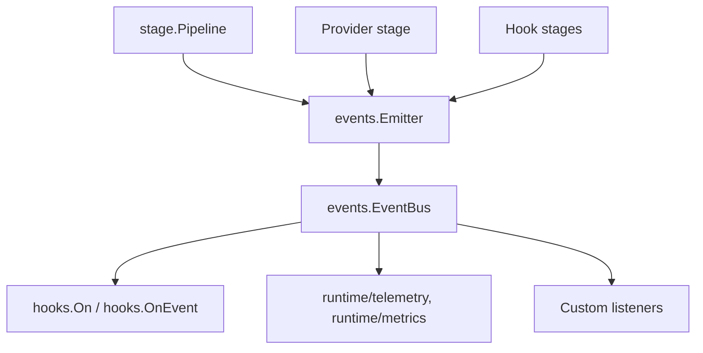

The runtime reports what it does through events: pipeline and stage lifecycle, provider calls, tool calls, validation, evals and messages. Events carry metadata about execution progress, performance and errors. They do not carry the content stream of an LLM response.

## How events flow

Producers publish through an `Emitter` to an `EventBus`. The bus delivers each event to every matching listener.



## Event bus

`EventBus` implements the `Bus` interface (`Publish`, `Subscribe`, `SubscribeAll`, `Close`). Listeners are plain functions:

```go
bus := events.NewEventBus()
defer bus.Close()

bus.Subscribe(events.EventPipelineStarted, func(e *events.Event) {
    log.Printf("pipeline started: %s", e.ConversationID)
})

bus.SubscribeAll(func(e *events.Event) {
    metrics.RecordEvent(e.Type)
})
```

`Subscribe` and `SubscribeAll` return an unsubscribe function. A listener that panics is recovered and the bus keeps delivering.

## Emitter

The `Emitter` wraps a bus with typed methods and fills in the identifying fields of each event:

```go
emitter := events.NewEmitter(bus, executionID, sessionID, conversationID)

emitter.ProviderCallCompleted(&events.ProviderCallCompletedData{
    Provider: provider, Model: model, Duration: duration,
})
```

An `Event` has these fields:

- `Type` and `Data` (the type-specific payload).
- `Timestamp`, set by the emitter.
- `Sequence`, a monotonic per-bus counter set when the event is published.
- `ExecutionID`, `SessionID`, `ConversationID`, set by the emitter.
- `UserID`, a pseudonymous identifier set with `emitter.WithUserID()`.

## Event types

### Pipeline and stage lifecycle

- `pipeline.started`, `pipeline.completed`, `pipeline.failed`
- `stage.started`, `stage.completed`, `stage.failed`

### Provider and tool calls

- `provider.call.started`, `provider.call.completed` (tokens, cost, duration), `provider.call.failed`
- `tool.call.started`, `tool.call.completed`, `tool.call.failed`

### Client tools

A client-mode tool is fulfilled on the caller's device. Two events track its deferred execution:

- `tool.client.request`: the tool returned `ToolStatusPending` and awaits the caller.
- `tool.client.resolved`: the caller fulfilled, rejected or errored the tool, emitted during `Resume` or `ResumeStream`.

The full lifecycle of a deferred client tool:

1. `tool.call.started`
2. `tool.client.request`, with the consent message and categories
3. `tool.call.completed` with status `"pending"`
4. The caller fulfills via `SendToolResult` or `RejectClientTool`.
5. `tool.client.resolved` with status `"fulfilled"`, `"rejected"` or `"error"`

A client tool with a synchronous handler registered through `OnClientTool` emits only `tool.call.started` and `tool.call.completed` with status `"complete"`.

### Validation

- `validation.started`, `validation.passed`, `validation.failed`

Guardrail hooks in the provider stage emit `validation.passed` or `validation.failed`. The `ValidationEventData` payload includes:

- `Direction`: `"input"` (before the call) or `"output"` (after it).
- `Enforced`: whether the guardrail modified the content or blocked the call.
- `Score`: the evaluation score.

### Eval results

- `eval.completed`: an eval, assertion or guardrail produced a result.
- `eval.failed`: the eval handler returned an error.

`EvalEventData` carries these fields, which a consumer must not conflate:

- `Kind` is the role: `eval`, `assertion` or `guardrail`.
- `Passed` is a pointer that is set only for an assertion or a guardrail.
- `Value`, `MetricValue` and `Score` are what the eval measured.
- `TurnIndex` is the turn it evaluated. Turn 0 is a real turn, so the field has no `omitempty`.

An eval measures and returns a value; it does not pass or fail, so its `Passed` is always nil. Only an assertion (score against thresholds) or a guardrail (the same shape, gating rather than reporting) states a verdict. A nil `Passed` on `Kind: eval` means that this kind of result has no pass or fail. Do not derive the boolean from `Score`: the `1.0` threshold is the assertion's default, and applying it to an eval nobody asserted on reports a 0.9 judge score as a failure.

`Value` is the handler's own output, such as a rubric's per-criterion map or a classifier's label. It is bounded by `events.MaxEvalValueBytes`. A value too large to carry is dropped and `ValueOmitted` is set, so a consumer can tell that from an eval that produced none. Producers set it with `SetValue`.

### Prompt templates

- `prompt.template.started`, `prompt.template.rendered`, `prompt.template.failed`

`TemplateRenderedData` carries `TaskType`, the rendered `SystemPrompt`, a SHA-256 `PromptHash`, `VariablesUsed`, `UnusedVariables`, `FragmentsUsed` and `RenderPasses`:

```go
bus.Subscribe(events.EventTemplateRendered, func(e *events.Event) {
    data := e.Data.(*events.TemplateRenderedData)
    log.Printf("rendered task=%s hash=%s vars=%d passes=%d",
        data.TaskType, data.PromptHash[:8], len(data.VariablesUsed), data.RenderPasses)
})
```

### Context and state

- `context.built`, `context.token_budget_exceeded`
- `context.compacted`: the compactor folded stale tool results during a tool-loop round (`ContextCompactionData`).
- `state.loaded`, `state.saved`

### Streaming, conversation and reasoning

- `stream.interrupted`
- `conversation.started`
- `reasoning.delta` and `reasoning.completed` carry the model's reasoning. They are not conversational content.

### Messages

- `message.created`: a message joined the conversation (role, content, index, tool calls and results).
- `message.updated`: metadata arrived after completion (latency, token counts, cost).

Two producers carry `message.created`, with different guarantees:

| Producer | Delivery | Binary content parts | Requires |
|----------|----------|----------------------|----------|
| `MessageBroadcastStage` to the bus | async, lossy | stripped to metadata | an event bus |
| `RecordingStage` to `EventStore.Append` | synchronous, lossless | retained in full | `sdk.WithRecording` and an `EventStore` |

Both build the payload with `events.NewMessageCreatedData`, so `Parts` is the only difference, and `Index` is transcript-absolute on both. Subscribers order by `Index`, not by arrival.

:::tip[Read `GetContent()`, not `.Content`]
A user message carries its text in `Parts` with `Content` empty; an assistant reply is the reverse. `GetContent()` applies the canonical precedence: tool result, then text parts, then `Content`.
:::

Fragments of a message have their own types on the recording route: `message.text.delta` for a streaming text fragment, `image.input` and `image.output` for images, and `video.frame` for video frames.

### Custom events

`EmitCustom` publishes an event of any type with a `CustomEventData` payload:

```go
emitter.EmitCustom(
    events.EventType("app.cache.hit"),
    "cache", "cache_hit",
    map[string]interface{}{"cache_key": key, "response_size": size},
    "Response retrieved from cache",
)
```

The second argument fills `CustomEventData.MiddlewareName`, which names the component that emitted the event.

### Ordering and nesting

This page lists event types, not their order. Provider and tool events are emitted inside a round loop that can repeat many times per turn, and a turn can run several provider stages. [The Hook System](/sdk/explanation/hooks/#execution-ordering) shows where each event sits relative to the hooks.

## Where events are wired

### Pipeline

A pipeline built with an emitter emits `pipeline.started`, `pipeline.completed` and `pipeline.failed`, and `stage.started`, `stage.completed` and `stage.failed` for each stage:

```go
bus := events.NewEventBus()
emitter := events.NewEmitter(bus, executionID, sessionID, conversationID)

bus.Subscribe(events.EventStageCompleted, func(e *events.Event) {
    data := e.Data.(*events.StageCompletedData)
    log.Printf("stage %s finished in %s", data.Name, data.Duration)
})

pipe, err := stage.NewPipelineBuilder().
    WithEventEmitter(emitter).
    Chain(providerStage).
    Build()
```

A pipeline without an emitter emits nothing. A stage that needs its own events takes the emitter in its constructor, as `NewProviderStageWithEmitter` does for provider-call events.

### SDK

`sdk.WithEventBus` supplies a shared bus; the conversation creates one otherwise. The `hooks` package subscribes to a conversation's bus:

```go
conv, _ := sdk.Open("./assistant.pack.json", "chat", sdk.WithModel("gpt-4o-mini"))
defer conv.Close()

hooks.OnEvent(conv, func(e *events.Event) {
    fmt.Printf("[%s] %s\n", e.Type, e.Timestamp)
})

hooks.On(conv, events.EventToolCallStarted, func(e *events.Event) {
    fmt.Printf("tool call: %+v\n", e.Data)
})
```

## Use cases

Cost tracking subscribes to `provider.call.completed` and sums `Cost`:

```go
var (
    mu        sync.Mutex
    totalCost float64
)

bus.Subscribe(events.EventProviderCallCompleted, func(e *events.Event) {
    data := e.Data.(*events.ProviderCallCompletedData)
    mu.Lock()
    totalCost += data.Cost
    mu.Unlock()
})
```

Production monitoring subscribes to everything and forwards it to an observability platform. Debug tracing collects events in a slice and dumps them when a run fails. The `runtime/telemetry` and `runtime/metrics` packages are listeners of this kind.

## Design

### Asynchronous and lossy

`Publish` hands the event to a buffered channel and returns. One dispatcher goroutine takes each event in publish order and offers it to every matching listener's own bounded queue. Each listener runs on its own goroutine. The bus has no worker pool.

`Publish` never blocks the pipeline. It returns `false` when the event was dropped because the buffer was full, or because the bus is closed.

Two consequences shape every consumer:

- Delivery is not guaranteed. A listener whose queue is full misses the event, and `DroppedCount` counts the miss. A listener stuck in a call past the subscriber timeout misses events while it is stuck, and one that exceeds the timeout three times is disabled; those misses are logged, not counted. A slow listener delays only itself. Anything that must be complete, such as a transcript or an audit trail, reads the state store or a recording, not the bus.
- Each listener sees events in the order the bus accepted them. With concurrent publishers that need not be the order they were emitted in. `Event.Sequence` orders events on one bus; for conversation position use `MessageCreatedData.Index`.

Tune the bus with `events.WithEventBufferSize` (the channel and each listener queue, default 1000) and `events.WithSubscriberTimeout` (default 5 seconds), or with the `PROMPTKIT_EVENT_BUS_BUFFER_SIZE` and `PROMPTKIT_EVENT_BUS_SUBSCRIBER_TIMEOUT` environment variables.

### No binary on the bus

Events never carry binary payloads: audio samples, image and video bytes, base64 blobs. A megabyte of base64 per turn would swamp a bus whose job is to stay out of the pipeline's way.

Text and structured content travel, subject to a size bound and to redaction, because they carry customer data. A payload omitted for size says so, so a consumer can tell it from one that was never there.

Binary belongs to the recording route. `RecordingStage` writes straight to an `EventStore` and never publishes, so turning recording on puts no payloads on the bus. `events.Emitter`, the only publisher, has no method that accepts raw bytes. A bus subscriber sees MIME type, dimensions, size and URL references. `TestMessageBroadcastStage_NeverPutsBinaryOnTheBus` and `TestAudioTelemetry_NeverPublishesToBus` guard the rule.

### Opt-in

A pipeline without an emitter emits nothing, so observability costs nothing until you configure it.

## Adding an event

Four decisions, in order. A wrong choice compiles and passes tests, and the consumer receives nothing or the wrong thing.

1. Pick the route. The bus (`Emitter` to `EventBus`) is asynchronous, lossy, metadata only and available wherever an emitter is configured. Recording (`RecordingStage` to `EventStore`) is synchronous, lossless, retains binary and needs `sdk.WithRecording` and an `EventStore`. An event may take both, as `message.created` does, but then both producers build the payload through one shared constructor, as `events.NewMessageCreatedData` does, so the two cannot drift.
2. Keep binary off the bus. Text and structured content may go on it, bounded and redactable; raw bytes go on the recording route.
3. Name it for what it is. A fragment is not a message: a token or a JSON blob of image metadata under `message.created` leaves a consumer reading `Content` unable to tell message text from half a word. Video frames recorded under the wrong type are invisible to `media_timeline`, which filters on `video.frame`. Give a new kind of thing its own type.
4. Check who can receive it. `runtime/pipeline/stage/event_route_boundary_test.go` lists the types an ordinary consumer receives and the types that reach only a store. A type missing from the lists, or on the wrong side, fails the test. "Nothing in this repo calls it" is not evidence that a producer or consumer is unused: PromptKit ships libraries, and its largest consumer is a separate repository.

## Related

- `runtime/events/` holds the bus, emitter and payload types.
- `runtime/pipeline/stage/pipeline.go` emits the pipeline and stage events.
- [The Hook System](/sdk/explanation/hooks/) shows event ordering relative to hooks.
