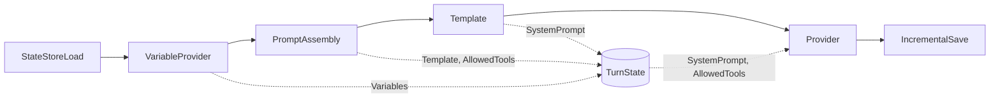
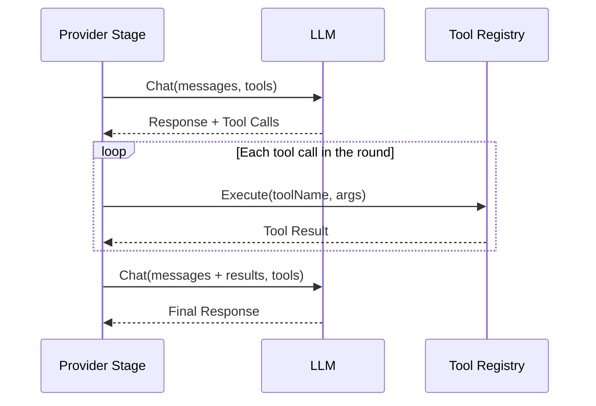
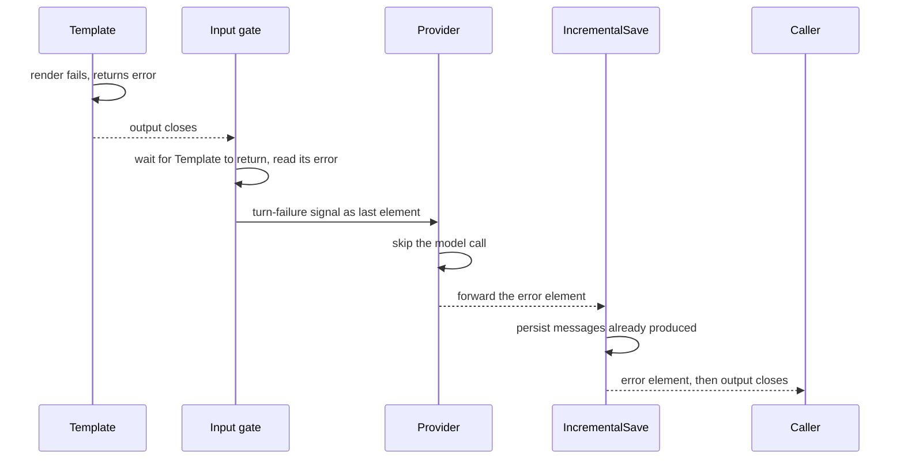

The runtime pipeline turns a user message into a model reply, and decides what happens when part of that fails. It is a streaming execution engine: a directed acyclic graph of stages that pass `StreamElement` values over channels, with each stage running in its own goroutine.

## How a turn flows

A text turn passes through six stages. Solid arrows are channels that carry elements. Dotted arrows are writes and reads of `TurnState`, the per-turn data that does not travel on elements.



Each stage reads from an input channel and writes to an output channel. The channels are buffered, so a slow consumer slows its producer and memory stays bounded.

`TurnState` holds what a turn needs but an element cannot carry: the loaded prompt template, the allowed tools, the variables, the rendered system prompt, and the turn index. An earlier stage writes it before it forwards the element that a later stage reads, so the channel hand-off orders the access.

Validation has no stage of its own. Hooks run inside the provider stage, because accumulating output to validate it would defeat streaming. See [Hooks](#hooks).

## StreamElement

A `StreamElement` carries one kind of content plus control signals:

```go
type StreamElement struct {
    // Content (at most one is set)
    Text      *string
    Audio     *AudioData
    Video     *VideoData
    Image     *ImageData
    Message   *types.Message
    ToolCall  *types.MessageToolCall
    Part      *types.ContentPart
    MediaData *types.MediaContent

    // Metadata
    Sequence  int64
    Timestamp time.Time
    Source    string
    Priority  Priority        // Low, Normal, High, Critical
    Reasoning *ReasoningDelta // live model reasoning, never persisted as content
    Meta      ElementMetadata // typed per-element coordination data

    // Control signals
    EndOfStream bool // session over
    EndOfTurn   bool // one turn's input is complete; the stream stays open
    Interrupt   bool // barge-in: cancel in-flight generation and playback
    Error       error
}
```

Constructors build the common shapes:

```go
textElem := stage.NewTextElement("Hello")
msgElem := stage.NewMessageElement(&types.Message{Role: "user", Content: "Hello"})
errorElem := stage.NewErrorElement(err)
```

## Stages

A stage transforms a stream of elements:

```go
type Stage interface {
    Name() string
    Type() StageType
    Process(ctx context.Context, input <-chan StreamElement, output chan<- StreamElement) error
}
```

`Type()` describes the stage's shape: `Transform` (1:1 or 1:N), `Accumulate` (N:1), `Generate` (0:N), `Sink` (N:0) or `Bidirectional` (full duplex). A stage must close its output channel when it returns, on every path.

A stage with several upstreams implements `MultiInputStage`, and a stage that routes to named downstreams implements `MultiOutputStage`.

### Core stages

| Stage | What it does |
|---|---|
| `StateStoreLoadStage` | Loads the conversation history, tags each message `Meta.FromHistory`, emits it before the current input, and derives the turn index from the persisted transcript. |
| `VariableProviderStage` | Merges static variables and the output of each `variables.Provider` into `TurnState.Variables`. A failing provider fails the turn. |
| `PromptAssemblyStage` | Loads the raw prompt template for the task type and publishes the template, its allowed tools and its validator configs to `TurnState`. It does not render. |
| `TemplateStage` | Renders the system prompt once per turn from the template, its default and fragment variables, and `TurnState.Variables`. A variable nothing supplied fails the turn with `ErrTemplateUnresolved`. Message content is not substituted. |
| `ProviderStage` | Calls the model, runs the tool loop, and runs the hooks. |
| `IncrementalSaveStage` | Persists the messages this turn produced, through `MessageAppender` when the store implements it and through a full save otherwise. |

### Provider stage

`ProviderStage` is the one stage that talks to the model. In its default (unary) mode it reads its input to the end, then calls the model. In streaming mode, used by the voice topologies, it fires the tool loop on each `EndOfTurn` element and stays open.

```go
providerStage := stage.NewProviderStage(
    provider,
    toolRegistry,
    toolPolicy,
    &stage.ProviderConfig{MaxTokens: 1000, Temperature: 0.7},
)
```

The tool loop is a sequence of rounds:



- Tool calls within a round run in parallel, up to 10 at a time by default.
- A turn runs at most 50 rounds by default. `ToolPolicy.MaxRounds` and the prompt's own policy lower it. Reaching the limit returns a `MaxRoundsError` that matches `ErrMaxRoundsExceeded`.
- `ToolPolicy` also carries a blocklist, a `ToolChoice`, and `MaxCostUSD`, which bounds the whole run rather than one turn.
- A tool whose result carries an error twice is left out of the tool list for the remaining rounds.
- A compactor folds stale tool results between rounds so the context does not overflow.

### Hooks

Hooks intercept the provider and its tools without being stages. A `ProviderHook` has `BeforeCall` and `AfterCall`. It can also implement `ChunkInterceptor` to inspect each streamed chunk and abort early with a `HookDeniedError`. A `ToolHook` wraps tool execution with `BeforeExecution` and `AfterExecution`, and can implement `ToolResultRewriter` to rewrite a result before the model sees it.

Every hook lives on one `hooks.Registry`, whether it came from a pack `validators` block, an eval handler wrapped by `GuardrailHookAdapter`, or a `WithProviderHook` or `WithToolHook` option.

### Speech and streaming stages

- `AudioTurnStage` combines voice activity detection, turn boundaries, audio accumulation and interruption detection. `STTStage` transcribes audio elements. `TTSStage` and `TTSStageWithInterruption` synthesize speech, and the interruption variant supports barge-in. `AudioResampleStage` normalizes sample rates.
- `DuplexProviderStage` holds one bidirectional session with a native audio model such as the Gemini Live API.

### Routing and utility stages

- `RouterStage` sends each element to the downstream names a function returns. `MergeStage` fans several inputs into one and stamps `Meta.MergeInputIndex`.
- `MetricsStage` wraps another stage and records element counts, errors and forwarding latency.
- `ContextBuilderStage` enforces a token budget with `TruncateOldest`, `TruncateLeastRelevant`, `TruncateSummarize` or `TruncateFail`.
- `MediaExternalizerStage` moves large inline media to storage and leaves a reference.
- `DebugStage` logs each element as JSON at debug level.

The full list, with constructors and configs, is in the [pipeline reference](/runtime/reference/pipeline/).

## Pipeline modes

The SDK assembles one of three chains. Optional stages appear when their option is set: memory retrieval before `Template`, a token-budget `ContextBuilder`, image and frame-rate preprocessing, recording, memory extraction and message broadcast around the provider.

Text mode, for HTTP-based models:

```text
StateStoreLoad → VariableProvider → PromptAssembly → Template → Provider → IncrementalSave
```

VAD mode, for voice with a text model:

```text
StateStoreLoad → VariableProvider → PromptAssembly → Template → AudioTurn → STT → Provider → TTS → IncrementalSave
```

ASM mode, for models that take audio directly:

```text
StateStoreLoad → VariableProvider → PromptAssembly → Template → DuplexProvider → IncrementalSave
```

A context window or retrieval index swaps `StateStoreLoad` for `ContextAssembly`, and a pipeline without a state store has neither the load nor the save stage.

## Running a pipeline

`PipelineBuilder` wires the graph. `Chain` builds a line, `Connect`, `Branch` and `Merge` build other shapes, and `Build` rejects an empty graph, duplicate stage names, cycles, a stage with several upstreams that is not a `MultiInputStage`, and a `PromptAssemblyStage` or `TemplateStage` built without a `TurnState` (`stage.ErrTurnStateRequired`), which would leave the provider with an empty system prompt.

```go
// Prompt, template and provider stages share the turn's system prompt through
// one TurnState; Build rejects a prompt stage constructed without one.
turnState := stage.NewTurnState()
pipeline, err := stage.NewPipelineBuilder().
    Chain(
        stage.NewStateStoreLoadStage(stateConfig),
        stage.NewPromptAssemblyStageWithTurnState(registry, taskType, vars, turnState),
        stage.NewTemplateStageWithTurnState(nil, turnState),
        stage.NewProviderStageWithTurnState(provider, toolRegistry, toolPolicy, config, nil, nil, turnState),
        stage.NewIncrementalSaveStage(&stage.IncrementalSaveConfig{StateStoreConfig: stateConfig}),
    ).
    Build()
```

`Execute` streams, and `ExecuteSync` collects:

```go
output, err := pipeline.Execute(ctx, input)
for elem := range output {
    // Process elements as they arrive
}

result, err := pipeline.ExecuteSync(ctx, elements...)
// result.Response is the final assistant message
// result.Messages holds every message the turn produced
```

Timeouts and buffering come from `PipelineConfig`:

```go
config := stage.DefaultPipelineConfig().
    WithChannelBufferSize(64).
    WithExecutionTimeout(60 * time.Second).
    WithIdleTimeout(45 * time.Second)

pipeline, err := stage.NewPipelineBuilderWithConfig(config).
    Chain(stages...).
    Build()
```

The channel buffer holds 32 elements by default. The execution timeout is off by default. The idle timeout is 30 seconds. It resets on every streamed chunk, finished round and finished tool call, and stays open while a tool runs. `Shutdown` waits up to the graceful shutdown timeout (10 seconds by default) for in-flight executions, and `Execute` on a pipeline that is shutting down returns `ErrPipelineShuttingDown`.

## When a stage fails

A stage fails the turn by returning an error from `Process`. The pipeline wraps the error in a `StageError` that names the stage, emits a stage-failed event, and records the first failure. A context error that is only the cancellation of the pipeline's own context, a caller cancel or a timeout, is not a failure.

The pipeline does not cancel anything. The other stages keep running and drain, so the messages the turn already produced still reach `IncrementalSaveStage` and persist.

A failing stage closes its output like any stage that returns. A closed channel alone cannot tell the next stage whether its input is complete or cut short, and a provider stage that treats a cut-short input as complete calls the model without its system prompt. The pipeline closes that gap in-band:



Every stage after the root has an input gate. It forwards elements untouched. When the upstream channel closes, it waits for the upstream stage to return. If that stage failed, and the error did not already travel on the channel, the gate appends an error element that wraps the `StageError` as the last element of the input. A shared channel read by several downstream stages gets one distributor that signals every reader still running.

Stages react to the signal as follows:

- The unary `ProviderStage` collects it with the rest of its input, skips the model call, and forwards the error.
- `TemplateStage` passes it on without rendering, and `ContextBuilderStage` passes the messages on without truncating them.
- `IncrementalSaveStage` saves what it collected and forwards the error, and `RecordingStage` does not record it as content.
- Any other stage forwards an error element like any other element.

The caller receives the failure as the last element of the output channel, with the error in `Error`. `ExecuteSync` returns it as its error, together with the messages collected so far. `errors.As` finds the `*StageError`, and `errors.Is` reaches the cause. The pipeline reports `pipeline.failed` instead of `pipeline.completed`.

A stage can also report a problem without failing the turn by sending `NewErrorElement` and carrying on. The consumer sees the element, and `ExecuteSync` returns the last error element it saw as its error.

## Custom stages

Embed `BaseStage`, close the output, and check the context whenever you send:

```go
type MyStage struct {
    stage.BaseStage
}

func NewMyStage() *MyStage {
    return &MyStage{BaseStage: stage.NewBaseStage("my_stage", stage.StageTypeTransform)}
}

func (s *MyStage) Process(
    ctx context.Context,
    input <-chan stage.StreamElement,
    output chan<- stage.StreamElement,
) error {
    defer close(output) // always close output when done

    for elem := range input {
        if elem.Text != nil {
            upper := strings.ToUpper(*elem.Text)
            elem.Text = &upper
        }

        select {
        case output <- elem:
        case <-ctx.Done():
            return ctx.Err()
        }
    }

    return nil
}
```

Keep a stage to one responsibility, pass per-turn state through `TurnState` rather than a package variable, and test it alone by feeding it a channel. `NewStageFunc`, `NewMapStage` and `NewFilterStage` wrap a function when a type is more than the job needs.

## Trade-offs

- Stages run concurrently, so a slow stage throttles the ones before it through full channels. Buffer size trades memory for jitter tolerance, and audio pipelines use a larger buffer.
- Failure travels in-band instead of through cancellation. This keeps the persistence stages working on a failed turn, at the cost that every stage that acts on its input's end must recognize the signal.
- Stage order matters when a stage writes `TurnState`. A variable written after `Template` has rendered is invisible to the prompt, so memory retrieval sits before it.
- `RouterStage` registers its outputs on the stage instance, so a pipeline that contains one supports one `Execute` at a time.

## Related

- [Pipeline reference](/runtime/reference/pipeline/)
- [Stage design](/runtime/explanation/stage-design/)
- [Provider system architecture](/architecture/runtime-providers/)
- [Tool and MCP architecture](/architecture/runtime-tools-mcp/)
- [System overview](/architecture/system-overview/)
