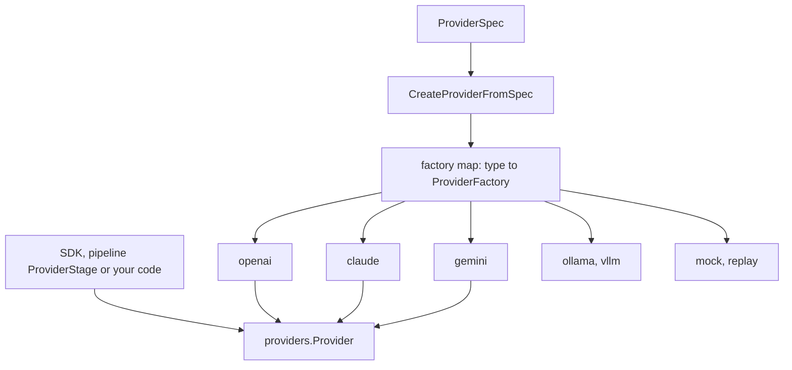
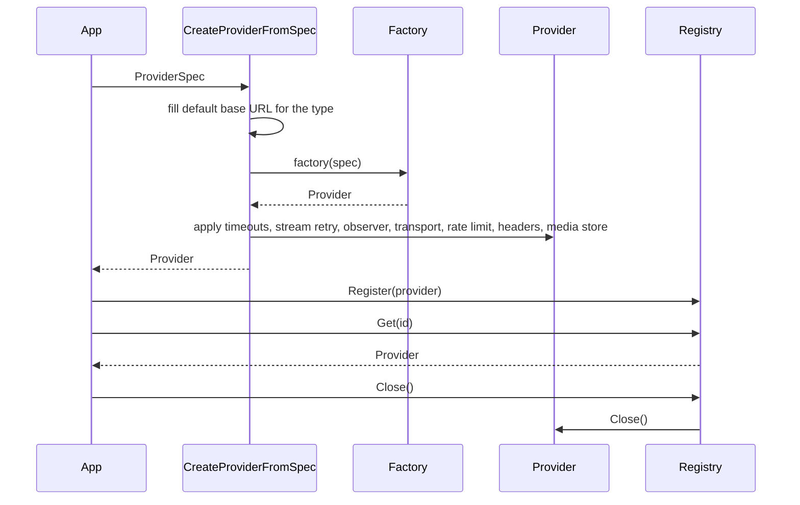
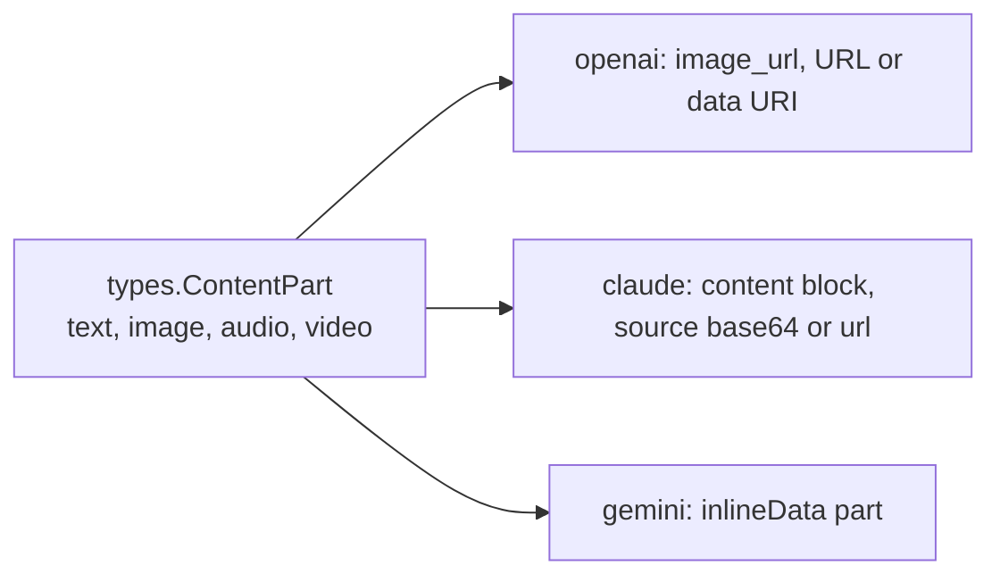
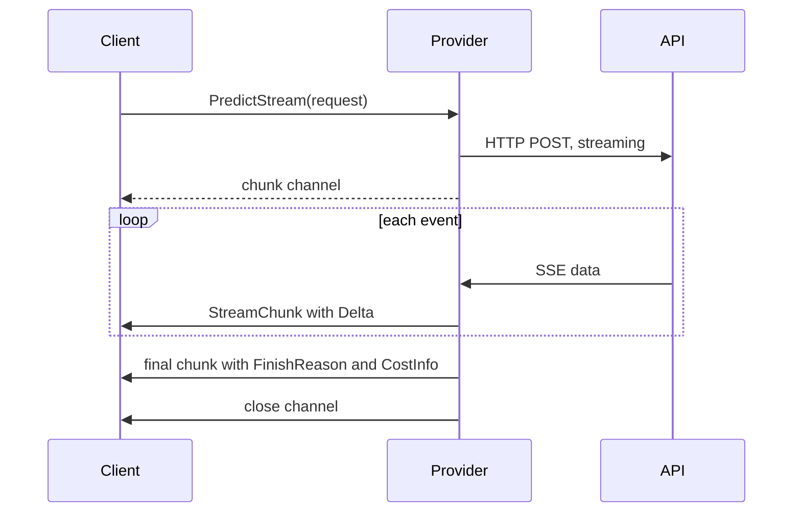
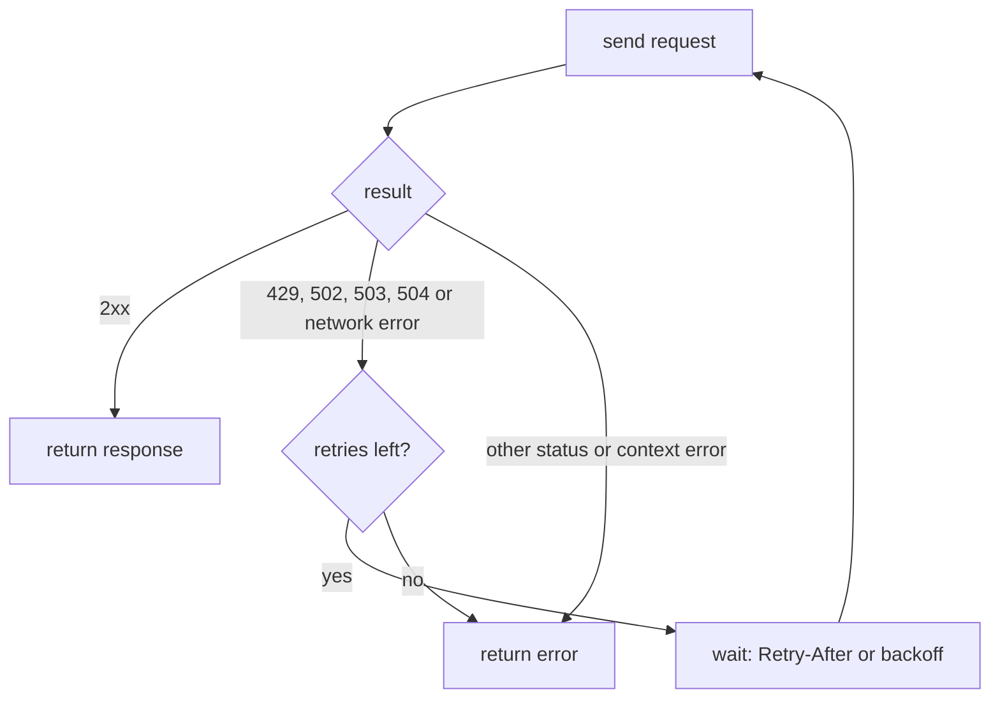

This page explains how the runtime reaches many LLM APIs through one Go interface: the interfaces, how a provider is created, what an adapter translates, and what the shared layer does for streaming, retries and cost. For what a provider is and how to configure one, see [Providers](/concepts/providers/).

## One interface, many adapters

Each vendor API differs in message layout, tool format, streaming wire format and error shape. The `providers` package defines one `Provider` interface and one set of request and response types. Each vendor gets an adapter package that translates between them. The pipeline's provider stage and your own code talk to `providers.Provider` and never to a vendor type.



The trade-off is the lowest common denominator. A request carries the fields most APIs share, and anything vendor-specific travels in `Metadata` or in the provider's `AdditionalConfig`. Features that only some providers have sit behind optional interfaces instead of widening `Provider`.

## Core interfaces

`Provider` is the base contract. It embeds `base.Provider` (name, type, pricing descriptor, validation, init, health check, close) and adds `ID`, `Model`, `Predict`, `PredictStream`, `SupportsStreaming`, `ShouldIncludeRawOutput` and `CalculateCost`.

Capabilities beyond a single prediction are separate interfaces. You detect them with a type assertion:

| Interface | Adds | Implemented by |
|---|---|---|
| `ToolSupport` | `BuildTooling`, `PredictWithTools`, `PredictStreamWithTools` | the `claude`, `gemini`, `openai`, `ollama`, `vllm` and `mock` tool providers |
| `StreamInputSupport` | `CreateStreamSession`, `SupportsStreamInput`, `GetStreamingCapabilities` | `gemini` (Live API), `openai` (Realtime), `mock` |
| `ContextWindowProvider` | `MaxContextTokens`, which sizes the compactor | any provider that reports its context window |
| `MessageMetadataTemplater` | `MessageMetadataTemplate`, the text appended to each message's metadata | every chat provider |
| `MediaScoped` | `WithMediaSettings`, a per-conversation view of a shared provider | providers that resolve media |
| `MultimodalCapabilityProvider` | `GetMultimodalCapabilities`, the media modalities and MIME types the provider accepts as input | `claude`, `gemini`, `openai`, `ollama`, `vllm` |

`BuildTooling` returns a provider-native value (`ProviderTools`) that you pass back to `PredictWithTools`. The runtime never inspects it.

```go
package main

import (
	"context"
	"fmt"
	"log"

	"github.com/AltairaLabs/PromptKit/runtime/v2/providers"
	_ "github.com/AltairaLabs/PromptKit/runtime/v2/providers/mock"
	"github.com/AltairaLabs/PromptKit/runtime/v2/types"
)

func main() {
	provider, err := providers.CreateProviderFromSpec(providers.ProviderSpec{
		ID: "demo", Type: "mock", Model: "mock-model",
	})
	if err != nil {
		log.Fatal(err)
	}

	registry := providers.NewRegistry()
	registry.Register(provider)
	defer registry.Close()

	p, _ := registry.Get("demo")
	if _, ok := p.(providers.ToolSupport); ok {
		fmt.Println("supports tools")
	}
	if _, ok := p.(providers.StreamInputSupport); ok {
		fmt.Println("supports streaming input")
	}

	resp, err := p.Predict(context.Background(), providers.PredictionRequest{
		System:   "You are terse.",
		Messages: []types.Message{{Role: "user", Content: "Hello"}},
	})
	if err != nil {
		log.Fatal(err)
	}
	fmt.Println(resp.Content)
}
```

The program prints `supports tools`, `supports streaming input` and `Mock response from demo model mock-model`.

## Requests and responses

`PredictionRequest` carries `System`, `Messages`, `Temperature` (with `TemperatureSet`), `TopP`, `MaxTokens`, `TopK`, `FrequencyPenalty`, `PresencePenalty`, `Seed`, `ResponseFormat` and `Metadata`. Three behaviors of the shared layer keep adapters thin:

- `NormalizeMessages` moves system-role messages into `System` before the adapter runs, because some APIs reject or drop a `system` role.
- A parameter the API does not take is dropped, and `WarnUnsentParams` logs it once per provider and parameter.
- When an API answers a 400 that names a sampling parameter its model rejects, the provider records the parameter as rejected, stops sending it and repeats the call. The `unsupported_params` provider setting declares the same thing up front.

Before every predict or stream call, the provider stage checks the image, audio, video and document parts of the request's input messages against what the provider's adapter can send, with `ValidateMultimodalRequest`. A provider whose `GetMultimodalCapabilities` applies a config's `capabilities` list also implements `SendableContentProvider` (`claude`, `gemini`, `openai`), and the check uses its `SendableMultimodalCapabilities`, so a partial `capabilities` list never narrows it. A part the adapter cannot send fails the round with an `UnsupportedContentError`, and no request is sent. Assistant messages are not checked, because their parts are model output. A provider that does not implement `MultimodalCapabilityProvider`, such as `mock`, is not checked. `ProviderConfig.SkipContentValidation` turns the check off. Duplex sessions stream raw media chunks rather than requests, so the check does not apply to them; a session declares what it accepts through `GetStreamingCapabilities`.

`PredictionResponse` returns `Content`, multimodal `Parts`, `ToolCalls`, `CostInfo`, `Latency`, `Reasoning`, a normalized `FinishReason` and, when raw output is enabled, `Raw` and `RawRequest`.

`StreamChunk` has these fields:

- `Content` holds the accumulated text and `Delta` the new text. `TokenCount` and `DeltaTokens` count tokens.
- `Reasoning` carries reasoning tokens, which are never part of the content.
- `FinishReason` is nil until the stream ends. `CostInfo` is set only on that final chunk.
- `Error` signals a failure in-band, on the channel.
- `FinalResult` is set on the final chunk of a stream that ends without an error. For a provider stream it is a `*PredictionResponse` holding the content, tool calls, cost, finish reason and latency.
- `Reset` tells the consumer to discard everything accumulated so far because the stream restarted.

## Creating providers and the registry

Each adapter package registers a factory for its type in an `init` function, so importing `providers/claude` makes the `claude` type available. `providers/all` imports every adapter at once. `CreateProviderFromSpec` looks up the factory, and an unknown type returns `UnsupportedProviderError`. A hosting platform such as `bedrock` is not a type: the error says to set the vendor as the type and the platform in the spec.



After the factory returns, `CreateProviderFromSpec` applies the spec's optional settings through small interfaces such as `timeoutConfigurable` and `streamRetryConfigurable`. Factories therefore stay short, and any provider that embeds `BaseProvider` picks up timeouts, stream retry, the concurrent-stream cap, the stream observer, the HTTP transport, the rate limit, custom headers and the media store without per-adapter code.

`Registry` is a map of providers keyed by `ID()`. `Register`, `Get`, `List` and `Close` work on that map, and `GetByType` and `GetAll` look up ancillary providers (TTS, STT, embedding, image, video, rerank) by capability. Registering a second provider under an ID that is already taken replaces the first for every lookup, typed or not. `CreateProviderFromSpec` does not register what it builds. You call `Register` yourself. The registry is not safe for concurrent use.

## What an adapter translates

Adapters own the places where vendors differ:

- OpenAI calls either the Chat Completions API or the Responses API, chosen by the provider's `api_mode`. It sends `seed` on Chat Completions and not on Responses.
- Claude sends the system prompt as separate system blocks and turns tools into `input_schema` definitions. It turns on prompt caching unless `DisablePromptCaching` is set. The Messages API requires an output limit, so Claude falls back to 4096 tokens.
- Gemini sends the system prompt as `systemInstruction` and tools as `function_declarations`. It supports a Live API for streaming input and an Interactions API mode.
- Ollama and vLLM call servers you run. The factory defaults their base URLs to `localhost`.

Media is the clearest example. A message holds `ContentPart` values whose `MediaContent` is inline base64, a file path, a URL or a storage reference. `MediaLoader` resolves any of these, and each adapter encodes the result for its API. An adapter shares one loader across a message's parts, so the loader's limits, `MaxMediaItems` and `MaxAggregateMediaSize`, apply to each message. Per message rather than per request, because every call resends the conversation's earlier messages.



Tools follow the same pattern. A `ToolDescriptor` (name, description, input and output schema) is the common form, and `BuildTooling` converts it to the vendor's tool format.

## Streaming

`PredictStream` returns a channel of `StreamChunk` and closes it when the stream ends. Providers read server-sent events with `SSEScanner`, which yields the payload of each `data:` line. Bedrock uses its own event-stream framing behind the same `StreamScanner` interface.



Streaming differs from a plain call in three ways.

A stalled stream is cut off. If no bytes arrive for `DefaultStreamIdleTimeout` (30 seconds, configurable per provider), the response body closes. Reasoning chunks count as activity.

Request timeouts do not apply to streams. A streaming call lasts as long as the model keeps sending data, and context cancellation ends it.

Retries are opt-in. With `StreamRetryPolicy` enabled, a failure before the first content chunk retries with full-jitter backoff, up to two attempts by default. The `always` window also retries after content has been sent: the provider emits a chunk with `Reset` set and starts over, which costs tokens. A server `Retry-After` longer than `MaxRetryAfter` stops the retry.

The runtime can also cap the number of streams in flight per provider (`StreamMaxConcurrent`) and share a retry budget across requests. A `StreamObserver` set on the spec or with `SetStreamObserver` receives every chunk, the final completion and each error of every stream the provider opens. Its callbacks run on the stream's relay goroutine, so they must return quickly.

## Errors and retries

Non-streaming calls go through `DoWithRetry`. Its default policy is three retries with exponential backoff from 500 ms, up to 60 seconds, plus up to 50% jitter. A `Retry-After` header replaces the computed delay.



The runtime does not retry a 500, a 400-class error, a cancelled context or a credential that could not be applied. Errors keep their structure so callers can classify them:

- `ProviderHTTPError` carries the status, body and `RetryAfter` of a non-2xx response. Its message redacts credentials in the URL.
- `ProviderTransportError` wraps connection-level failures.
- `RetryableHTTPError` reports that retries ran out on a retryable status.
- `ErrPayloadTooLarge` reports a request over the provider's size limit.

`IsTransient` is true for a retryable HTTP status or a transport error. It is false for context cancellation, for a stream idle timeout (a stall is a deadline and not a blip) and for a credential that could not be applied.

A per-provider rate limiter (`SetRateLimit`, or `ProviderSpec.RateLimit`) holds every HTTP request the provider sends, each retry attempt included, until a token is free. The wait ends when the request's context ends, and it does not count against the request timeout. The provider's credential is applied after the wait. Connection pooling is built into the base provider's transport, tunable through `HTTPTransportOptions`.

## Defaults and cost

Output-token and sampling defaults resolve in this order:

1. The request's own positive value. The SDK fills request fields from the prompt's `parameters` only.
2. The provider's `ProviderDefaults`, applied to request fields left at zero.
3. No limit: the field is left off the request and the model's own maximum applies.

`providers.ResolveMaxTokens` implements this for every provider, and `MaxTokensUnlimited` (`-1`) selects the third step. Claude's factory rejects `MaxTokensUnlimited`.

Every provider reports cost as a `types.CostInfo` on the response, or on the final stream chunk. `CalculateCost(inputTokens, outputTokens, cachedTokens)` is the legacy entry point. The adapters price full usage, including reasoning, audio, image and cache-write units, through the unit-keyed pricing engine in `providers/base`. A descriptor set in code wins over a flat per-1K config, which wins over the built-in per-model table. [How calls are priced](/concepts/providers/#how-calls-are-priced) describes the resolution and its fallbacks.

## Testing with the mock provider

The `mock` provider makes no API calls. It answers from a `ResponseRepository`: an in-memory one with a default response and per-scenario, per-turn overrides, or a file-backed one that also scripts tool calls and multimodal parts. Its streaming sessions can simulate an interruption on a chosen turn and a provider that closes the connection. It reports token counts estimated from text length. The `replay` provider serves recorded sessions for deterministic runs.

## Related pages

- [Providers](/concepts/providers/)
- [Provider System Explanation](/runtime/explanation/provider-system/)
- [Provider reference](/runtime/reference/providers/)
- [Set up providers](/runtime/how-to/providers/setup-providers/)
- [Runtime Pipeline Architecture](/architecture/runtime-pipeline/)
- [Tool & MCP Integration Architecture](/architecture/runtime-tools-mcp/)
