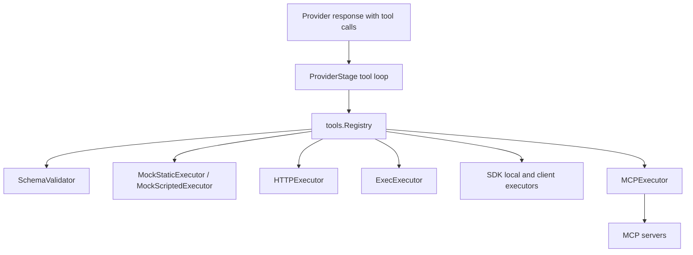
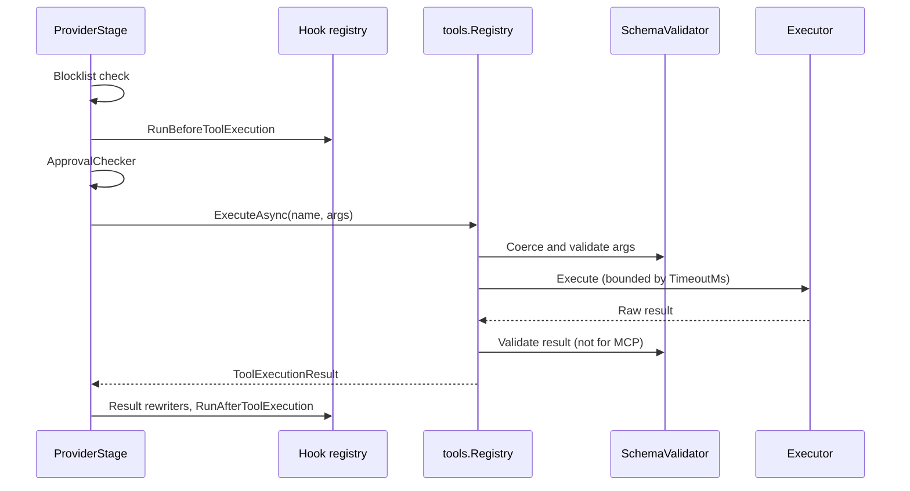
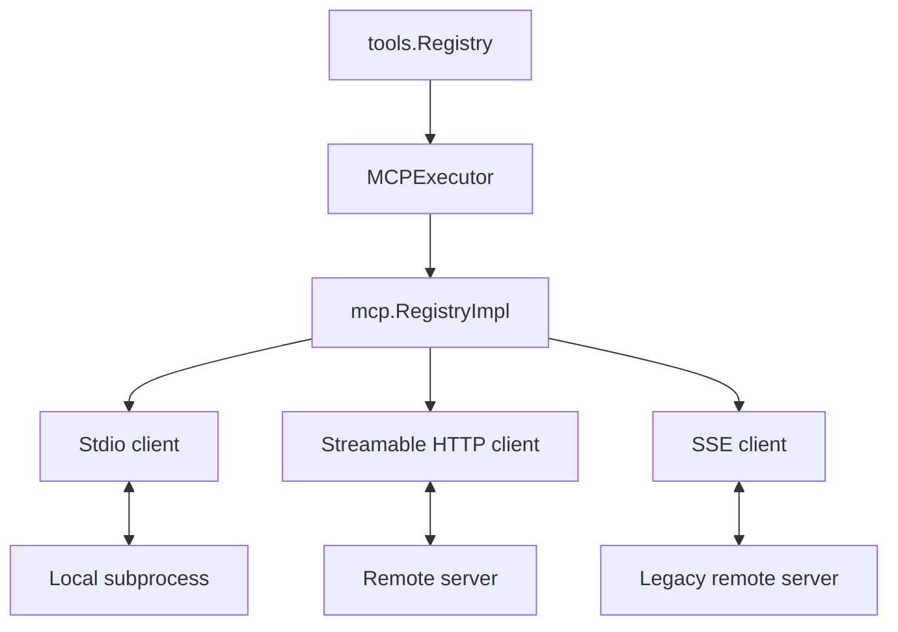
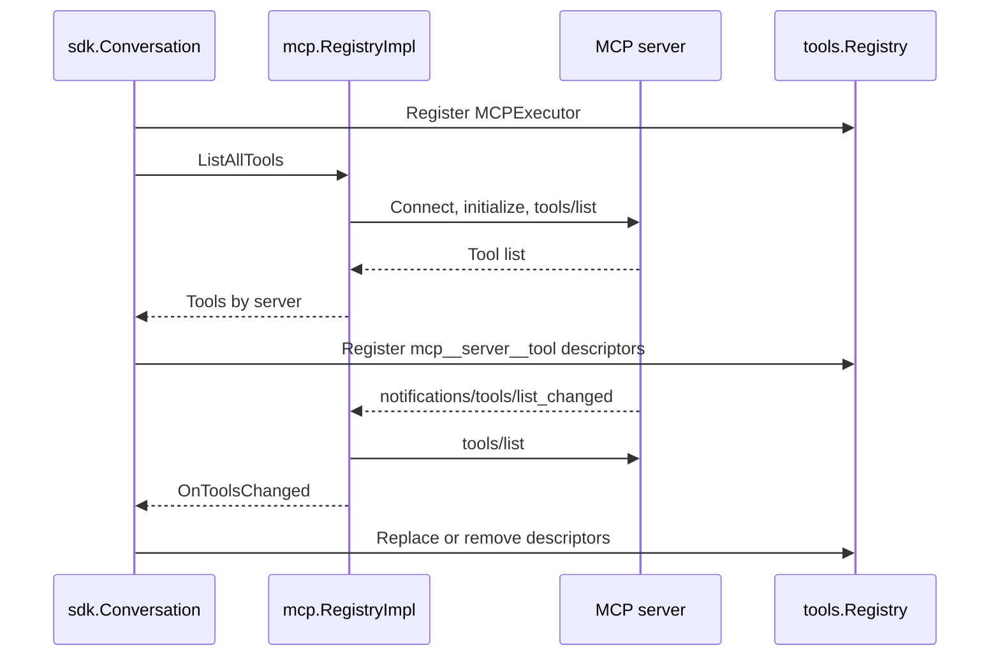
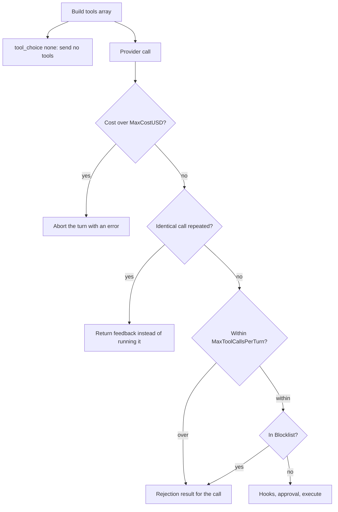

A tool call passes through policy checks, hooks, schema validation and an executor before the model sees a result. This page explains how the `tools` package routes a call, how Model Context Protocol (MCP) servers join the same path, and where each limit on tool use is enforced.

## How a call is routed

The provider stage owns the tool loop. For every tool call in a model response it asks the `tools.Registry` to run the call. The registry validates the arguments, picks an executor from the tool's `Mode`, and validates the result.



The registry is the single store of tool descriptors. `NewRegistryWithRepository` reads a `ToolRepository` once, at construction, and copies every descriptor into the registry. Capability tools such as `skill__activate` and the per-state `workflow__transition` register into the same map, so `Unregister` removes a descriptor from every read path. A registry holds one executor per name, and registering a second executor under a name evicts the first. Each conversation therefore derives its own registry with `Child()`.

A `ToolDescriptor` carries the tool's name, description, JSON Schema for input and output, a `Mode`, a timeout and the mode-specific configuration. The namespace comes from the name: `mcp__fs__read` has namespace `mcp`. The namespaces `a2a`, `mcp`, `workflow`, `memory`, `skill`, `image` and `video` mark system tools.

Every backend implements one interface:

```go
type Executor interface {
    Execute(ctx context.Context, descriptor *ToolDescriptor, args json.RawMessage) (json.RawMessage, error)
    Name() string
}
```

Two optional interfaces extend it. A `MultimodalExecutor` also returns content parts (images, audio), and the registry prefers it when an executor implements it. An `AsyncToolExecutor` can return a pending result instead of blocking, which is how approval and deferred client tools work.

The registry chooses the executor by mode. `mock` uses the scripted executor when the tool has a template and the static one otherwise, `live` uses the executor named `http`, and `local`, `client` and `mcp` use the executors with those names. Any other mode names a registered executor directly, which is how `exec` and custom executors plug in. A new registry holds only the two mock executors. The host registers the rest, and the SDK registers `local`, `client` and `exec`, plus `mcp` when you configure an MCP server.

A pack declares a tool's schema and description but not how it runs. The SDK loads pack tools with mode `local` as a placeholder, and the host binds the real execution mode and any consent policy. Execution mode and consent are hosting concerns, not pack fields.

## What happens to one call



A blocklisted tool, a hook denial, an invalid argument set, an executor error or a timeout each produce an error result for that call, not an aborted turn. The model reads the error and can correct itself. The registry coerces string-encoded numbers and booleans to the types the input schema declares before it validates, because models often send `"5"` for an integer.

A pending result (approval required, client tool without a handler) holds that call out of the round. The other calls finish, and the loop returns `ErrToolsPending` so the caller can resolve the held calls and resume.

Calls in one model response run concurrently, up to `MaxParallelToolCalls` (default 10). Results return in the order the model issued the calls, and one failure does not cancel the others. The provider stage truncates a result larger than the registry's `MaxToolResultSize` (1 MB by default) and appends a truncation notice.

### Schema validation

The `SchemaValidator` compiles input and output schemas with `gojsonschema` (JSON Schema draft-07) and keeps the compiled forms in an LRU cache. A schema with an external `$ref` is not compiled, and its data is not validated, because compiling it would fetch the reference.

A descriptor registered directly has no timeout unless it sets `TimeoutMs`. A descriptor loaded from a manifest or JSON file gets `DefaultToolTimeout` (30 seconds) when it sets none.

Result validation skips MCP tools. MCP servers are a standard protocol with trusted responses, and their declared schemas often differ from what they return. The `MCPExecutor` instead validates a result's `structuredContent` against the tool's output schema and reports a mismatch as a tool error.

## Execution modes

- `mock` returns canned data for tests. `mock_result` is static, and `mock_template` is a Go `text/template` rendered with the call's arguments.
- `live` calls an HTTP endpoint through `HTTPExecutor`. It sets headers from config and from environment variables (`headers_from_env` entries take the form `Header-Name=ENV_VAR`), applies the configured timeout, redacts named fields from the response, and wraps a non-JSON body in a result object. A non-2xx status is an error. The executor does not retry.
- `exec` runs a one-shot subprocess: arguments go to stdin as JSON and the result comes back on stdout.
- `local` dispatches to handlers you register with `OnTool` or `OnToolCtx`. Pack tools use it by default.
- `client` fulfills a tool on the caller's device, such as GPS or a camera. With a handler registered through `OnClientTool`, the call runs synchronously. Without one, the executor returns a pending result carrying the consent message and categories from `ClientConfig`. You answer with `SendToolResult` and call `Resume`. Whether and how to ask the user for consent is the host's decision.
- `mcp` delegates to an MCP server, described next.

## MCP integration

An MCP server contributes tools that look like any other descriptor. The runtime keeps the protocol work in the `mcp` package and the routing in `MCPExecutor`.



A `ServerConfig` picks the transport. A `Command` starts a local subprocess and speaks over stdio. A `URL` uses Streamable HTTP and falls back to the older HTTP+SSE transport when the server does not host a Streamable HTTP endpoint. A `transport` setting pins one. The clients are built on the MCP Go SDK.

You declare a server with an SDK option and let the prompt name the tools it may use:

```go
conv, err := sdk.Open("./assistant.pack.json", "assistant",
    sdk.WithMCP("filesystem", "npx", "@modelcontextprotocol/server-filesystem", "/data"),
)
```

### Discovery



When the SDK builds the pipeline, it registers the `MCPExecutor` and lists every server's tools in parallel. Each tool becomes a descriptor named `mcp__<server>__<tool>` with mode `mcp`, after the server's `ToolFilter` is applied. If a server cannot be listed, the SDK retries in the background with exponential backoff, from one second up to one minute, so a slow-starting server does not leave the conversation without its tools. When a server reports that its tool list changed, the registry re-reads it and the SDK replaces or removes the descriptors, so the next turn offers the new set.

Registry clients connect lazily. The first `GetClient` for a server starts it, and a client that is no longer alive is replaced on the next use. `RegistryOptions.MaxProcesses` caps concurrent server processes. A client whose connection drops reconnects up to `MaxReconnectAttempts` times (3 by default), and connecting is retried up to `MaxRetries` times. A `tools/call` is never retried, because a tool may have side effects.

MCP tools are not implicit. The model sees one only when the prompt's tool list names it, either exactly or with a wildcard such as `mcp__filesystem__*`. Capability tools (`skill__`, `a2a__`, `workflow__`, `memory__`, `image__`, `video__`) are offered without a listing.

### Execution and results

The `MCPExecutor` strips the `mcp__<server>__` prefix, asks the `mcp.Registry` for the client that owns the raw tool name, and calls `CallTool`. The registry's tool index maps a raw tool name to one server, so two servers that expose the same tool name share a single entry and the last listed wins. A context-attached registry (`WithMCPRegistry`) overrides the executor's default, and `RegistryImpl.Fork` gives each concurrent run its own servers while sharing the parent's connections.

The executor turns MCP content into what the model reads:

- `structuredContent`, when present, is the result.
- Text blocks become text. One block stays a JSON string and several become a JSON array.
- Images and audio become content parts through `ExecuteMultimodal`, or stay as content blocks in the JSON through plain `Execute`.
- Resource links and embedded resources become small JSON objects. A binary resource the model cannot take as a part is described, not inlined.
- A result with `isError` set becomes an execution error carrying the server's text.

## Tool policy

A `ToolPolicy` can come from the caller's stage configuration and from the prompt's `tool_policy`. The merge only narrows: limits take the smaller non-zero value, and blocklists are the union. Each limit is enforced at a different point of the loop.



`ToolChoice` is passed to the provider, and `none` omits tool declarations entirely. `MaxRounds` (default 50) bounds the model-tool cycles in a turn, and exceeding it returns a `MaxRoundsError`. `MaxToolCallsPerTurn` counts calls across all rounds. Once spent, the loop stops offering tools so the next round is the model's answer. `MaxCostUSD` bounds the whole run, because the loop seeds its total with the cost already in the conversation history. The loop checks it after each provider round, so a round that crosses the budget has already been paid for.

A model that repeats the same call with identical arguments three times (`MaxIdenticalToolCalls`) gets one synthetic result telling it to change course, and the turn aborts if it repeats again. `StopOnTool` ends the loop after the round that called the named tool. The blocklist matches exact tool names.

The loop also excludes a tool from later rounds after its second error result in a turn. This prevents a model from calling a failing or rejected tool until the round limit.

## Trade-offs

- Lazy connection keeps unused MCP servers from starting, and the first call to a server pays the startup cost. The background retry covers a server that was down when the conversation opened.
- Skipping result validation for MCP tools avoids failing calls on loose server schemas, and the cost is that unstructured results reach the model unchecked.
- Never retrying `tools/call` protects against duplicated side effects. A flaky server surfaces as tool errors the model must handle.
- Limits are enforced by the provider stage, not the registry. A host that calls `Registry.Execute` directly gets validation and routing but none of the policy.

## Related

- [Runtime pipeline architecture](/architecture/runtime-pipeline/)
- [Provider system architecture](/architecture/runtime-providers/)
- [System overview](/architecture/system-overview/)
- [MCP specification](https://modelcontextprotocol.io/)
