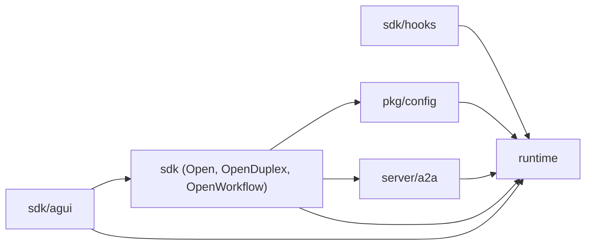
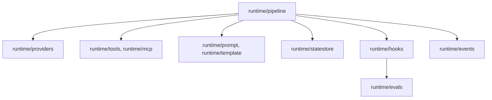
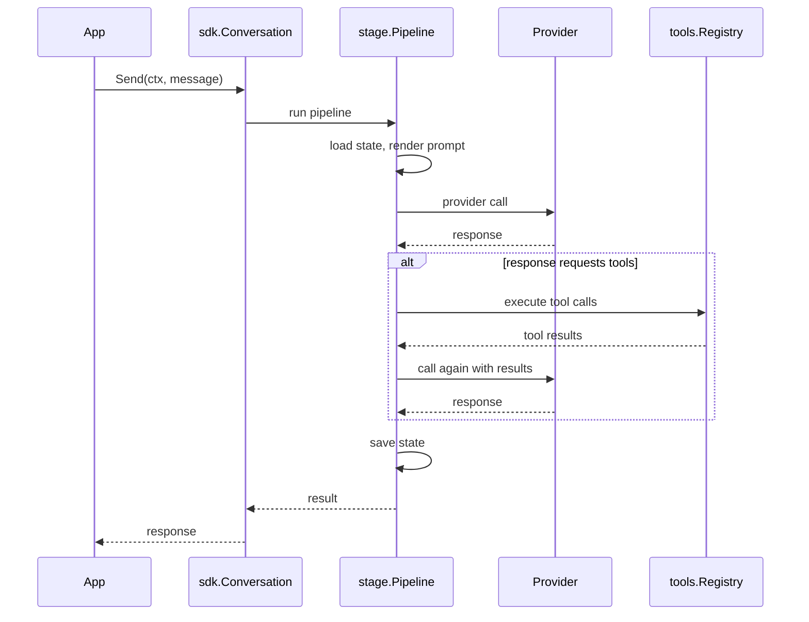

PromptKit is a set of Go library modules. The SDK is the entry point for applications, the runtime holds the engine, and two smaller modules add shared configuration types and an A2A server. The PromptArena and PackC command-line tools live in the separate `promptarena` repository and build on these libraries.

## Modules

Four Go modules make up PromptKit: `sdk`, `runtime`, `pkg` and `server/a2a`. `sdk/agui` and `sdk/hooks` are packages inside the `sdk` module. Arrows point from a module or package to what it imports.

`runtime` imports no sibling module. That keeps it usable on its own: you can build a pipeline from runtime packages without the SDK. The SDK adds the conversation API on top: it loads a pack, builds the pipeline, wires capabilities and exposes `Send`, `Stream` and the lifecycle around them. `sdk/agui` adapts a conversation to the AG-UI protocol for frontends, and `server/a2a` serves conversations over the A2A protocol.

## Runtime packages

The SDK drives these runtime packages. The runtime owns each of them; none depends on the SDK.

- `runtime/pipeline/stage` runs stages as concurrent goroutines connected by channels. [Runtime pipeline](/architecture/runtime-pipeline/) covers it.
- `runtime/providers` has one subpackage per provider, including `openai`, `claude`, `gemini`, `vertex`, `bedrock`, `ollama`, `vllm` and `mock`. [Runtime providers](/architecture/runtime-providers/) covers it.
- `runtime/tools` holds the tool registry and executors. `runtime/mcp` connects to MCP servers and registers their tools. [Runtime tools and MCP](/architecture/runtime-tools-mcp/) covers both.
- `runtime/statestore` persists conversation state in memory or in Redis.
- `runtime/hooks` runs guardrails and other hooks around provider calls and tool calls.
- `runtime/events` is the observability bus. [Runtime events](/architecture/runtime-events/) covers it.

## A message through the system

This sequence shows one `Send` call, including a tool round.

The pipeline repeats the provider call and tool execution until the model answers without requesting a tool. Every step emits events on the bus, so a listener sees the same run the sequence shows.

## Trade-offs

- Libraries instead of a server: you embed PromptKit in your process and own deployment, scaling and state storage. The cost is that you assemble the surrounding service yourself, with `server/a2a` as the one ready-made server.
- A leaf runtime: because `runtime` depends on no sibling module, other tools can build on it without pulling in the SDK. The cost is that a runtime-only user wires pipelines, providers and state by hand.
- Streaming stages over a middleware chain: concurrent stages give true streaming and backpressure, at the price of reasoning about channels and goroutine lifetimes instead of nested function calls.

## Related

- [Runtime pipeline](/architecture/runtime-pipeline/)
- [Runtime events](/architecture/runtime-events/)
- [Runtime providers](/architecture/runtime-providers/)
- [Runtime tools and MCP](/architecture/runtime-tools-mcp/)
