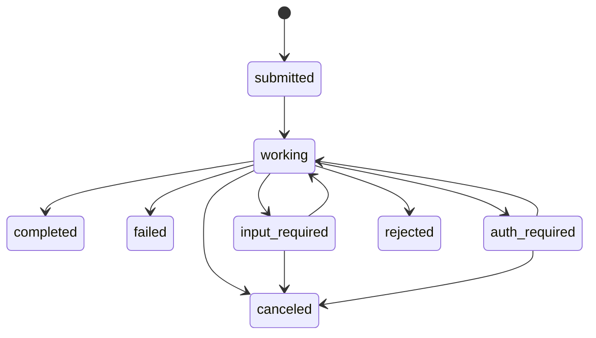

How PromptKit implements the Agent-to-Agent (A2A) protocol: the wire format, agent cards, the task lifecycle and streaming.

---

## Why Agent-to-Agent?

AI applications often need several specialized agents. A research agent might delegate citation lookups to a knowledge agent, or an orchestrator might fan out tasks to domain experts.

A2A treats agents as services: each agent publishes a card describing its skills and capabilities, and any HTTP client can call it, so tasks route to the best-suited agent.

---

## Protocol Overview

A2A uses **JSON-RPC 2.0 over HTTP**. All method calls go to a single endpoint (`POST /a2a`), and agent discovery uses a well-known URL.

PromptKit speaks two versions of the protocol on the same endpoint: **A2A 1.0** and **A2A 0.3**. Each request is answered in the version its `A2A-Version` header names, or its `A2A-Version` query parameter. A request that names no version is 0.3, as A2A 1.0 §3.6.2 requires. The method name must be one that version has:

- A 1.0 method name (`SendMessage`) in a 0.3 request fails with `VersionNotSupportedError` (`-32009`). That includes a request without `A2A-Version`. A 1.0 client must send the header (§3.6.1), and the official 1.0 SDKs for Python, JavaScript and Go do.
- A 0.3 method name (`message/send`) in a 1.0 request fails with `-32601`, because 1.0 has no method by that name. The error message names the method's 1.0 name.
- A version the server does not speak, such as `2.0`, fails with `-32009`. A patch number is ignored, so `0.3.0` is 0.3.

| Operation | A2A 1.0 method | A2A 0.3 method |
|-----------|----------------|----------------|
| Send a message | `SendMessage` | `message/send` |
| Send a message (SSE streaming) | `SendStreamingMessage` | `message/stream` |
| Get a task by ID | `GetTask` | `tasks/get` |
| Cancel a running task | `CancelTask` | `tasks/cancel` |
| List tasks in a context | `ListTasks` | (1.0 only) |
| Subscribe to a task's updates (SSE) | `SubscribeToTask` | `tasks/resubscribe` |
| Get the extended agent card | `GetExtendedAgentCard` | `agent/getAuthenticatedExtendedCard` |

Agent discovery is `GET /.well-known/agent-card.json`; `/.well-known/agent.json` serves the same card.

Every request is a JSON-RPC envelope:

```json
{
  "jsonrpc": "2.0",
  "id": 1,
  "method": "SendMessage",
  "params": { ... }
}
```

The envelope must be a JSON-RPC 2.0 Request object: `"jsonrpc"` exactly `"2.0"`, a non-empty string `method`, and an `id` that is a string, a number or null. Anything else fails with `-32600` Invalid Request, which echoes the `id` when the `id` itself is valid. A body that is not JSON fails with `-32700` Parse error. A batch (a JSON array) also fails with `-32600`, because the server does not take batches. Every response echoes the request's `id` exactly as it was sent, so a number larger than 2^53 is not rounded.

A blank `A2A-Version` header names no version, so the server reads the query parameter next. Every header line counts. Lines that name different versions fail with `-32009`.

A request without an `id` is a JSON-RPC notification. JSON-RPC 2.0 §4.1 says a server must not reply to one, but PromptKit runs it and answers with `"id": null`. Every A2A method returns a result or an error the caller needs, and an HTTP request gets a response either way, so an empty reply would only hide what happened. Send an `id`.

The mock server in `runtime/a2a/mock` reads requests with the same code as the real server (`a2a.ReadServerRequest`), so a test against it gets the same refusals.

The two versions carry the same operations in different wire shapes:

| | A2A 1.0 | A2A 0.3 |
|-|---------|---------|
| Task states | `TASK_STATE_COMPLETED`, `TASK_STATE_INPUT_REQUIRED`, ... | `completed`, `input-required`, ... |
| Roles | `ROLE_USER`, `ROLE_AGENT` | `user`, `agent` |
| `SendMessage` result | `{"task": {...}}` | the task, with `"kind": "task"` |
| Stream events | `{"task"\|"statusUpdate"\|"artifactUpdate": {...}}` | the event, with `"kind"` and, on status updates, `"final"` |
| File parts | `{"raw": ...}` / `{"url": ...}` with `mediaType` | `{"kind": "file", "file": {"bytes"\|"uri": ...}}` |
| Blocking `SendMessage` | by default; `returnImmediately: true` opts out | only with `blocking: true` |
| A2A errors (`-32001` to `-32009`) | `error.data` holds a `google.rpc.ErrorInfo` | no `error.data` |

In 1.0, an A2A error carries an array in `error.data` with one `google.rpc.ErrorInfo` (A2A 1.0 §9.5). Its `reason` is the error's name in upper snake case, and its `domain` is `a2a-protocol.org`. Errors about a task name it in `metadata.taskId`:

```json
{"jsonrpc":"2.0","id":2,"error":{"code":-32001,"message":"Task not found","data":[
  {"@type":"type.googleapis.com/google.rpc.ErrorInfo","reason":"TASK_NOT_FOUND",
   "domain":"a2a-protocol.org","metadata":{"taskId":"abc123"}}]}}
```

`VersionNotSupportedError` carries it in either version, with `requestedVersion` and `supportedVersions` (`1.0,0.3`) in its metadata, because only 1.0 defines that error. Other 0.3 errors have no `error.data`: 0.3 clients, a2a-go's among them, read it as an object, and an array would fail their decode. Standard JSON-RPC errors (`-32600`, `-32601`, `-32602`, `-32603`, `-32700`) carry no `error.data` in either version.

A status update carries the status the task store recorded, so its `timestamp` is the one `GetTask` returns. A task status's `timestamp` is always sent in UTC with a `Z` suffix, as A2A 1.0 §5.6.1 requires, with 0, 3, 6 or 9 fractional digits, as ProtoJSON writes a timestamp. A time a custom `TaskStore` keeps in another zone is converted. Every status update a stream or subscription sends carries one.

A file part sent by URL is a URL the caller chose. OpenAI and Claude hand an image URL to the vendor to fetch. The host fetches the other parts itself: every media part for Gemini, documents for Claude, audio for OpenAI, and every image for Ollama, whose server usually sits inside the host's network. The host refuses to fetch from loopback, private, link-local or otherwise non-public addresses, including redirects to them, so a caller cannot point it at the cloud metadata service or the internal network. The same applies to AG-UI messages. `sdk.WithUnsafePrivateNetworkMedia()` turns the check off; use it only when every media URL comes from a source you trust, and use your egress policy to allow specific internal destinations.

A blocking `SendMessage` holds its request until the turn ends. If the caller disconnects first, the server stops waiting and the turn runs on under its task. `a2aserver.WithMaxBlockingWait` caps the wait: past the cap, the caller gets the task still working, and polls `GetTask` or subscribes. `a2aserver.WithWriteTimeout` sets the HTTP server's write timeout, which is 0 (none) by default. Streaming responses lift it for their own connection and a blocking `SendMessage` does not, so set it above the longest turn a caller waits on. The runtime's A2A tool executor does not block. It sends with `returnImmediately`, polls the task until it finishes (`Client.WaitForTask`), and cancels the task if the tool's timeout runs out first. It does not resend a message after a response timeout, because the agent may already have started the turn.

The runtime client sends `A2A-Version: 1.0`. If the agent rejects a 1.0 method as unknown or unsupported, the client retries once in 0.3 and remembers the answer; `a2a.WithProtocolVersion` pins a version instead. The client reads every version's shapes, so its callers see one set of Go types.

---

## Agent Cards

An **Agent Card** is a JSON document served at `/.well-known/agent-card.json` that describes an agent's identity and capabilities:

```json
{
  "name": "Research Agent",
  "description": "Searches academic papers on a given topic",
  "version": "1.0.0",
  "capabilities": {
    "streaming": true
  },
  "skills": [
    {
      "id": "search_papers",
      "name": "Search Papers",
      "description": "Search for academic papers on a given topic",
      "tags": ["research", "papers"]
    }
  ],
  "defaultInputModes": ["text/plain"],
  "defaultOutputModes": ["text/plain"]
}
```

A skill can override the default modes with its own `inputModes` and `outputModes`.

A card should also say how to authenticate. Set `SecuritySchemes` (for example an `HTTPAuth` Bearer scheme) and `SecurityRequirements` on the `a2a.AgentCard`; the server publishes them in each version's shape.

The server completes the card before serving it:

- A JSON-RPC interface is declared for both 1.0 and 0.3.
- A card that declares no interface gets one pointing at the server's own `/a2a` endpoint, taken from the request's `Host` header. `X-Forwarded-*` headers are ignored: any caller can set them, and a cached card that trusted them could point other callers somewhere else. Behind a proxy, declare the public URL in the card's `supportedInterfaces`.
- `streaming` is declared whatever the configured card says. The server answers `SendStreamingMessage` and `SubscribeToTask` in every mode, and a conversation that does not implement `StreamingConversation` is streamed from its `Send` result: the task, then its result, then the final status. `a2aserver.WithoutStreaming()` turns streaming off: the card declares `streaming: false`, and both streaming methods fail with `UnsupportedOperationError` (`-32004`), as A2A 1.0 §3.3.4 requires. Use it when something in front of the server cannot carry Server-Sent Events.
- `pushNotifications` is never declared. Every push method fails with `PushNotificationNotSupportedError` (`-32003`), and so does a `SendMessage` or `SendStreamingMessage` that asks for push notifications inline (`configuration.taskPushNotificationConfig`, 0.3: `pushNotificationConfig`). The message is refused rather than run without them, so the caller is not left waiting for notifications that never come.

`a2aserver.WithExtendedCardProvider` sets an extended card: the card `GetExtendedAgentCard` returns to an authenticated caller (A2A 1.0 §3.1.11). The public card then declares `extendedAgentCard`, and the server completes the extended card as it does the public one. The provider is given the request, so it can tailor the card to the caller. A2A 1.0 §3.1.11 requires the call to be authenticated, so the server serves the card only when it can tell callers apart: with `WithAuthenticator`, `WithTaskOwner` or `NewServerFor`. Without one of them, `GetExtendedAgentCard` fails with `ExtendedAgentCardNotConfiguredError` (`-32007`). Without a provider, `GetExtendedAgentCard` fails with `UnsupportedOperationError` (`-32004`) unless the card declares `extendedAgentCard`, and with `ExtendedAgentCardNotConfiguredError` (`-32007`) if it does. A request that sends `A2A-Version: 1.0` gets the 1.0 card. Any other request gets the 0.3 card: `url`, `preferredTransport` and `protocolVersion`, with `supportedInterfaces` alongside.

A 1.0 card always carries the fields A2A 1.0 marks required: `name`, `description`, `supportedInterfaces`, `version`, `capabilities`, `defaultInputModes`, `defaultOutputModes` and `skills`, and each skill's `description` and `tags`. Unset ones are sent empty (`""`, `{}`, `[]`), so a server without `WithCard` still serves a complete card, with an empty name. Set the name, description, version and modes on the card yourself.

Decoding a card keeps everything either version defines, including `signatures`, extension `params` and a 0.3 skill's `security`, which becomes `securityRequirements`. PromptKit carries signatures but does not create or verify them. They are left out of the 0.3 card, which is a different document from the one that was signed. The server also changes the interfaces and capabilities of the card it serves, so a signed card it has to complete does not match its signature: sign the card as served.

The card response is cacheable. It carries `Cache-Control: max-age=300`, a weak `ETag` hashed from the body and `Vary: A2A-Version`, because the version header picks the card's shape. The tag is weak so it stays valid when compression middleware re-encodes the body, and `Vary` is added to any value a wrapping middleware set. A request whose `If-None-Match` names the current tag gets `304 Not Modified`. A card from an `AgentCardProvider` can differ per request, so it is sent with `Cache-Control: no-cache`: clients revalidate on every fetch and get a 304 while the card is unchanged. `a2aserver.WithCardMaxAge` sets the max-age for either kind of card; zero or less sends `no-cache`.

### Where the client sends calls

After `Client.Discover`, the runtime client considers only the card's interfaces on the scheme, host and port given to `a2a.NewClient` (default ports filled in). Of those it calls the first JSON-RPC interface that serves the version it speaks, otherwise the first JSON-RPC one, taking its path (an agent serving JSON-RPC at `/`, for example), its version and its `tenant`. An interface at the default `/a2a` keeps the base URL as given.

A card that names a different host or port is not followed, and its tenant and version are not used. Calls go to `{base}/a2a`, and the client logs a warning once. A card's URL is what the agent believes about itself, and following it would send the client's credentials wherever a card points, so some deployments need explicit configuration. An agent whose card names a public hostname, a separate RPC host or another port is called by creating the client with that address. An `http` interface on the `https` base host, as a TLS-terminating proxy reports, is not warned about. Without a card, or with a card that declares no interfaces, calls go to `{base}/a2a`. The A2A tool executors discover the card themselves on first use.

`Client.GetExtendedAgentCard` fetches the extended card with the client's credentials. The card it returns replaces the one `Discover` cached, as A2A 1.0 §3.1.11 recommends, so later calls are routed by it. A discovery still in flight when it returns does not put the public card back.

---

## Task Lifecycle

Every message without a `taskId` creates a **Task** that progresses through a state machine:



| State | Meaning |
|-------|---------|
| `submitted` | Task created, processing has not started |
| `working` | Agent is actively processing |
| `completed` | Task finished successfully |
| `failed` | Task encountered an error |
| `canceled` | Task was canceled by the caller |
| `input_required` | Agent needs more information from the caller |
| `auth_required` | Agent requires authentication |
| `rejected` | Agent declined the task |

Terminal states (`completed`, `failed`, `canceled`, `rejected`) cannot transition further. From `input_required` and `auth_required` the caller resumes the task by sending its next message with the task's `taskId`; the same task goes back to `working`. A message whose `taskId` names no task the caller can see fails with `TaskNotFoundError` (`-32001`); one naming a finished task, or a task that is not waiting for input, fails with `UnsupportedOperationError` (`-32004`); and a `contextId` that differs from the task's fails with `-32602`. The context is taken from the task when the message names only the `taskId`. A message without a `taskId` always starts a new task.

A streaming caller that disconnects closes only its own stream. The task runs on, its result is recorded, and subscribers keep receiving its updates. `CancelTask` stops it.

These are PromptKit's Go names (`a2a.TaskStateInputRequired`). On the wire each state takes its version's spelling: `TASK_STATE_INPUT_REQUIRED` in 1.0, `input-required` in 0.3.

Canceling a task that has already finished fails with `TaskNotCancelableError` (`-32002`). Subscribing to one fails with `UnsupportedOperationError` (`-32004`).

A state the client does not know, such as one a later protocol version adds, is decoded as `a2a.TaskStateUnknown` rather than failing the task or dropping a stream event, as A2A 1.0 §5.7 asks of implementations. Nothing says a task will ever leave such a state, so `Client.WaitForTask` stops at it and returns an error matching `a2a.ErrUnknownTaskState`. The A2A tool executor then cancels the task and fails the call, and the `a2a_eval` check fails. The server still validates the states a caller sends: a `ListTasks` `status` filter that names no state fails with `-32602`.

### Eviction

Finished tasks are kept for an hour after their last status change, then evicted (`a2aserver.WithTaskTTL`). A task waiting for the caller (`input-required` or `auth-required`) is kept for 24 hours, then evicted (`a2aserver.WithInterruptedTaskTTL`). A caller that never comes back would otherwise leave it in the store for good. So would a client that resumes without the task's `taskId`, which starts a new task instead. An evicted task is reported as `TaskNotFoundError`. A TTL of zero turns that eviction off. The in-memory store supports both. A custom `TaskStore` takes part in interrupted-task eviction by implementing `a2aserver.InterruptedTaskEvictor`; a store that does not must bound its waiting tasks itself. Eviction runs on a background goroutine once a minute, which the default interrupted-task TTL starts even when the other TTLs are zero. `Shutdown` stops it.

### History

Each task records the messages its turns exchange in `history`, oldest first: the caller's message when a turn begins, and the agent's status message when a turn ends with one, such as a request for a client tool or the reason a turn failed. The agent's answer is in the task's artifacts, not its history. `historyLength` on `GetTask`, `ListTasks`, `SendMessage` and the task a `SendStreamingMessage` opens with trims it (A2A 1.0 §3.2.4): unset returns it all, `0` omits the field, and `n` returns the last `n` messages. A negative `historyLength` fails with `-32602`. A message the server refuses is not recorded. A task keeps its last 100 messages; `a2aserver.WithMaxTaskHistory` changes the cap, and zero or less keeps them all. Messages are kept as sent, file parts and their bytes included, so a conversation that exchanges files holds up to that many of them per task. The in-memory store keeps history; a custom store does by implementing `a2aserver.TaskHistoryStore`, and without it tasks are served with none.

### Tenants

An A2A 1.0 request may name a `tenant`, which the client takes from the agent interface it calls. A 0.3 request has none. With the in-memory store, the server records the tenant each task is created in:

- A task is visible only to requests in its tenant. `GetTask`, `CancelTask`, `SubscribeToTask`, `ListTasks` and a message continuing the task from another tenant, or from none, get `TaskNotFoundError`, as for a task that does not exist (A2A 1.0 §3.3.2).
- In conversation mode, a context belongs to the tenant that first used it. A message from another tenant naming it fails with `-32602`, while its conversation is open and after it is evicted. That tells the other tenant only that the context ID is in use, as the same refusal tells another caller under `WithTaskOwner`; a message that names no context gets a new random one. A conversation opener is given only the context ID, so contexts cannot be namespaced per tenant for it.
- In stateless mode the handler owns contexts, as it does for callers under `WithTaskOwner`. Two tenants may send the same `contextId`, and the server does not refuse either. The handler receives the tenant in `MessageRequest.Tenant` and `ToolResultRequest.Tenant`, and must key its sessions by tenant and context ID together.
- A task the store records no tenant for is in none, so it is visible only to requests that name none.

Tenants partition tasks; they do not authenticate anyone, since any caller can name any tenant. Use `WithTaskOwner` or `NewServerFor` to scope tasks by authenticated caller; the two combine, so in the same tenant another caller's task is still not found.

A custom store partitions by tenant by implementing `a2aserver.TenantTaskStore`. A request that names a tenant to a server whose store does not implement it fails with `UnsupportedOperationError` (`-32004`), rather than being served across tenants. A store that implements `TaskQuerier` should honor `TaskQuery.Tenant`; the server also drops any task of another tenant a query returns, but the page's `totalSize` is then the store's own count.

A store that embeds `*InMemoryTaskStore` gets its optional methods by promotion: `CreateInTenant`, `Tenant`, `AppendHistory` and `EvictInterrupted` act on the embedded store's own tasks. A wrapper that keeps tasks elsewhere, or overrides `Create`, must override those too, or hide them by embedding the `TaskStore` interface instead of the struct.

---

## Message Format

Messages consist of parts. Each part carries one type of content:

```go
type Part struct {
    Text      *string        `json:"text,omitempty"`
    Raw       []byte         `json:"raw,omitempty"`
    URL       *string        `json:"url,omitempty"`
    Data      map[string]any `json:"data,omitempty"`
    DataValue any            `json:"-"` // a data value that is not an object
    Metadata  map[string]any `json:"metadata,omitempty"`
    Filename  string         `json:"filename,omitempty"`
    MediaType string         `json:"mediaType,omitempty"`
}
```

A message has a `role` (`user` or `agent`), a list of parts, and optional metadata:

```go
type Message struct {
    MessageID        string         `json:"messageId"`
    ContextID        string         `json:"contextId,omitempty"`
    TaskID           string         `json:"taskId,omitempty"`
    Role             Role           `json:"role"`
    Parts            []Part         `json:"parts"`
    ReferenceTaskIDs []string       `json:"referenceTaskIds,omitempty"`
    Extensions       []string       `json:"extensions,omitempty"`
    Metadata         map[string]any `json:"metadata,omitempty"`
}
```

The `contextId` groups related tasks into a conversation. The server generates one when a message omits it.

In conversation mode the server converts each part of an incoming message for the conversation. A stateless handler receives the A2A message as sent.

| Part | What the conversation receives |
|------|-------------------------------|
| `text` | a text part |
| `raw` or `url` | an image, audio, video or document part, by media type |
| `data` | a text part holding the value as JSON |

`mediaType` is optional in A2A 1.0. When a `raw` or `url` part omits it, the server takes the type from the part's `filename` extension, then from a data URL's header or the URL path's extension, or by sniffing the raw bytes. A data URL whose header names no type is `text/plain`, as RFC 2397 says. Every type, declared or inferred, reaches the conversation under the name the providers list: lowercase, without parameters, and with aliases resolved, so `audio/x-wav` and `audio/wave` arrive as `audio/wav` and `video/quicktime` as `video/mov`.

The server refuses a message with `ContentTypeNotSupportedError` (`-32005`) when a part's type cannot be determined, when it is `application/octet-stream`, or when raw text without a declared `mediaType` is not UTF-8. It refuses a part with no content, an empty `url`, or a data URL without a comma with `-32602`. A refused message opens no conversation. The server does not check a resolved type against what the conversation's provider accepts, because it cannot see the provider before the conversation is opened. A type the provider rejects fails the task instead.

---

## Artifacts

When a task completes, the agent's output is stored as artifacts on the task:

```go
type Artifact struct {
    ArtifactID  string         `json:"artifactId"`
    Name        string         `json:"name,omitempty"`
    Description string         `json:"description,omitempty"`
    Parts       []Part         `json:"parts"`
    Extensions  []string       `json:"extensions,omitempty"`
    Metadata    map[string]any `json:"metadata,omitempty"`
}
```

A task can produce several artifacts, such as a text response and a generated image.

---

## SSE Streaming

`SendStreamingMessage` (0.3: `message/stream`) returns Server-Sent Events instead of a single JSON response. The stream follows A2A 1.0 §3.1.2:

1. **The Task** comes first, already `working`.
2. **Artifact updates** follow as the agent produces output. A run of text is a single artifact: the first chunk opens it, later chunks carry `append: true`, and the last carries `lastChunk: true`. Media parts are artifacts of their own.
3. **A status update** ends the stream when the task finishes (`completed`, `failed`, `canceled`) or needs the caller (`input-required`).

In 1.0 each result is wrapped by what it is:

```
data: {"jsonrpc":"2.0","id":1,"result":{"task":{"id":"abc123","contextId":"ctx456","status":{"state":"TASK_STATE_WORKING","timestamp":"2026-11-21T10:00:00.123Z"}}}}

data: {"jsonrpc":"2.0","id":1,"result":{"artifactUpdate":{"taskId":"abc123","contextId":"ctx456","artifact":{"artifactId":"artifact-1","parts":[{"text":"Hello"}]}}}}

data: {"jsonrpc":"2.0","id":1,"result":{"artifactUpdate":{"taskId":"abc123","contextId":"ctx456","artifact":{"artifactId":"artifact-1","parts":[{"text":" world"}]},"append":true,"lastChunk":true}}}

data: {"jsonrpc":"2.0","id":1,"result":{"statusUpdate":{"taskId":"abc123","contextId":"ctx456","status":{"state":"TASK_STATE_COMPLETED","timestamp":"2026-11-21T10:00:01.456Z"}}}}
```

In 0.3 each result is sent bare, tagged with `"kind"` (`task`, `artifact-update`, `status-update`), and the closing status update carries `"final": true`.

`SubscribeToTask` (0.3: `tasks/resubscribe`) streams the same updates for a task already running. That includes a task started with a non-streaming `SendMessage`. The subscription opens with the task as it stands. On the client, `Client.SubscribeToTask` returns the subscription as a channel of `StreamEvent` values, as `SendMessageStream` does; a subscription the agent refuses (an unknown or finished task, or an agent that does not stream) is an `*RPCError` from the call.

The client parses every version's events and delivers them as a channel of `StreamEvent` values. Each holds exactly one of `Task`, `Message`, `StatusUpdate` or `ArtifactUpdate`, except the last event of a stream that ends in an error. That event holds an `Error`: a JSON-RPC error the agent sent, or `ErrSSEIdleTimeout` when the stream received nothing within the idle timeout (5 minutes by default, `a2a.WithSSEIdleTimeout`), so a caller can tell a stall from a finished stream.

---

## Design Decisions

### Why JSON-RPC?

JSON-RPC gives typed methods, error codes and request IDs over a single HTTP endpoint, with no REST path design.

### Why Agent Cards?

Agent cards enable dynamic discovery. A client can connect to any A2A server, fetch its card, and learn what it can do without hardcoded knowledge. The Tool Bridge uses the card to generate a tool descriptor for each agent skill, named `a2a__<agent>__<skill>`.

### Architecture Split

PromptKit splits A2A into two packages:

- **`runtime/a2a`**: protocol types, client, tool bridge, mock server (`runtime/a2a/mock`) and conversion helpers. Use it to consume A2A services.
- **`server/a2a`**: the A2A server, task store and conversation opener (package `a2aserver`). Use it to expose an agent as an A2A service. The `sdk` package re-exports them as `A2AServer`, `A2ATaskStore` and `A2AConversationOpener`.

The runtime has no dependency on the server or the SDK, and both build on the runtime's protocol types.

---

## A2A and AG-UI

A2A handles agent-to-agent communication: agents calling other agents as services. For connecting agents to frontend applications (user interfaces, chat widgets, dashboards), PromptKit supports the [AG-UI protocol](/concepts/ag-ui/). Together with MCP, the protocols cover the full communication surface:

| Protocol | Direction | Use Case |
|----------|-----------|----------|
| MCP | Agent ↔ Tools | Tool discovery and execution |
| A2A | Agent ↔ Agents | Task delegation between agents |
| AG-UI | Agent ↔ Frontends | Real-time streaming to user interfaces |

---

## Next Steps

- [Tutorial: A2A Client](/runtime/tutorials/07-a2a-client/) — discover agents and send messages
- [Tutorial: A2A Server](/sdk/tutorials/10-a2a-server/) — expose your agent as an A2A service
- [Tool Bridge How-To](/runtime/how-to/a2a/use-a2a-tool-bridge/) — register agents as tools
- [Runtime A2A Reference](/runtime/reference/a2a/) — client, types, bridge, mock API
- [SDK A2A Reference](/sdk/reference/a2a-server/) — server, task store, opener API
