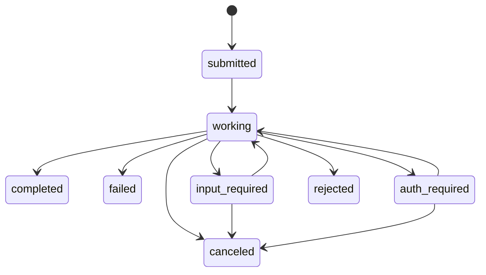

How PromptKit implements the Agent-to-Agent (A2A) protocol: the wire format, agent cards, the task lifecycle and streaming.

---

## Why Agent-to-Agent?

AI applications often need several specialized agents. A research agent might delegate citation lookups to a knowledge agent, or an orchestrator might fan out tasks to domain experts.

A2A treats agents as services: each agent publishes a card describing its skills and capabilities, and any HTTP client can call it, so tasks route to the best-suited agent.

---

## Protocol Overview

A2A uses **JSON-RPC 2.0 over HTTP**. All method calls go to a single endpoint (`POST /a2a`), and agent discovery uses a well-known URL.

PromptKit speaks two versions of the protocol on the same endpoint: **A2A 1.0** and **A2A 0.3**. Each request is answered in the version it asked for. That is the `A2A-Version` header when present. Otherwise it is the version whose method name the request used. The spec reads a request with no version as 0.3.

| Operation | A2A 1.0 method | A2A 0.3 method |
|-----------|----------------|----------------|
| Send a message | `SendMessage` | `message/send` |
| Send a message (SSE streaming) | `SendStreamingMessage` | `message/stream` |
| Get a task by ID | `GetTask` | `tasks/get` |
| Cancel a running task | `CancelTask` | `tasks/cancel` |
| List tasks in a context | `ListTasks` | (1.0 only) |
| Subscribe to a task's updates (SSE) | `SubscribeToTask` | `tasks/resubscribe` |

Agent discovery is `GET /.well-known/agent-card.json`; `/.well-known/agent.json` serves the same card.

Every request is a JSON-RPC envelope:

```json
{
  "jsonrpc": "2.0",
  "id": 1,
  "method": "SendMessage",
  "params": { ... }
}
```

The two versions carry the same operations in different wire shapes:

| | A2A 1.0 | A2A 0.3 |
|-|---------|---------|
| Task states | `TASK_STATE_COMPLETED`, `TASK_STATE_INPUT_REQUIRED`, ... | `completed`, `input-required`, ... |
| Roles | `ROLE_USER`, `ROLE_AGENT` | `user`, `agent` |
| `SendMessage` result | `{"task": {...}}` | the task, with `"kind": "task"` |
| Stream events | `{"task"\|"statusUpdate"\|"artifactUpdate": {...}}` | the event, with `"kind"` and, on status updates, `"final"` |
| File parts | `{"raw": ...}` / `{"url": ...}` with `mediaType` | `{"kind": "file", "file": {"bytes"\|"uri": ...}}` |
| Blocking `SendMessage` | by default; `returnImmediately: true` opts out | only with `blocking: true` |

A file part sent by URL is a URL the caller chose. OpenAI and Claude hand an image URL to the vendor to fetch. The host fetches the other parts itself: every media part for Gemini, documents for Claude, audio for OpenAI, and every image for Ollama, whose server usually sits inside the host's network. The host refuses to fetch from loopback, private, link-local or otherwise non-public addresses, including redirects to them, so a caller cannot point it at the cloud metadata service or the internal network. The same applies to AG-UI messages. `sdk.WithUnsafePrivateNetworkMedia()` turns the check off; use it only when every media URL comes from a source you trust, and use your egress policy to allow specific internal destinations.

A blocking `SendMessage` holds its request until the turn ends. If the caller disconnects first, the server stops waiting and the turn runs on under its task. `a2aserver.WithMaxBlockingWait` caps the wait: past the cap, the caller gets the task still working, and polls `GetTask` or subscribes. The runtime's A2A tool executor does not block. It sends with `returnImmediately`, polls the task until it finishes (`Client.WaitForTask`), and cancels the task if the tool's timeout runs out first. It does not resend a message after a response timeout, because the agent may already have started the turn.

The runtime client sends `A2A-Version: 1.0`. If the agent rejects a 1.0 method as unknown or unsupported, the client retries once in 0.3 and remembers the answer; `a2a.WithProtocolVersion` pins a version instead. The client reads every version's shapes, so its callers see one set of Go types.

---

## Agent Cards

An **Agent Card** is a JSON document served at `/.well-known/agent-card.json` that describes an agent's identity and capabilities:

```json
{
  "name": "Research Agent",
  "description": "Searches academic papers on a given topic",
  "version": "1.0.0",
  "capabilities": {
    "streaming": true
  },
  "skills": [
    {
      "id": "search_papers",
      "name": "Search Papers",
      "description": "Search for academic papers on a given topic",
      "tags": ["research", "papers"]
    }
  ],
  "defaultInputModes": ["text/plain"],
  "defaultOutputModes": ["text/plain"]
}
```

A skill can override the default modes with its own `inputModes` and `outputModes`.

A card should also say how to authenticate. Set `SecuritySchemes` (for example an `HTTPAuth` Bearer scheme) and `SecurityRequirements` on the `a2a.AgentCard`; the server publishes them in each version's shape.

The server completes the card before serving it:

- A JSON-RPC interface is declared for both 1.0 and 0.3.
- A card that declares no interface gets one pointing at the server's own `/a2a` endpoint, taken from the request's `Host` header. `X-Forwarded-*` headers are ignored: any caller can set them, and a cached card that trusted them could point other callers somewhere else. Behind a proxy, declare the public URL in the card's `supportedInterfaces`.
- `streaming` is declared whatever the configured card says. The server answers `SendStreamingMessage` and `SubscribeToTask` in every mode, and a conversation that does not implement `StreamingConversation` is streamed from its `Send` result: the task, then its result, then the final status.
- `pushNotifications` is never declared, and every push method fails with `-32003`.

`GetExtendedAgentCard` fails with `UnsupportedOperationError` (`-32004`) unless the card declares `extendedAgentCard`, and with `ExtendedAgentCardNotConfiguredError` (`-32007`) if it does. A request that sends `A2A-Version: 1.0` gets the 1.0 card. Any other request gets the 0.3 card: `url`, `preferredTransport` and `protocolVersion`, with `supportedInterfaces` alongside.

### Where the client sends calls

After `Client.Discover`, the runtime client considers only the card's interfaces on the scheme, host and port given to `a2a.NewClient` (default ports filled in). Of those it calls the first JSON-RPC interface that serves the version it speaks, otherwise the first JSON-RPC one, taking its path (an agent serving JSON-RPC at `/`, for example), its version and its `tenant`. An interface at the default `/a2a` keeps the base URL as given.

A card that names a different host or port is not followed, and its tenant and version are not used. Calls go to `{base}/a2a`, and the client logs a warning once. An `http` interface on the `https` base host, as a TLS-terminating proxy reports, is not warned about. To call the other host, create a client with that host. Without a card, or with a card that declares no interfaces, calls go to `{base}/a2a`. The A2A tool executors discover the card themselves on first use.

---

## Task Lifecycle

Every message without a `taskId` creates a **Task** that progresses through a state machine:



| State | Meaning |
|-------|---------|
| `submitted` | Task created, processing has not started |
| `working` | Agent is actively processing |
| `completed` | Task finished successfully |
| `failed` | Task encountered an error |
| `canceled` | Task was canceled by the caller |
| `input_required` | Agent needs more information from the caller |
| `auth_required` | Agent requires authentication |
| `rejected` | Agent declined the task |

Terminal states (`completed`, `failed`, `canceled`, `rejected`) cannot transition further. From `input_required` and `auth_required` the caller resumes the task by sending its next message with the task's `taskId`; the same task goes back to `working`. A message whose `taskId` names no task the caller can see fails with `TaskNotFoundError` (`-32001`); one naming a finished task, or a task that is not waiting for input, fails with `UnsupportedOperationError` (`-32004`); and a `contextId` that differs from the task's fails with `-32602`. The context is taken from the task when the message names only the `taskId`. A message without a `taskId` always starts a new task.

A streaming caller that disconnects closes only its own stream. The task runs on, its result is recorded, and subscribers keep receiving its updates. `CancelTask` stops it.

These are PromptKit's Go names (`a2a.TaskStateInputRequired`). On the wire each state takes its version's spelling: `TASK_STATE_INPUT_REQUIRED` in 1.0, `input-required` in 0.3.

Canceling a task that has already finished fails with `TaskNotCancelableError` (`-32002`). Subscribing to one fails with `UnsupportedOperationError` (`-32004`).

---

## Message Format

Messages consist of parts. Each part carries one type of content:

```go
type Part struct {
    Text      *string        `json:"text,omitempty"`
    Raw       []byte         `json:"raw,omitempty"`
    URL       *string        `json:"url,omitempty"`
    Data      map[string]any `json:"data,omitempty"`
    DataValue any            `json:"-"` // a data value that is not an object
    Metadata  map[string]any `json:"metadata,omitempty"`
    Filename  string         `json:"filename,omitempty"`
    MediaType string         `json:"mediaType,omitempty"`
}
```

A message has a `role` (`user` or `agent`), a list of parts, and optional metadata:

```go
type Message struct {
    MessageID        string         `json:"messageId"`
    ContextID        string         `json:"contextId,omitempty"`
    TaskID           string         `json:"taskId,omitempty"`
    Role             Role           `json:"role"`
    Parts            []Part         `json:"parts"`
    ReferenceTaskIDs []string       `json:"referenceTaskIds,omitempty"`
    Extensions       []string       `json:"extensions,omitempty"`
    Metadata         map[string]any `json:"metadata,omitempty"`
}
```

The `contextId` groups related tasks into a conversation. The server generates one when a message omits it.

---

## Artifacts

When a task completes, the agent's output is stored as artifacts on the task:

```go
type Artifact struct {
    ArtifactID  string         `json:"artifactId"`
    Name        string         `json:"name,omitempty"`
    Description string         `json:"description,omitempty"`
    Parts       []Part         `json:"parts"`
    Extensions  []string       `json:"extensions,omitempty"`
    Metadata    map[string]any `json:"metadata,omitempty"`
}
```

A task can produce several artifacts, such as a text response and a generated image.

---

## SSE Streaming

`SendStreamingMessage` (0.3: `message/stream`) returns Server-Sent Events instead of a single JSON response. The stream follows A2A 1.0 §3.1.2:

1. **The Task** comes first, already `working`.
2. **Artifact updates** follow as the agent produces output. A run of text is a single artifact: the first chunk opens it, later chunks carry `append: true`, and the last carries `lastChunk: true`. Media parts are artifacts of their own.
3. **A status update** ends the stream when the task finishes (`completed`, `failed`, `canceled`) or needs the caller (`input-required`).

In 1.0 each result is wrapped by what it is:

```
data: {"jsonrpc":"2.0","id":1,"result":{"task":{"id":"abc123","contextId":"ctx456","status":{"state":"TASK_STATE_WORKING"}}}}

data: {"jsonrpc":"2.0","id":1,"result":{"artifactUpdate":{"taskId":"abc123","contextId":"ctx456","artifact":{"artifactId":"artifact-1","parts":[{"text":"Hello"}]}}}}

data: {"jsonrpc":"2.0","id":1,"result":{"artifactUpdate":{"taskId":"abc123","contextId":"ctx456","artifact":{"artifactId":"artifact-1","parts":[{"text":" world"}]},"append":true,"lastChunk":true}}}

data: {"jsonrpc":"2.0","id":1,"result":{"statusUpdate":{"taskId":"abc123","contextId":"ctx456","status":{"state":"TASK_STATE_COMPLETED"}}}}
```

In 0.3 each result is sent bare, tagged with `"kind"` (`task`, `artifact-update`, `status-update`), and the closing status update carries `"final": true`.

`SubscribeToTask` (0.3: `tasks/resubscribe`) streams the same updates for a task already running. That includes a task started with a non-streaming `SendMessage`. The subscription opens with the task as it stands.

The client parses every version's events and delivers them as a channel of `StreamEvent` values. Each holds exactly one of `Task`, `Message`, `StatusUpdate` or `ArtifactUpdate`.

---

## Design Decisions

### Why JSON-RPC?

JSON-RPC gives typed methods, error codes and request IDs over a single HTTP endpoint, with no REST path design.

### Why Agent Cards?

Agent cards enable dynamic discovery. A client can connect to any A2A server, fetch its card, and learn what it can do without hardcoded knowledge. The Tool Bridge uses the card to generate a tool descriptor for each agent skill.

### Architecture Split

PromptKit splits A2A into two packages:

- **`runtime/a2a`**: protocol types, client, tool bridge, mock server (`runtime/a2a/mock`) and conversion helpers. Use it to consume A2A services.
- **`server/a2a`**: the A2A server, task store and conversation opener (package `a2aserver`). Use it to expose an agent as an A2A service. The `sdk` package re-exports them as `A2AServer`, `A2ATaskStore` and `A2AConversationOpener`.

The runtime has no dependency on the server or the SDK, and both build on the runtime's protocol types.

---

## A2A and AG-UI

A2A handles agent-to-agent communication: agents calling other agents as services. For connecting agents to frontend applications (user interfaces, chat widgets, dashboards), PromptKit supports the [AG-UI protocol](/concepts/ag-ui/). Together with MCP, the protocols cover the full communication surface:

| Protocol | Direction | Use Case |
|----------|-----------|----------|
| MCP | Agent ↔ Tools | Tool discovery and execution |
| A2A | Agent ↔ Agents | Task delegation between agents |
| AG-UI | Agent ↔ Frontends | Real-time streaming to user interfaces |

---

## Next Steps

- [Tutorial: A2A Client](/runtime/tutorials/07-a2a-client/) — discover agents and send messages
- [Tutorial: A2A Server](/sdk/tutorials/10-a2a-server/) — expose your agent as an A2A service
- [Tool Bridge How-To](/runtime/how-to/a2a/use-a2a-tool-bridge/) — register agents as tools
- [Runtime A2A Reference](/runtime/reference/a2a/) — client, types, bridge, mock API
- [SDK A2A Reference](/sdk/reference/a2a-server/) — server, task store, opener API
