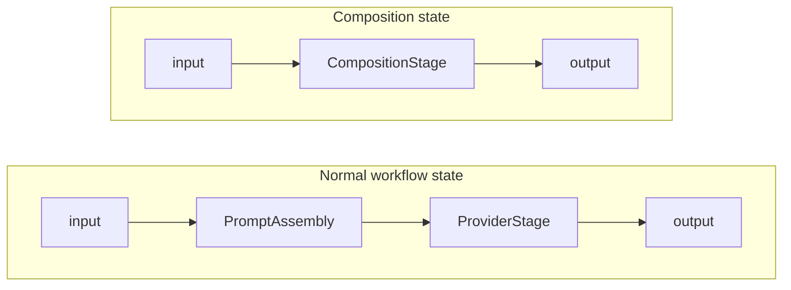

A **composition** is a declarative step graph the runtime executes for a workflow state, instead of an LLM-driven turn. A normal workflow state calls a language model and waits for it to call the `workflow__transition` tool. A composition state runs a graph of `prompt`, `agent`, `tool`, `branch` and `parallel` steps and returns structured output, with no free-form conversation.

Compositions implement [RFC 0010](https://promptpack.org/docs/rfcs/workflow-composition).

---

## Why Compositions?

Some workflow states are procedural: classify a document, extract fields, call a tool, pick a path, fan out to several sub-tasks and merge the results. Expressed as a multi-turn chat, the LLM carries the orchestration. A composition moves that control flow into a deterministic, testable declaration.

| | LLM-driven state | Composition state |
|---|---|---|
| **Orchestration** | LLM decides tool order | Explicit step graph |
| **Output** | Free-form assistant message | Structured JSON from the output step |
| **Testing** | Assert on tool calls | Assert on step outputs, branch taken, final output |
| **Latency** | Multiple round-trips | Predictable step sequence |

---

## How a Composition State Works

A composition state replaces the `ProviderStage` (the LLM and tool loop) with a `CompositionStage`. The stage reads the turn's user message as the composition input, walks the steps, and emits the output step's result as the turn response.



A message that is a JSON object or array is the composition input as written. Any other text is encoded as a JSON string.

Each `prompt` and `agent` step runs as its own sub-pipeline: prompt assembly, template rendering and a provider call. Each `tool` step calls the tool registry directly.

---

## Step Kinds

A composition is a list of steps. Each step has an `id` and a `kind`. Steps run in array order. A step runs after the steps listed in its `depends_on`, and is skipped when every step it depends on was skipped.

### `prompt`

Runs a sub-pipeline (prompt assembly and one LLM call) for the named `prompt_task`. No tool loop. The LLM response is the step output.

```yaml
- id: classify
  kind: prompt
  prompt_task: doc_classifier
  input: ${input.text}
  output_schema: schemas/doctype.json
```

`output_schema` is a path, relative to the pack file, to a JSON Schema. The runtime sends it to the provider as a strict structured-output format. It does not validate the response afterwards.

### `agent`

Runs a sub-pipeline with tools and an LLM tool loop. The loop ends at `max_steps` or when `tool_called` fires. An agent step must declare one of them.

```yaml
- id: synthesize
  kind: agent
  prompt_task: doc_analyzer
  input: ${meta.output.metadata}
  tools: [doc.section_lookup, ref.search]
  termination: { max_steps: 10 }
  output_schema: schemas/analysis.json
```

`max_steps` bounds the step's tool-loop rounds, like the prompt's `tool_policy.max_rounds`; the lower of the two applies. Tool access for an `agent` step is the intersection of the prompt template's allowed tools and the step's `tools:` list. A `prompt` step has no tools.

### `tool`

Invokes a tool from the registry directly. No LLM is involved. A tool that reports an error fails the step.

```yaml
- id: parse_meta
  kind: tool
  tool: doc.parse_structure
  args:
    content: ${input.text}
```

### `branch`

Evaluates a predicate and picks `then` or `else`, both step ids. The branch skips the target it did not take and the walk continues in order. `else` is optional: with no `else` and a false predicate, the `then` step is skipped.

```yaml
- id: route
  kind: branch
  predicate:
    path: ${classify.output.type}
    op: equals
    value: research_paper
  then: extract_paper
  else: extract_general
```

A comparison predicate takes a `path`, an `op` and a `value`. The ops are `equals`, `not_equals`, `in`, `not_in`, `less_than`, `less_than_or_equals`, `greater_than` and `greater_than_or_equals`. `in` and `not_in` take a list as `value`; the ordered ops need numbers. A path that does not resolve compares as null and logs a warning.

An existence predicate takes a `path` and `exists: true` or `exists: false`. Compound predicates use `all_of`, `any_of` or `not`. A predicate sets exactly one of these forms.

### `parallel`

Runs two or more leaf steps (`prompt`, `agent` or `tool`) concurrently and merges their outputs. Nesting a `branch` or `parallel` inside a `parallel` is an error. A failed branch does not cancel its siblings. The step fails with every branch error after all branches finish.

```yaml
- id: meta
  kind: parallel
  branches:
    - { id: structure,  kind: tool, tool: doc.parse_structure,   args: { content: ${input.text} } }
    - { id: citations,  kind: tool, tool: doc.extract_citations,  args: { content: ${input.text} } }
  reduce:
    strategy: barrier
    into: metadata
```

`reduce` is required. `reduce.into` names the key that holds the merged result, which downstream steps read as `${meta.output.metadata}`.

The strategies merge the branch outputs differently:

- `barrier` produces a map of branch id to branch output.
- `append` produces a list of branch outputs, in branch order.
- `replace` produces the last branch's output.

---

## Inputs and References

Steps receive data through the `input` field, which is a `${...}` reference, a string with embedded references, or a literal object mixing references and constants. A tool step takes `args` the same way. A reference that does not resolve fails the step.

- `${input.X}` is field `X` of the composition's input.
- `${stepID.output.X}` is field `X` of step `stepID`'s output.
- `${meta.output.metadata}` is the merged output of a `parallel` step named `meta`.

A reference to a step id that does not exist is a validation error.

---

## Step Modifiers

Every step kind accepts a `modifiers` block with a `retry` setting.

```yaml
modifiers:
  retry:
    max_attempts: 3
```

`retry.max_attempts` is the total number of attempts. The step runs again after any error, and the last error is returned when the attempts run out. Parallel branches retry independently.

---

## Authoring in PromptArena

### Pack structure

`compositions:` is a top-level block, a sibling of `workflow:` under `spec:`. A workflow state opts into a composition with `orchestration: composition` and `composition: <name>`. The state omits `prompt_task`.

```yaml
spec:
  prompt_configs:
    - { id: doc_classifier, file: prompts/doc_classifier.yaml }
    - { id: doc_analyzer,   file: prompts/doc_analyzer.yaml }
  tools:
    - { id: doc.parse_structure,   file: tools/parse_structure.yaml }
    - { id: doc.extract_citations, file: tools/extract_citations.yaml }
    - { id: doc.section_lookup,    file: tools/section_lookup.yaml }
    - { id: ref.search,            file: tools/ref_search.yaml }

  workflow:
    version: 1
    entry: analyze
    states:
      analyze:
        orchestration: composition   # opt into composition mode
        composition: analyze_document
        terminal: true               # prompt_task omitted for composition states

  compositions:
    analyze_document:
      version: 1
      output: synthesize             # final step; defaults to the last output-producing step
      steps:
        - id: classify
          kind: prompt
          prompt_task: doc_classifier
          input: ${input.text}
          output_schema: schemas/doctype.json

        - id: route
          kind: branch
          predicate:
            path: ${classify.output.type}
            op: equals
            value: research_paper
          then: extract_paper
          else: extract_general

        - { id: extract_paper,   kind: prompt, prompt_task: research_paper_extractor, input: ${input.text} }
        - { id: extract_general, kind: prompt, prompt_task: general_doc_extractor,    input: ${input.text} }

        - id: meta
          kind: parallel
          depends_on: [extract_paper, extract_general]
          branches:
            - { id: structure,  kind: tool, tool: doc.parse_structure,   args: { content: ${input.text} } }
            - { id: citations,  kind: tool, tool: doc.extract_citations,  args: { content: ${input.text} } }
          reduce: { strategy: barrier, into: metadata }

        - id: synthesize
          kind: agent
          prompt_task: doc_analyzer
          input: ${meta.output.metadata}
          tools: [doc.section_lookup, ref.search]
          termination: { max_steps: 10 }
          output_schema: schemas/analysis.json
```

### Choosing a provider per step

A `prompt` or `agent` step runs on the provider requirement named by its `provider` field. Without one, it uses its prompt's `provider`, and without that, the default agent provider. Bind a named requirement with `sdk.WithNamedProvider`.

### Validation rules

A workflow state whose `composition` names a composition that does not exist is a hard error. A composition that no state references produces a warning, as does one defined in a pack with no workflow.

Other errors:

- `version` is not `1`.
- Step ids are not unique, or do not match `^[a-zA-Z_][a-zA-Z0-9_]*$`.
- A `prompt_task`, `tool`, step `tools` entry or `modifiers.eval` entry names something the pack does not define.
- A `${...}` reference starts with anything other than `input` or a step id.
- A step carries a field its kind does not allow, an `agent` step has no `termination`, a `parallel` step has fewer than two branches or no `reduce`, or a `branch` has no `then` or no valid predicate.
- `then`, `else`, `depends_on` or `output` names a step that does not exist.
- The graph, including `then`, `else` and `depends_on` edges, contains a cycle.

A step that follows a `branch` or `parallel` without `depends_on` produces a warning that asks you to mark the join point.

---

## SDK Usage

### Embedded mode

When `Send()` lands on a composition state, the runtime runs the `CompositionStage`. Read the output with `resp.CompositionOutput()`.

```go
conv, err := sdk.OpenWorkflow("./pack.json",
    sdk.WithProvider(myProvider),
)
if err != nil {
    log.Fatal(err)
}
defer conv.Close()

resp, err := conv.Send(ctx, `{"text": "Analyze this document..."}`)
if err != nil {
    log.Fatal(err)
}

// CompositionOutput returns the composition's output as raw JSON.
fmt.Println(string(resp.CompositionOutput()))
```

### Function mode

`OpenComposition` runs a named composition directly, with no workflow state machine.

```go
conv, err := sdk.OpenComposition("./pack.json", "analyze_document",
    sdk.WithProvider(myProvider),
)
if err != nil {
    log.Fatal(err)
}
defer conv.Close()

// Register tool handlers before Send.
conv.OnTool("doc.parse_structure", func(args map[string]any) (any, error) {
    // ... call your real implementation
    return result, nil
})

resp, err := conv.Send(ctx, `{"text": "Analyze this document..."}`)
if err != nil {
    log.Fatal(err)
}

fmt.Println(string(resp.CompositionOutput()))
```

---

## Testing Compositions in Arena

### Mock responses: per-step responses

The mock provider looks up responses by composition step id. Add a `steps:` map alongside `turns:` in your scenario's entry in `mock-responses.yaml`, keyed by step `id`. An entry is a string or a structured turn with `content` and `tool_calls`; `tool_calls` simulates an `agent` step's tool loop.

```yaml
scenarios:
  my-analysis-scenario:
    steps:
      classify:
        content: '{"type": "research_paper"}'
      extract_paper:
        content: '{"title": "...", "abstract": "..."}'
      synthesize:
        content: '{"summary": "...", "key_findings": [...]}'
        tool_calls:
          - name: doc.section_lookup
            arguments:
              section: introduction
```

A step id present in `steps:` takes priority over any `turns:` entry. With no matching step entry, the lookup falls back to the scenario default.

### Composition assertions

Four handlers verify composition behavior at each layer. They are pure eval primitives: threshold judgment lives on the `type: assertion` wrapper, and used directly in `assertions:` they pass on a truthy result. See [Composition Checks](/reference/checks/#composition-checks) for the full parameter reference.

```yaml
assertions:
  - type: composition_step_output      # a step's output
    params:
      step: classify
      contains: '"type": "research_paper"'
  - type: composition_branch_taken     # the target a branch took
    params:
      branch: route
      expected: extract_paper
  - type: composition_parallel_complete  # a parallel step finished
    params:
      parallel: meta

conversation_assertions:
  - type: composition_output           # the final composition output
    params:
      contains: '"key_findings"'
```

---

## Limits

- The step graph is acyclic, so there are no loops.
- The step kinds are `prompt`, `agent`, `tool`, `branch` and `parallel`. Any other kind fails validation.
- A branch of a `parallel` step is a leaf step.
- `output_schema` constrains the provider's response format. The runtime does not validate step output against it.

---

## Related Documentation

- [RFC 0010 — Workflow Composition](https://promptpack.org/docs/rfcs/workflow-composition): the canonical spec
- [State Management](/concepts/state-management/): workflow state machines and persistence
- [Workflow Regression Testing](https://promptarena.altairalabs.ai/arena/how-to/workflow-regression/): CI gate patterns for workflow scenarios
- [Composition Checks](/reference/checks/#composition-checks): `composition_step_output`, `composition_branch_taken`, `composition_parallel_complete`, `composition_output`
