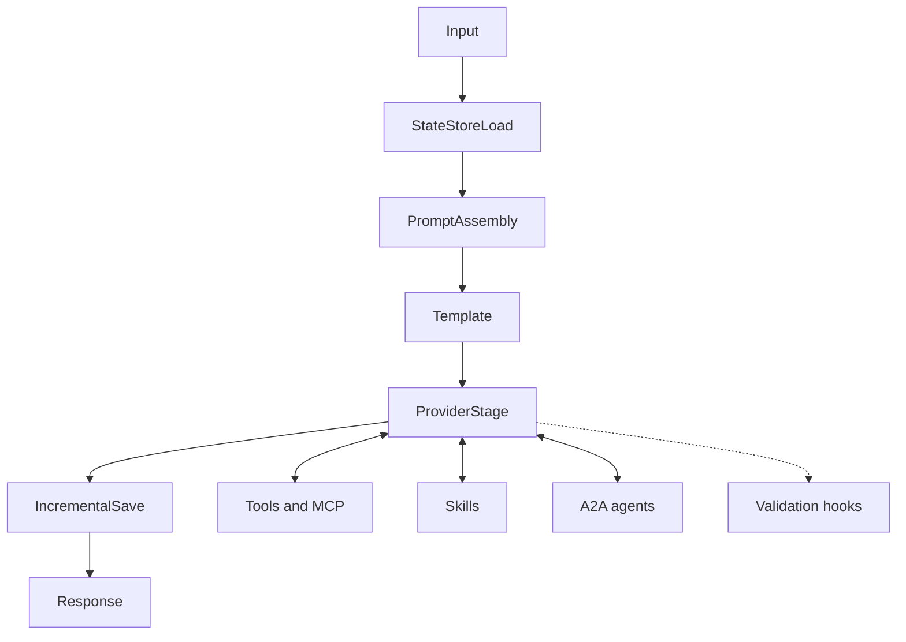

The concept pages explain what each PromptKit building block is and why it exists. They apply to the runtime, the SDK, PromptArena and PackC alike.

## How the concepts fit together

The runtime pipeline runs a request through a fixed sequence of stages. Each concept below maps to one of them or sits beside them.

`StateStoreLoad` and `IncrementalSave` implement [state management](/concepts/state-management/). `PromptAssembly` and `Template` build the [prompt](/concepts/prompts/) from a [template](/concepts/templates/). `ProviderStage` calls the [provider](/concepts/providers/) and runs the [validation](/concepts/validation/) hooks. The [architecture overview](/architecture/index/) covers the stages in detail.

## Concept pages

| Page | Covers |
|------|--------|
| [Prompts](/concepts/prompts/) | What a prompt is, how messages and roles work, and how PromptKit manages prompts. |
| [Templates](/concepts/templates/) | Variable substitution and template management. |
| [Providers](/concepts/providers/) | How PromptKit abstracts LLM providers, and multi-provider strategies. |
| [Validation](/concepts/validation/) | Content validation, guardrails and safety measures. |
| [State Management](/concepts/state-management/) | Conversation state, sessions and persistence. |
| [Tools & MCP](/concepts/tools-mcp/) | Function calling, tool integration and the Model Context Protocol. |
| [A2A (Agent-to-Agent)](/concepts/a2a/) | Inter-agent communication, the task lifecycle and discovery. |
| [AG-UI](/concepts/ag-ui/) | How the AG-UI protocol connects agents to frontend applications. |
| [Skills](/concepts/skills/) | Demand-driven knowledge loading with progressive disclosure and three-level tool scoping. |
| [Governance](/concepts/governance/) | Who is accountable for an agent, how autonomously it acts, and what its tools can affect. |
| [Workflow Compositions](/concepts/compositions/) | Declarative step graphs that replace LLM-driven orchestration for a workflow state. |

## Learning paths

If you are new to PromptKit, read in this order:

1. [Prompts](/concepts/prompts/)
2. [Providers](/concepts/providers/)
3. [Templates](/concepts/templates/)
4. [State Management](/concepts/state-management/)

If you are building a production application, read:

1. [Validation](/concepts/validation/)
2. [State Management](/concepts/state-management/)
3. [Tools & MCP](/concepts/tools-mcp/)
4. [Skills](/concepts/skills/)
5. [A2A](/concepts/a2a/)
6. [Providers](/concepts/providers/)

## Where concepts sit in the docs

Concept pages explain what things are and why they exist. [Reference](/runtime/reference/) pages describe the APIs, [how-to guides](/runtime/how-to/) accomplish tasks, and [tutorials](/runtime/tutorials/) teach step by step.

## Related

- [Architecture](/architecture/index/)
- [Glossary](/glossary/)
