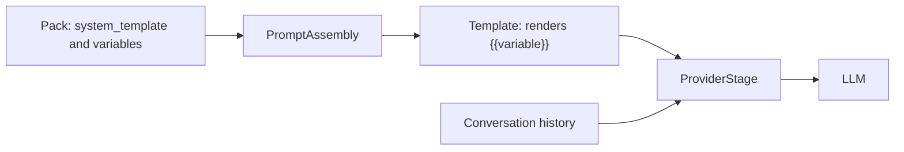

A prompt is the input you send to an LLM. It tells the model what to do and gives it the context to do it. This page explains the parts of a prompt, the techniques that improve one, and where each PromptKit component handles prompts.

## What a prompt contains

A prompt is a list of messages. Each message has a role:

| Role | Purpose |
|------|---------|
| `system` | Instructions that set the model's behavior |
| `user` | Input from the end user |
| `assistant` | Earlier model responses, kept for context |
| `tool` | Results from tool calls |

In the runtime, a message is a `types.Message` with `Role` and `Content` fields:

```go
messages := []types.Message{
    {Role: "system", Content: "You are a helpful assistant"},
    {Role: "user", Content: "Hello"},
    {Role: "assistant", Content: "Hi! How can I help?"},
    {Role: "user", Content: "What's 2+2?"},
}
```

### System prompts

The system prompt carries the instructions that apply to every turn. A specific one names the role, the constraints and the resources:

```
You are a customer support agent for TechCorp.

Guidelines:
- Be professional and empathetic
- Keep responses under 100 words
- Escalate complex issues to human agents
```

A vague one such as "Be helpful." leaves the model to guess the format, length and tone.

## Techniques that improve a prompt

### Clear instructions

State the task, the length and the content you expect. "Write a 3-sentence summary about Golden Retrievers, covering origin, temperament and typical uses" gives the model more to work with than "Write something about dogs."

### Few-shot examples

Examples show the model the pattern to follow:

```
Convert user questions to support ticket categories.

Q: "I can't log in" -> Category: Authentication
Q: "My credit card was declined" -> Category: Billing

Q: "I forgot my password" -> Category: ?
```

### Step-by-step reasoning

Asking the model to work through a problem in steps improves accuracy on arithmetic and multi-part questions.

### Role assignment

A role focuses the response: "You are an experienced software architect reviewing code. Focus on design patterns, scalability and maintainability."

## How PromptKit handles prompts

A pack stores each prompt as a `system_template` with declared variables. The runtime pipeline loads the prompt, renders the variables into the template, and sends the result to the provider along with the conversation history.



Variables use the `{{name}}` syntax. A pack prompt looks like this:

```json
{
  "id": "hello-example",
  "version": "1.0.0",
  "template_engine": { "version": "v1", "syntax": "{{variable}}" },
  "prompts": {
    "chat": {
      "id": "chat",
      "system_template": "You are a friendly assistant. The user's name is {{user_name}}.",
      "variables": [
        { "name": "user_name", "type": "string", "required": true }
      ]
    }
  }
}
```

### Runtime

The `template` package renders a template with a variable map. The renderer returns an error if a placeholder stays unresolved:

```go
text, err := template.NewRenderer().Render(
    "You are a support agent for {{company}}.",
    map[string]string{"company": "TechCorp"},
)
```

See [Templates](/concepts/templates/) for how templates are structured.

### SDK

`sdk.Open` loads a pack and returns a conversation for one of its prompts:

```go
conv, err := sdk.Open("./assistant.pack.json", "chat",
    sdk.WithModel("gpt-5-mini"),
)
if err != nil {
    log.Fatal(err)
}
defer conv.Close()

resp, err := conv.Send(ctx, "Hello")
fmt.Println(resp.Text())
```

### PackC

PackC compiles prompt configurations into a pack file:

```bash
packc compile --config arena.yaml --output support.pack.json --id support
```

The runtime loads the result with `prompt.LoadPack`:

```go
pack, err := prompt.LoadPack("support.pack.json")
```

### PromptArena

PromptArena tests prompts with scenarios. Each turn can carry assertions on the response:

```yaml
spec:
  task_type: assistant
  turns:
    - role: user
      content: "How do I reset my password?"
      assertions:
        - type: content_includes
          params:
            patterns:
              - "password reset"
```

## Prompt lifecycle

Store prompts in version control and give each a meaningful name. Test them with PromptArena, including edge cases, and compare variations before changing a production prompt. In production, load prompts from compiled packs, use variables for the parts that change per request, and version the pack.

## Fixing common problems

| Problem | Fix |
|---------|-----|
| Inconsistent responses | Add specific instructions and examples. |
| Wrong output format | State the exact format, for example `{"items": ["item1", "item2"]}`. |
| Ignored instructions | Move the instruction to the system prompt and state it once, clearly. |
| Responses too long | Set a length limit, for example "Answer in exactly 2 sentences." |

## Related

- [Templates](/concepts/templates/)
- [Validation](/concepts/validation/)
- [PackC](https://promptarena.altairalabs.ai/packc/)
