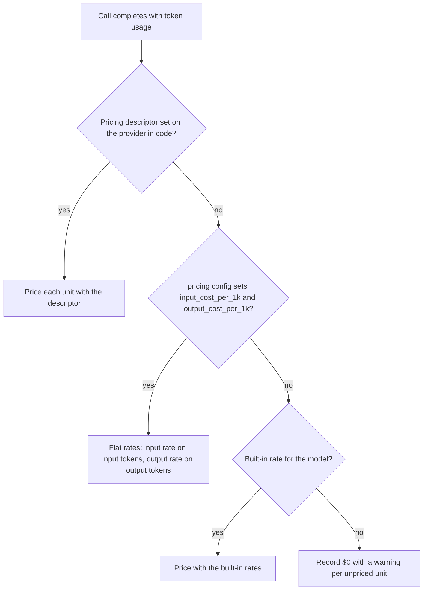

This page explains what a provider is in PromptKit, why the runtime puts every provider behind one interface, and how credentials and call costs are resolved.

## What is a Provider?

A **provider** is an LLM service (OpenAI, Anthropic, Google) that generates text responses. PromptKit abstracts providers behind a common interface.

## Supported Providers

The chat provider types are `openai`, `claude`, `gemini`, `ollama` and `vllm`. The first three call vendor APIs. `ollama` and `vllm` call servers you run yourself. `mock` returns canned responses and `replay` replays a recorded session, both for tests, and `imagen` generates images. For the models each type serves, and how to configure it, see [Set up providers](/runtime/how-to/providers/setup-providers/).

## Provider Roles

A provider's `role:` field is optional and defaults to `llm`. It tells the runtime which interface the provider implements:

- `llm` is the default role: chat completion via `Predict()`. The matrix of
  agents-under-test in arena scenarios is built from these.
- `tts` is text-to-speech via `Synthesize()`.
- `stt` is speech-to-text via `Transcribe()`.
- `embedding` is vector embeddings via `Embed()`.
- `image` is image generation; Predict-compatible, so eligible for the
  arena matrix alongside `llm`.
- `rerank` orders documents by relevance to a query via `Rerank()`. Types:
  `cohere` and `voyageai`.
- `inference` is non-LLM classification through one interface,
  `inference.Provider`: content in, a probability per label out. It powers
  checks like `audio_emotion`, `text_toxicity` and `topic_policy`. Types:
  `huggingface`, `openai` (logprobs), `systemone` (Jev) and
  `nvidia-topic-control`; see
  [Inference Providers](https://promptarena.altairalabs.ai/arena/how-to/configure-providers/#inference-providers-audio--text--image-classification--embedding)
  in the configure-providers how-to.

Providers route into role-specific registries at load time. An inference
backend implements the single `inference.Provider` interface and serves several
tasks by looking at the content of each request. The HuggingFace inference
backend, for example, is one `inference.Provider` that handles candidate-label,
audio and image classification. Embeddings come from a separate provider under
`role: embedding`.

## Platform Support

PromptKit runs models on cloud hyperscaler platforms in addition to direct API access. The platform route reaches the same models through the cloud's own authentication, so you hold no vendor API key.

AWS Bedrock authenticates through the AWS SDK credential chain (IRSA, IAM roles, `AWS_*` environment variables). It serves Claude models and OpenAI-shaped models. A `gemini` provider on Bedrock is rejected.

Google Cloud Vertex AI authenticates through GCP Application Default Credentials (Workload Identity, service accounts, `GOOGLE_APPLICATION_CREDENTIALS`). It serves Claude and Gemini models, and OpenAI-type models through Model Garden.

Azure AI Foundry authenticates through the Azure default credential chain (managed identity, service principals via `AZURE_*` environment variables, the Azure CLI). It serves OpenAI models and Claude models. A `gemini` provider on Azure is rejected.

## Why Provider Abstraction?

Each vendor ships a different API:

```go
// OpenAI specific
openai.CreateChatCompletion(...)

// Claude specific
anthropic.Messages(...)

// Gemini specific
genai.GenerateContent(...)
```

PromptKit gives them one interface instead:

```go
// Works with any provider
var provider providers.Provider
response, err := provider.Predict(ctx, req)
```

Code written against `providers.Provider` changes provider by changing the value behind the interface. The interface, its request and response types and its errors are documented in the [Provider reference](/runtime/reference/providers/). For the steps to create a provider and call it, see [Set up providers](/runtime/how-to/providers/setup-providers/).

## Credential Configuration

A provider's credential resolves through a chain, so that an explicit setting beats an implicit one and a deployment can choose where secrets live. The chain tries, in order, `api_key` (an explicit key in configuration), `credential_file` (a key read from a file path), `credential_env` (a key read from a named environment variable), and finally the default environment variables for the provider type, such as `OPENAI_API_KEY` and `ANTHROPIC_API_KEY`.

Each step suits a different deployment. A file path fits secrets mounted by an orchestrator. A named environment variable lets two providers of the same type, such as `openai-prod` and `openai-dev`, use different keys. An inline `api_key` suits local experiments and not production configuration. For the credential fields and YAML examples, see the [runtime config reference](/sdk/reference/runtime-config/).

For cloud platforms, credentials come from the platform's SDK credential chain instead of a key. A provider selects a platform with a `platform` block whose `type` is `bedrock`, `vertex` or `azure`, and whose `region` names the cloud region. Vertex also takes a `project`. Azure takes an `endpoint`, and the same field carries a Model Garden endpoint ID for an OpenAI-type provider on Vertex.

## Provider Configuration

### Temperature

Temperature controls how random the model's output is. Lower values make output more focused and higher values make it more varied.

PromptKit has no temperature default of its own. A `PredictionRequest` with a `Temperature` of 0 counts as unset unless `TemperatureSet` is true, and the provider then substitutes `ProviderDefaults.Temperature`, whose zero value is 0. Claude omits the field in that case and the API applies its own default. Providers that the SDK builds itself default to 0.7. To send a temperature of 0, set `TemperatureSet: true`. Even then the vendor APIs do not guarantee identical output from identical input.

### Max Tokens

Max tokens limits the length of the output. A request with `MaxTokens` at zero uses the provider's `Defaults.MaxTokens`. When that is zero or `providers.MaxTokensUnlimited`, the provider sends no limit and the model's own maximum applies. Claude requires a limit, so it sends 4096 instead and rejects `MaxTokensUnlimited` when the provider is created.

The remaining request fields are listed in the [Provider reference](/runtime/reference/providers/).

## Multi-Provider Strategies

Because every provider shares one interface, strategies that span providers are ordinary Go code: fall back to a second provider when the first fails, spread requests across several, or pick a model by the task. [Set up providers](/runtime/how-to/providers/setup-providers/) implements fallback and model selection by task.

## How Calls Are Priced

A provider records what each call cost as a `CostInfo`: the tokens used by
unit (input, cached input, output and reasoning, plus audio, image and video
where the provider reports them apart) and the dollar cost of each unit.

The diagram shows how Claude, OpenAI and Gemini resolve a call's rates.



Claude, OpenAI and Gemini use the first of these that covers the model:

- A pricing descriptor set on the provider in code.
- The provider's `pricing` config, used when both `input_cost_per_1k` and `output_cost_per_1k` are set. It applies one input rate and one output rate to every input and output token, whatever its modality (text, audio, image or video), and prices reasoning tokens at the output rate. Cached tokens get no rate, so they are recorded unpriced with a warning.
- The built-in rates for the model. These are a fallback. Each entry records the date it was checked against the vendor's price list, and vendors change prices without notice.

A model with none of these is recorded at $0, and a warning names each unpriced unit, once per unit. vLLM has no built-in rates, so it prices from config only and records $0 without a warning when the config is absent.

Set `pricing` when cost feeds billing or a budget, and always when you pay
negotiated or regional rates. For current list prices, see the vendors' pages:
[OpenAI](https://platform.openai.com/docs/pricing),
[Anthropic](https://platform.claude.com/docs/en/about-claude/pricing) and
[Google](https://aistudio.google.com/docs/pricing). To track the cost of calls as they happen, see [Monitor costs](/runtime/how-to/observability/monitor-costs/).

## Testing with Providers

The mock provider makes no API calls, so tests that use it run fast, return predictable responses and work offline. It does not exercise a vendor's behavior, so keep a small set of tests against real providers. For the mock provider's setup, see [Set up providers](/runtime/how-to/providers/setup-providers/).

## Operating Providers

A provider holds an HTTP client and its connections, so create one per provider configuration and reuse it across requests rather than creating one per request. Closing providers, handling provider errors and setting timeouts around `Predict` are covered in [Set up providers](/runtime/how-to/providers/setup-providers/). The sentinel errors are listed in the [Provider reference](/runtime/reference/providers/).

## Related Documentation

- [Provider System Explanation](/runtime/explanation/provider-system/) - Architecture details
- [Provider Reference](/runtime/reference/providers/) - API documentation
- [Cloud Provider Examples](https://promptarena.altairalabs.ai/arena/examples/) - Bedrock, Vertex, Azure examples
- [Set up providers](/runtime/how-to/providers/setup-providers/) - Implementation guide, including fallback and mocks
- [Monitor costs](/runtime/how-to/observability/monitor-costs/) - Track expenses
