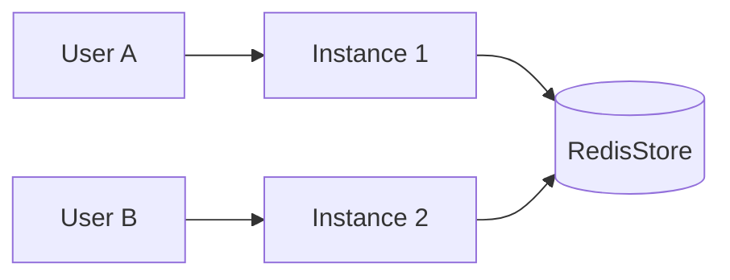

State management keeps conversation history across turns so the model can use what was said earlier.

## Why state exists

LLM calls are stateless. A model answers "What about Germany?" correctly only when the request also carries the earlier question about France and its answer. PromptKit keeps that history, loads it before each turn, and appends the new messages afterward.

State gives you:

- **Context**: the model sees earlier turns.
- **Continuity**: a conversation survives across `Send` calls and, with a durable store, across process restarts.
- **Isolation**: each conversation has its own history, keyed by conversation ID.

## Conversations and IDs

Each conversation has an ID. The SDK generates one, or you set it with `sdk.WithConversationID`. State is saved to the state store you pass with `sdk.WithStateStore`, and `sdk.Resume` reopens a stored conversation by ID.

```go
store := statestore.NewMemoryStore()

conv, err := sdk.Open("./assistant.pack.json", "chat",
    sdk.WithModel("gpt-4o-mini"),
    sdk.WithStateStore(store),
    sdk.WithConversationID("user-123-conv-1"),
)
if err != nil {
    log.Fatal(err)
}
defer conv.Close()

if _, err := conv.Send(ctx, "Hello"); err != nil {
    log.Fatal(err)
}

// Later: reopen the same conversation.
conv, err = sdk.Resume("user-123-conv-1", "./assistant.pack.json", "chat",
    sdk.WithModel("gpt-4o-mini"),
    sdk.WithStateStore(store),
)
```

Without a state store, each `Open` creates a private in-memory store. Turns accumulate within that `Conversation`, but a second `Open` with the same ID starts an empty conversation. `Resume` returns `sdk.ErrNoStateStore` when you pass no store.

## The Store interface

`statestore.Store` has two methods:

| Method | Purpose |
|--------|---------|
| `Load(ctx, id)` | Returns the `*ConversationState` for an ID, or `statestore.ErrNotFound`. |
| `Fork(ctx, sourceID, newID)` | Copies a conversation to a new ID and leaves the original unchanged. |

Writes go through optional interfaces that a store implements: `BulkWriter.Save` replaces a whole state, and `MessageAppender`, `MetadataAccessor`, `SummaryAccessor` and `ListAccessor` write incrementally. Both built-in stores implement all of them.

```go
state, err := store.Load(ctx, "user-123-conv-1")
if errors.Is(err, statestore.ErrNotFound) {
    // No such conversation.
}

err = store.Fork(ctx, "user-123-conv-1", "user-123-conv-1-branch")
```

## State stores

### In-memory store

```go
store := statestore.NewMemoryStore()
```

The memory store is fast and thread-safe, and its contents are lost when the process exits. It serves one instance only. By default it expires conversations one hour after last use (`statestore.DefaultTTL`) and holds at most 10,000 (`statestore.DefaultMaxEntries`), evicting the least recently used. Use `statestore.WithMemoryTTL`, `statestore.WithNoTTL`, `statestore.WithMemoryMaxEntries` and `statestore.WithNoMaxEntries` to change these limits.

It suits development, testing, and demos.

### Redis store

```go
redisClient := redis.NewClient(&redis.Options{
    Addr: "localhost:6379",
})
store := statestore.NewRedisStore(redisClient,
    statestore.WithTTL(24*time.Hour),
    statestore.WithPrefix("myapp"),
)
```

The Redis store persists conversations, lets several instances share them, and expires idle conversations. The TTL defaults to 24 hours (`0` disables expiry) and the key prefix defaults to `promptkit`. Reading a conversation extends its TTL.

It suits production and distributed deployments.

## Limiting history size

A long history costs tokens and latency. Three options bound what the model sees:

| Option | Effect |
|--------|--------|
| `sdk.WithContextWindow(n)` | Loads only the most recent `n` messages from the store each turn. Requires a state store. |
| `sdk.WithTokenBudget(tokens)` | Truncates history when prompt plus history exceeds the budget. |
| `sdk.WithTruncation(strategy)` | Picks how truncation works: `"sliding"` (default), `"summarize"`, or `"relevance"`. |

```go
conv, _ := sdk.Open("./assistant.pack.json", "chat",
    sdk.WithStateStore(store),
    sdk.WithContextWindow(20),
)
```

## Session ID patterns

How you build conversation IDs decides what a conversation means.

| Pattern | Example | Use case |
|---------|---------|----------|
| One per user | `fmt.Sprintf("user-%s", userID)` | A single ongoing conversation per user |
| Several per user | `fmt.Sprintf("user-%s-conv-%s", userID, conversationID)` | A user can start multiple conversations |
| Anonymous | `uuid.New().String()` | Guest users with no account |

## Scaling across instances

A shared Redis store lets any instance serve any conversation: the instance loads the history for the ID it receives.



Shared state gives you high availability and horizontal scaling. A memory store holds state in one process, so route a conversation to the same instance every time if you use one.

## Workflow state

A workflow adds a state machine on top of conversation state. Each workflow tracks:

- The current state.
- The transition history, with timestamps.
- A separate conversation for each state. A transition closes the current conversation and opens one for the destination state's `prompt_task`.

A state's `skills` field limits which skills that state's conversation can activate. The SDK applies it each time it opens a conversation for a state: on open, on resume, and after a transition. [Skills](/concepts/skills/) covers the filter.

### Persistence per state

A workflow state can opt out of persistence with `persistence`:

```json
{
  "states": {
    "intake": {
      "prompt_task": "greeting",
      "persistence": "transient"
    },
    "specialist": {
      "prompt_task": "specialist",
      "persistence": "persistent"
    }
  }
}
```

- `transient`: the SDK does not write the workflow context to the store while the workflow is in this state.
- `persistent`: the SDK writes the workflow context to the store (also the behavior when `persistence` is absent).

### Who speaks after a transition

A state declares who holds the turn once the workflow enters it with `control`:

```json
{
  "states": {
    "route": {
      "prompt_task": "classify",
      "control": "agent"
    },
    "confirm": {
      "prompt_task": "confirm_order",
      "control": "user"
    }
  }
}
```

- `agent`: take another round in this state without yielding. Use it for routing and processing states that should not stop mid-task.
- `user`: end the turn and wait for the user.

:::note[Absent `control` means `agent`]
The PromptPack specification defaults `control` to `user`. PromptKit treats an absent `control` as `agent`, so routing states in packs that never declared the field keep running on. A declared `control` follows the specification exactly. Declare `control` explicitly on any state where turn-taking matters.
:::

Validation warns about two combinations. `control: agent` on a terminal state has no effect, because the workflow ends there. A cycle of `control: agent` states with no state that yields to the user, no terminal state, no `max_visits`, and no `engine.budget` limit on total visits or wall time runs until the tool loop's round cap stops it.

### Workflow context

`workflow.Context` captures the machine state for persistence and resumption. The workflow ID is the conversation ID. `sdk.ResumeWorkflow` restores a workflow from a state store, so pass the same store you used when opening it:

```go
wf, _ := sdk.OpenWorkflow("./support.pack.json",
    sdk.WithStateStore(store),
    sdk.WithConversationID("workflow-id"),
)

// ... interact with the workflow ...

wfCtx := wf.Context()
fmt.Println(wfCtx.CurrentState) // "specialist"
fmt.Println(len(wfCtx.History)) // number of transitions

// Resume later.
wf, _ = sdk.ResumeWorkflow("workflow-id", "./support.pack.json",
    sdk.WithStateStore(store),
)
```

### Context carry-forward

`sdk.WithContextCarryForward()` injects a summary of the previous state's conversation into the next state. The summary arrives in the `{{workflow_context}}` template variable, so the next state's prompt must reference that variable to use it. Without the option, each state starts a fresh conversation.

```go
wf, _ := sdk.OpenWorkflow("./support.pack.json",
    sdk.WithContextCarryForward(),
)
```

## Related

- [State Management Explanation](/runtime/explanation/state-management) covers the architecture.
- [Manage State How-To](/runtime/how-to/state/manage-state) walks through implementation.
- [Multi-turn Tutorial](/runtime/tutorials/02-multi-turn) is a step-by-step guide.
- [StateStore Reference](/runtime/reference/statestore) documents the API.
