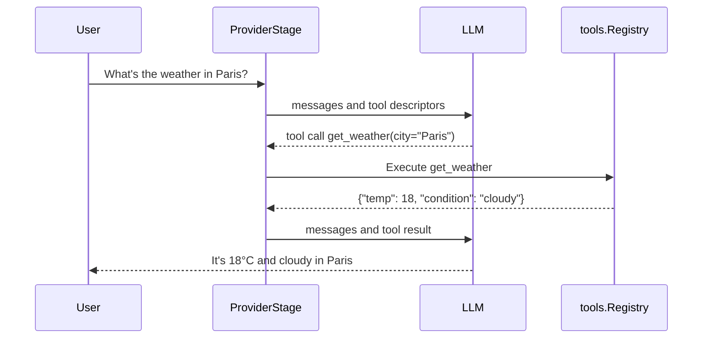
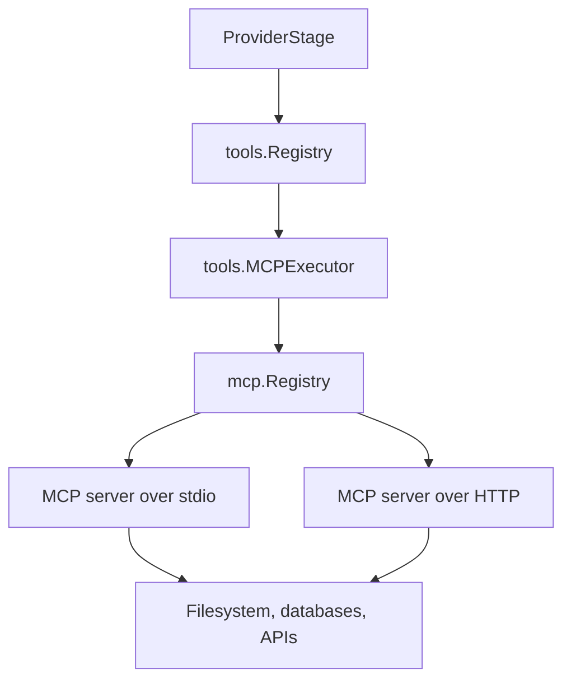
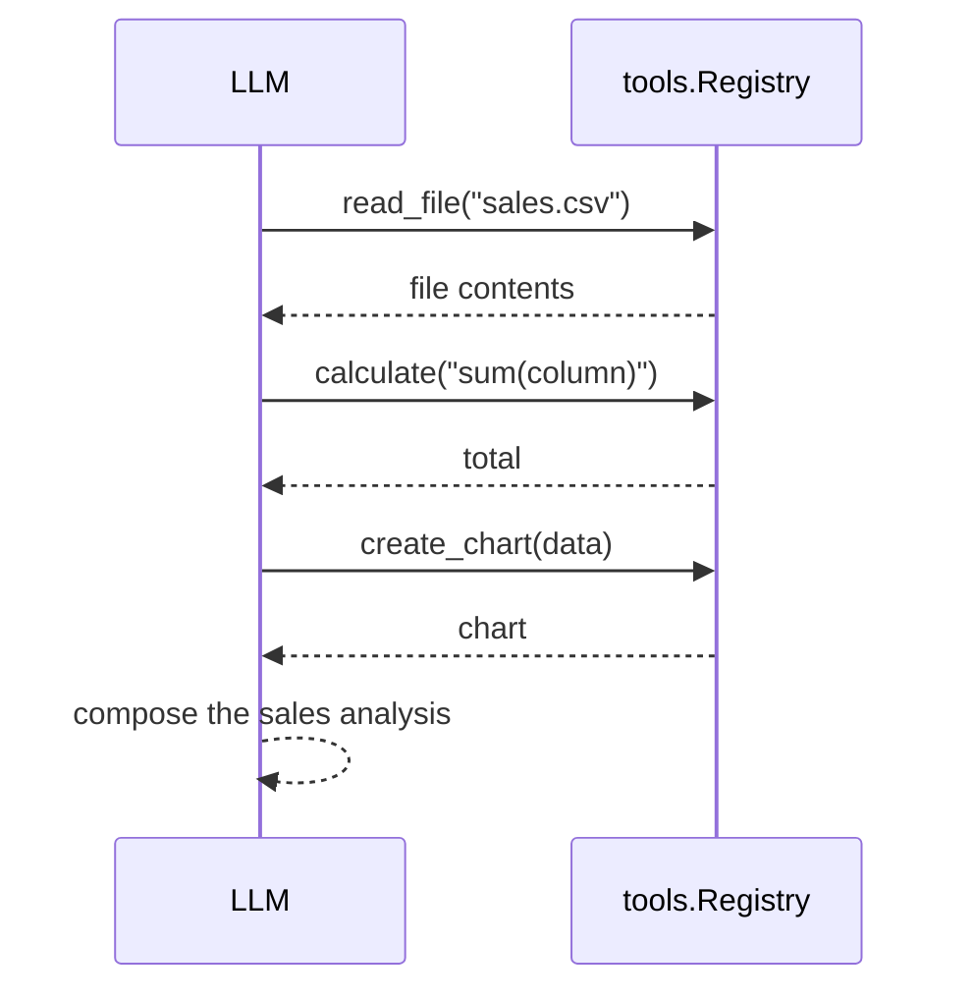

Tools let a model call code you write. MCP lets it call code that runs in another process.

## What are Tools?

A tool, also called a function call, is a function the model can ask the runtime to run. Tools let the model query a database, call an API, take an action such as sending an email, or compute a result with code instead of reasoning about it.

The model never runs the function. It emits a tool call with arguments, the runtime executes the matching tool, and the result goes back to the model as the next message.

## How Tools Work

The runtime describes the available tools to the model, the model decides whether to call one, the runtime executes it, and the model answers with the result in context.



Each pass through "model, tool, model" is one round. The provider stage repeats rounds until the model answers without calling a tool or a limit stops the turn.

## Tools in PromptKit

### Define Tools

A `tools.ToolDescriptor` gives the model a name, a description and a JSON Schema for the arguments. `Mode` names the executor that runs the tool.

```go
import (
    "encoding/json"

    "github.com/AltairaLabs/PromptKit/runtime/v2/tools"
)

weatherTool := &tools.ToolDescriptor{
    Name:        "get_weather",
    Description: "Get current weather for a city",
    Mode:        "weather", // the Name() of the executor below
    InputSchema: json.RawMessage(`{
        "type": "object",
        "properties": {
            "city": {
                "type": "string",
                "description": "City name"
            }
        },
        "required": ["city"]
    }`),
}
```

### Implement Executor

An executor implements `tools.Executor`. It receives the descriptor and the raw JSON arguments, and returns raw JSON.

```go
type WeatherExecutor struct{}

func (e *WeatherExecutor) Name() string {
    return "weather"
}

func (e *WeatherExecutor) Execute(
    ctx context.Context, descriptor *tools.ToolDescriptor, args json.RawMessage,
) (json.RawMessage, error) {
    var params struct {
        City string `json:"city"`
    }
    if err := json.Unmarshal(args, &params); err != nil {
        return nil, fmt.Errorf("invalid arguments: %w", err)
    }

    weather := getWeather(params.City)
    return json.Marshal(map[string]any{
        "temp":      weather.Temp,
        "condition": weather.Condition,
    })
}
```

### Register Tools

The registry routes a call to the executor whose `Name()` equals the descriptor's `Mode`. A descriptor with an empty `Mode` runs as a mock tool.

```go
registry := tools.NewRegistry()
registry.RegisterExecutor(&WeatherExecutor{})
if err := registry.Register(weatherTool); err != nil {
    log.Fatal(err)
}
```

## Limiting Tool Use

A prompt's `tool_policy` in the pack limits how it uses tools in one turn:

```json
"prompts": {
  "builder": {
    "tools": ["catalog_overview", "write_file", "delete_kit"],
    "tool_policy": {
      "max_rounds": 200,
      "max_tool_calls_per_turn": 400,
      "tool_choice": "auto",
      "blocklist": ["delete_kit"]
    }
  }
}
```

- `max_rounds`: how many LLM → tool → LLM cycles one turn may take. Defaults to 50. A turn that still wants tools at the limit fails with `provider stage: max rounds (N) exceeded`. The error matches `stage.ErrMaxRoundsExceeded` with `errors.Is`, and `errors.As` with `*stage.MaxRoundsError` gives the limit, so a host can tell it apart from other failures without matching the message.
- `max_tool_calls_per_turn`: how many tool calls one turn may run, across all its rounds. A call over the limit is not run; the model gets an error result for it, and the next round offers no tools, so the model answers.
- `tool_choice`: `auto`, `required` or `none`. With `none`, no tools are sent.
- `blocklist`: tools this prompt may not run, even when listed in `tools`.

`tool_policy` can only be set on a prompt. There is no pack-level `tool_policy`. These four keys are the whole of it. Schema validation rejects any other key. With `sdk.WithSkipSchemaValidation` the key is ignored, and the load logs a warning that names the prompt and the key.

### Limits the host sets

`sdk.WithToolPolicy` sets a `pipeline.ToolPolicy` from Go. It applies to every tool loop the conversation runs: text, voice in VAD mode, each workflow state, and each step of a composition. A realtime duplex session (`OpenDuplex` with a provider that streams audio itself) runs its tool calls outside the tool loop, so the policy does not apply there. It carries the limits a pack cannot declare:

```go
conv, err := sdk.Open("./app.pack.json", "builder",
    sdk.WithToolPolicy(&pipeline.ToolPolicy{
        MaxCallsPerMinute:     30,
        MaxCostUSD:            1.50,
        MaxIdenticalToolCalls: 2,
        MaxParallelToolCalls:  4,
    }),
)
```

- `MaxCallsPerMinute`: how many times each tool may run in any one-minute window of a conversation. The window spans the conversation's turns, a composition's steps, and every state of a workflow. Each call takes a slot when the model makes it:
  - If the calls that ran in the last minute plus the calls still waiting already reach the limit, the call is refused at once. It is not run and not put to a human, and the model gets a result saying the tool's limit is reached.
  - A call that runs keeps its slot for one minute from when it ran.
  - A call held for approval, or a client tool waiting for its result, keeps its slot while it waits. Approving it with `ResolveTool`, or answering it with `SendToolResult` or `FailClientTool`, starts its minute. Rejecting it with `RejectTool` or `RejectClientTool` gives the slot back. An answer takes effect when `Resume` or `Continue` sends it on, or when a new `Send` moves on from the waiting turn.
  - A waiting call that is never answered gives its slot back after five minutes, the default time a held call stays pending. A call approved after that still counts.
- `MaxCostUSD`: the spend a tool loop may reach, counting the cost recorded on the history it is given. In a conversation, that history is the earlier turns, so the budget spans them. A composition step is given only its own input, so each step has the full budget. The round that crosses it fails the turn with `provider stage: cost budget exceeded`.
- `MaxIdenticalToolCalls`: how many times the same call with the same arguments may run before the model is told to change course. Defaults to 3.
- `MaxParallelToolCalls`: how many of one round's calls run at once. Defaults to 10.
- `StopOnTool`: the loop ends after the round that calls this tool.

`MaxRounds`, `MaxToolCallsPerTurn`, `ToolChoice` and `Blocklist` can be set here too. For those, the turn runs under both this policy and the prompt's `tool_policy`:

| Field | Result |
|---|---|
| `MaxRounds`, `MaxToolCallsPerTurn` | The lower of the two values that are set. Either side can tighten the limit; neither can loosen it. |
| `Blocklist` | Both lists. |
| `ToolChoice` | The host's when set, otherwise the prompt's. |
| Every other field | The host's. |

In a composition, an agent step's `termination.max_steps` narrows `MaxRounds` the same way, and its `termination.tool_called` replaces `StopOnTool` for that step. A prompt step always runs one round.

### How other limits combine with it

Three other limits can apply, and they work differently:

- A composition agent step's `termination.max_steps` bounds the LLM-tool loop of that one step, counted in the same rounds as `max_rounds`. The step stops at the lower of `max_steps` and its prompt's `max_rounds`.
- `workflow.engine.budget` (`max_tool_calls`, `max_total_visits`, `max_wall_time_sec`) and a state's `max_visits` bound the whole workflow run, across states and turns. They apply on top: each turn is still bounded by its prompt's `tool_policy`.
- Limits a host sets in code (`sdk.WithToolPolicy`, or the policy a test harness passes to the provider stage) combine with the prompt's as the table above shows.

`max_steps` limits rounds inside one step, not how many steps run. A composition's steps form an acyclic graph, so no step runs twice. To loop, use workflow states with `max_visits`.

## Model Context Protocol (MCP)

MCP is a standard protocol for connecting an LLM application to external tool servers.

### What is MCP?

MCP gives you:

- A standard interface: a server written once serves any MCP client.
- Tool discovery: the client asks each server which tools it offers.
- Composability: one application connects to several servers at once.

A server runs in its own process or on another host. PromptKit does not sandbox it, so a server has the access of the process that runs it.

### MCP Architecture

The runtime routes calls to tools with `mode: mcp` through the MCP executor, which uses the MCP registry to reach the server that owns the tool.



## MCP in PromptKit

### Connect in Code

A `mcp.ServerConfig` with `Command` makes PromptKit spawn the server as a subprocess and talk to it over stdio. A config with `URL` connects to an HTTP server instead.

```go
import "github.com/AltairaLabs/PromptKit/runtime/v2/mcp"

// Create MCP registry with server configuration
mcpRegistry := mcp.NewRegistry()
defer mcpRegistry.Close()

err := mcpRegistry.RegisterServer(mcp.ServerConfig{
    Name:    "filesystem",
    Command: "npx",
    Args:    []string{"-y", "@modelcontextprotocol/server-filesystem", "/path/to/files"},
})
if err != nil {
    log.Fatal(err)
}

// Discover tools from all registered servers
ctx := context.Background()
serverTools, err := mcpRegistry.ListAllTools(ctx)
if err != nil {
    log.Fatal(err)
}
```

## Common Tools

Most tools fall into a few kinds: file operations (`read_file`, `write_file`, `list_directory`), database queries, HTTP calls and calculations. Each is a descriptor with a narrow job and an input schema:

```go
dbTool := &tools.ToolDescriptor{
    Name:        "query_database",
    Description: "Execute a read-only SQL query",
    InputSchema: json.RawMessage(`{
        "type": "object",
        "properties": {
            "query": {"type": "string"}
        },
        "required": ["query"]
    }`),
}
```

## Tool Design Best Practices

### Clear Descriptions

The model chooses a tool from its description. A vague description leads to wrong or missed calls.

```go
// Bad
Description: "Gets stuff"

// Good
Description: "Get current weather for a specified city. Returns temperature in Celsius and current conditions."
```

### Detailed Parameters

Describe each parameter, constrain values with `enum`, and mark what is required.

```go
InputSchema: json.RawMessage(`{
    "type": "object",
    "properties": {
        "city": {
            "type": "string",
            "description": "City name (e.g., 'Paris', 'New York')"
        },
        "units": {
            "type": "string",
            "enum": ["celsius", "fahrenheit"],
            "description": "Temperature units",
            "default": "celsius"
        }
    },
    "required": ["city"]
}`)
```

### Error Handling

An executor returns an error for bad arguments and for failures in the work it does. Wrap errors so the cause stays visible.

```go
func (e *WeatherExecutor) Execute(
    ctx context.Context, descriptor *tools.ToolDescriptor, args json.RawMessage,
) (json.RawMessage, error) {
    var params struct {
        City string `json:"city"`
    }
    if err := json.Unmarshal(args, &params); err != nil {
        return nil, fmt.Errorf("invalid arguments: %w", err)
    }
    if params.City == "" {
        return nil, errors.New("city is required")
    }

    weather, err := api.GetWeather(params.City)
    if err != nil {
        return nil, fmt.Errorf("failed to get weather: %w", err)
    }

    return json.Marshal(weather)
}
```

### Security

Arguments come from a model, so treat them as untrusted input.

- Validate arguments before using them, and reject values outside the expected set.
- Limit what the tool can reach, for example by checking paths against an allowed list.
- Bound the work with a timeout on the context.
- Return only the data the model needs. Keep secrets such as API keys out of results.

```go
ctx, cancel := context.WithTimeout(ctx, 5*time.Second)
defer cancel()

if !isValidCity(params.City) {
    return nil, errors.New("invalid city name")
}
```

## Testing Tools

An executor is an ordinary Go type, so test it directly:

```go
func TestWeatherExecutor(t *testing.T) {
    executor := &WeatherExecutor{}
    descriptor := &tools.ToolDescriptor{Name: "get_weather", Mode: "weather"}

    result, err := executor.Execute(
        context.Background(), descriptor, json.RawMessage(`{"city": "Paris"}`),
    )
    assert.NoError(t, err)
    assert.Contains(t, string(result), "temp")
}
```

## Monitoring Tools

The runtime emits `tool.call.started`, `tool.call.completed` and `tool.call.failed` events for each call. Subscribe to them to count calls, errors and latency per tool. See [Runtime Events](/architecture/runtime-events/) for the event model.

## Common Patterns

### Tool Chaining

The model can call several tools across rounds, each result informing the next call.



### Conditional Tools

Register a tool only when the caller should have it:

```go
if userTier == "premium" {
    if err := registry.Register(advancedAnalyticsTool); err != nil {
        log.Fatal(err)
    }
}
```

### Cached Tools

Wrap an executor to cache results by tool name and arguments:

```go
type CachedExecutor struct {
    inner tools.Executor
    cache map[string]json.RawMessage
}

func (e *CachedExecutor) Name() string { return e.inner.Name() }

func (e *CachedExecutor) Execute(
    ctx context.Context, descriptor *tools.ToolDescriptor, args json.RawMessage,
) (json.RawMessage, error) {
    key := getCacheKey(descriptor.Name, args)
    if cached, ok := e.cache[key]; ok {
        return cached, nil
    }

    result, err := e.inner.Execute(ctx, descriptor, args)
    if err == nil {
        e.cache[key] = result
    }
    return result, err
}
```

A concurrent host guards the map with a mutex.

## Related Documentation

- [Integrate MCP](/runtime/how-to/tools/integrate-mcp) - MCP integration guide
- [MCP Tutorial](/runtime/tutorials/03-mcp-integration) - Step-by-step setup
- [Tools Reference](/runtime/reference/tools) - API documentation
- [MCP Reference](/runtime/reference/mcp) - API documentation
- [Runtime Tools Architecture](/architecture/runtime-tools-mcp/) - Technical details
