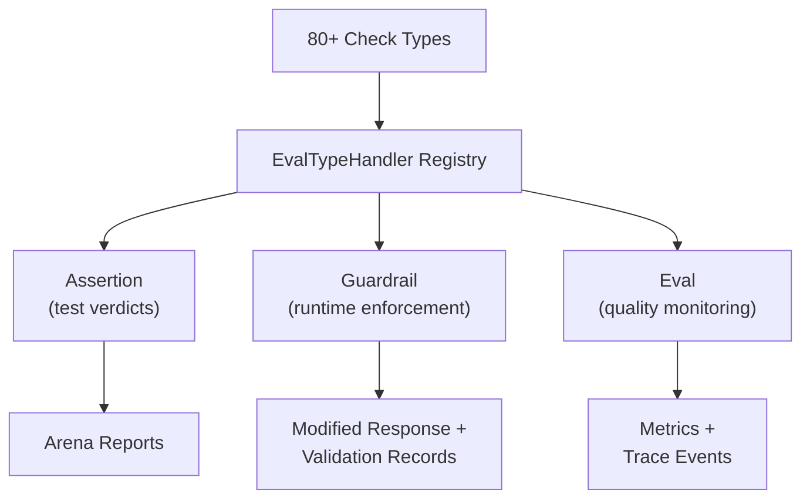

PromptKit has a single check system that serves three purposes: testing, runtime enforcement, and production monitoring. This page explains that unified model and when to use each surface.

## The Unified Check Model

PromptKit ships with more than 80 built-in check types (`contains`, `max_length`, `llm_judge`, `regex`, `banned_words`, and many more). Every check type can be used in three contexts, depending on where you configure it:

| Surface | Config Location | When It Runs | What It Does |
|---------|----------------|--------------|--------------|
| Assertion | Scenario YAML `assertions:` | After LLM generation, during testing | Produces pass/fail test verdicts |
| Guardrail | Pack YAML `validators:` | During LLM generation, at runtime | Enforces policies (truncate, replace, block) |
| Eval | Pack file `evals:` | Production + testing, configurable triggers | Produces scores (0.0–1.0) and records metrics |

Under the hood, all three paths share the same `EvalTypeHandler` registry. Eval handlers produce scores only (0.0–1.0) and never determine pass/fail. Assertions and guardrails are wrappers that add pass/fail judgment on top:

- Assertions wrap an eval handler in `AssertionEvalHandler`, which applies score thresholds (`min_score`, `max_score`) to determine pass/fail. Without explicit thresholds, a score of 1.0 passes. A pack eval of `type: assertion` or `type: guardrail` can instead declare the spec's `threshold: {operator, value}`, with `gte`, `gt`, `lte`, `lt` or `eq`; `gt` and `lt` are strict. Declaring both `threshold` and `min_score` or `max_score` is an error. On a plain eval, `threshold` is carried but not applied, because an eval states no verdict.
- Guardrails wrap an eval handler in `GuardrailEvalHandler`, which checks whether the score indicates a violation and enforces policy (truncate, replace, block).

You write a check once and deploy it wherever you need it. A `content_excludes` check works identically whether it is validating a test scenario, blocking banned words at runtime, or monitoring violations in production.

## Which Surface Should I Use?

To test LLM behavior in CI, use an assertion. Define checks in your scenario YAML under `assertions:`. They run only in Arena. Use `when:` for conditional checks and `pass_threshold` for statistical testing across multiple runs.

To enforce policies at runtime, use a guardrail. Define checks in your pack YAML under `validators:`. They run during every LLM call in production. Streaming-capable checks can abort early to save tokens. Guardrails always enforce: a triggered validator rewrites or blocks the message, and the `fail_on_violation` field has no effect. To switch a validator off, use `enabled: false`. For observe-only behavior, declare an eval and assert on it instead. Guardrails run before the LLM call, after it, or both, according to `direction`.

To monitor quality in production, use an eval. Define checks in your pack file under `evals:`. They travel with the pack and run based on configurable triggers. Results are exported as Prometheus metrics and trace events.

To get all three, use the same check type in all three configs. For example, configure `content_excludes` as a guardrail to block banned words at runtime, as an assertion to verify that blocking works in CI, and as an eval to track violation rates in production dashboards.

## Enforcement Behavior (Guardrails)

When a guardrail triggers, the pipeline does not return an error. What the message ends up
containing depends on `direction` and on the check type, and the round loop stops either
way. Only the provider work inside that turn's `ProviderStage` is affected; every
downstream pipeline stage still runs.

- Content blockers (`content_excludes`, `banned_words`): replace the entire response with a configurable policy message.
- Length checks (`max_length`, or any check carrying a `max_characters` / `max` /
  `max_chars` param): truncate the response to that character limit, when it is what the
  response exceeded.
- Every other case: replace the response with the policy message, the same as a content
  blocker. Guardrails always act; there is no log-only mode. If you want to record a
  violation without changing the response, declare an eval and assert on it instead.
- Input guardrails (`direction: input`): evaluated before the provider call. On a hit
  the call is never made (no tokens are spent), and the conversation returns a canned
  assistant turn. Its text is the validator's `message`, else the replacement text the check supplies (`topic_policy` does), else the default blocked message. Evaluated once
  per user turn, not once per tool round.
- Round termination: when a guardrail enforces, input or output, the round loop stops,
  so no further provider/tool rounds run for that turn. Any tool calls requested by an
  enforced output response are dropped rather than executed.

All violations are recorded in `message.Validations` and emitted as `validation.failed` events, regardless of enforcement mode.

## Extending the Check System

PromptKit's check system is extensible at multiple levels:

- Go handlers: Implement the `EvalTypeHandler` interface for custom check logic that runs in-process.
- Subprocess handlers: Define exec eval bindings in RuntimeConfig YAML to run checks written in Python, Node.js, or any language.
- External services: Use the `rest_eval` or `a2a_eval` check types to delegate evaluation to HTTP endpoints or A2A agents. Both return the service's score and reject `min_score` and `max_score` params; set the threshold on an `assertion` or `guardrail` wrapper.
- Custom guardrails: Implement the `ProviderHook` interface for runtime hooks that go beyond check types (e.g., ML-based content moderation with streaming abort).
- Custom LLM judges: Implement the `JudgeProvider` interface for specialized LLM evaluation logic.

See the [Checks Reference](/reference/checks/#extending-the-check-system) for implementation details and examples.

## Terminology

| Term | Meaning |
|------|---------|
| Check | Generic term for any evaluation, such as `contains`, `llm_judge`, or `max_length` |
| Assertion | A check used in an Arena test scenario to produce pass/fail verdicts |
| Guardrail | A check used as a runtime policy enforcer during LLM generation |
| Eval | A check used for production quality monitoring with metrics and triggers |
| Check type | The identifier for a check implementation (e.g., `contains`, `regex`, `banned_words`) |

:::note
These docs use "guardrail" for the runtime enforcement surface. The YAML key in pack files is `validators:`.
:::

## See Also

- [Checks Reference](/reference/checks/) -- All check types, parameters, and extensibility details
- [Write Assertions](https://promptarena.altairalabs.ai/arena/reference/assertions/) -- Using checks in Arena scenarios
- [Guardrails](https://promptarena.altairalabs.ai/arena/reference/validators/) -- Using checks as runtime guardrails
- [Eval Framework](https://promptarena.altairalabs.ai/arena/explanation/eval-framework/) -- Eval architecture, triggers, and metrics
- [Run Evals](/sdk/how-to/observability/run-evals/) -- Programmatic eval execution
- [Hooks & Guardrails](/runtime/reference/hooks/) -- Runtime hook system API
