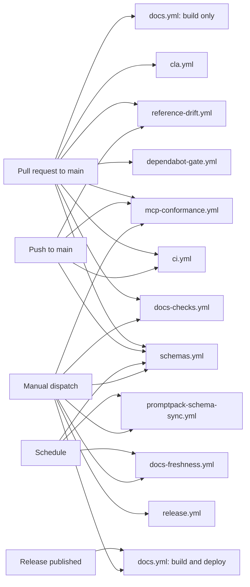
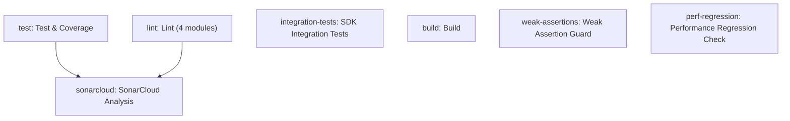
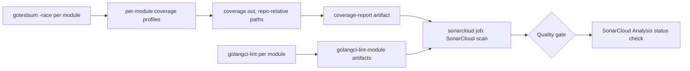
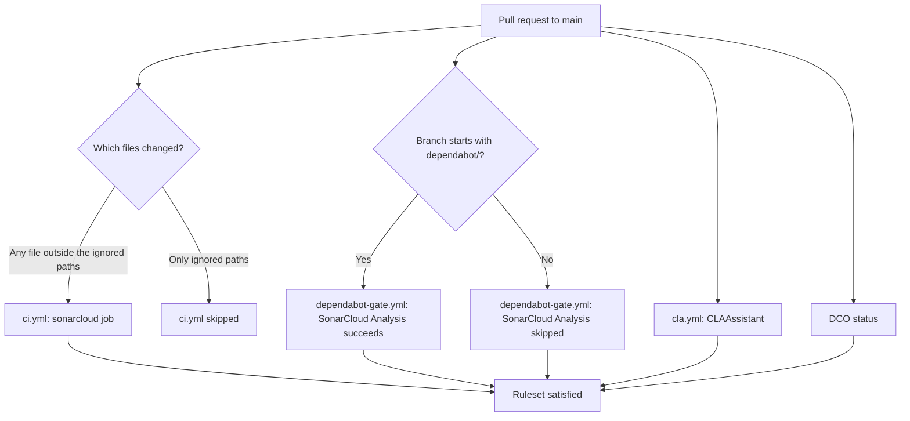
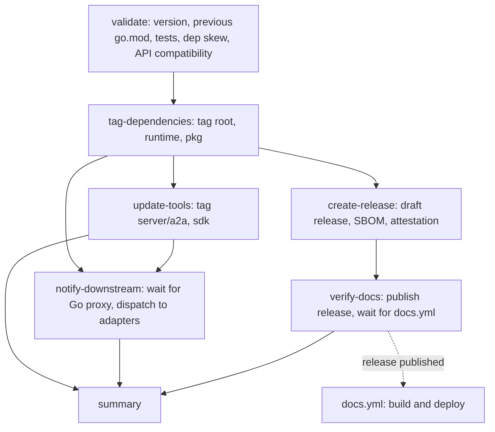
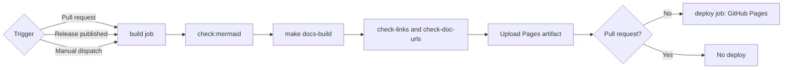

Diagrams of how the workflows in `.github/workflows/` relate. The [pipelines reference](/devops/ci-cd-pipelines/) has the details behind each node.

## Events and workflows

This diagram shows which event starts which workflow.

`ci.yml`, `docs.yml`, `reference-drift.yml`, `schemas.yml` and `mcp-conformance.yml` filter by changed paths. `cla.yml` also reacts to issue comments, and `promptpack-schema-sync.yml` also reacts to a `promptpack-release` repository dispatch.

## CI job dependencies

This diagram shows how the jobs in `ci.yml` depend on each other. Only `sonarcloud` waits for other jobs.

`integration-tests`, `build`, `weak-assertions` and `perf-regression` have no dependencies. `weak-assertions` runs on pull requests only. `lint`, `sonarcloud` and `perf-regression` skip Dependabot pull requests.

## Coverage and lint data flow

This diagram shows how test coverage and lint results reach SonarCloud.

## Required checks

This diagram shows which workflows report the three status checks that the `Protect Main` ruleset requires.

A skipped job counts as passing for a required check, so a docs-only pull request merges with `SonarCloud Analysis` reported as skipped.

## Release flow

This diagram shows the job order in `release.yml` for `phase=full`.

`phase=libs-only` runs `validate` and `tag-dependencies`. `phase=tools-only` runs `validate` and `update-tools`. `summary` runs in every phase.

## Documentation deploy

This diagram shows what `docs.yml` does for each trigger.

## Related

- [CI/CD pipelines](/devops/ci-cd-pipelines/)
- [CI/CD quick reference](/devops/ci-cd-quickref/)
- [Branch protection](/devops/branch-protection/)
