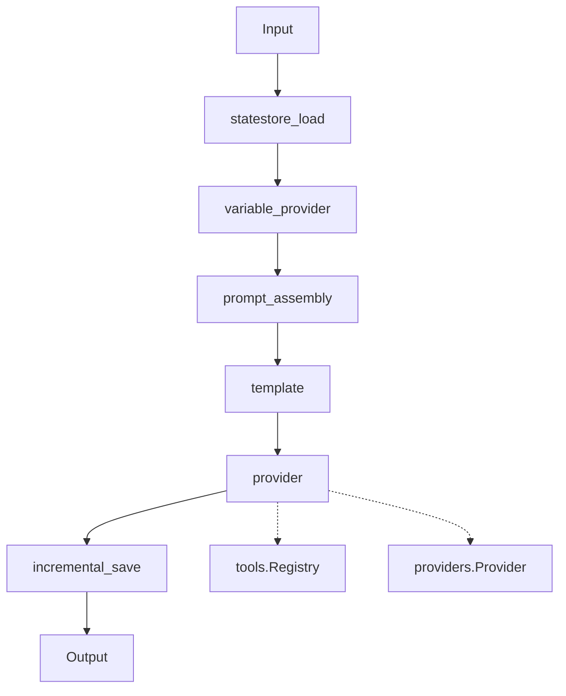

These pages explain why the runtime works the way it does: the architectural decisions, the design patterns, and the trade-offs behind them.

## Topics

### Architecture

- [Pipeline Architecture](/runtime/explanation/pipeline-architecture/): how the stage-based streaming pipeline works
- [Provider System](/runtime/explanation/provider-system/): the LLM provider abstraction

### Integration

- [Stage Design](/runtime/explanation/stage-design/): composable stage patterns
- [State Management](/runtime/explanation/state-management/): conversation history and persistence
- [Media Storage](/runtime/explanation/media-storage/): deduplication and atomic writes for stored media
- [Retrieval Architecture](/runtime/explanation/retrieval-architecture/): model-initiated and pipeline-initiated retrieval, and what each costs

## When to read these

Read an explanation page to understand an architectural decision, to extend the runtime with custom components, to troubleshoot a complex issue, or to contribute.

To complete a task, see the [how-to guides](/runtime/how-to/index/). To learn the runtime from scratch, see the [tutorials](/runtime/tutorials/index/). To look up an API, see the [reference](/runtime/reference/index/).

## Key concepts

### Stage-based architecture

Each stage processes elements in its own goroutine, and channels connect the stages. The design gives you:

- Streaming: elements flow as they are produced.
- Concurrency: stages run in parallel.
- Composability: you assemble pipelines from stages.
- Backpressure: a full channel blocks the producer.
- Testability: you test a stage in isolation.

### Provider abstraction

The runtime puts LLM providers behind a common interface, so the same pipeline code runs against OpenAI, Claude, Gemini and the other supported providers. A mock provider replaces the model in tests.

### Tool system

The runtime implements function calling through tool descriptors that define a tool and its schema, executors that run it, and MCP integration for external tool servers. The model decides when to call a tool.

## Architecture overview

The diagram shows the text-mode stages that the SDK assembles, in order.

The provider stage calls the LLM and runs the tool loop.

## Pipeline modes

### Text mode

Request/response interactions with a text LLM over HTTP.

### VAD mode

Voice activity detection for voice applications that use a text LLM: audio, speech-to-text, LLM, text-to-speech.

### ASM mode

Audio streaming mode for native multimodal LLMs, with real-time audio over a WebSocket.

## Design principles

- Streaming first: channel-based data flow and concurrent stages.
- Composability: you build custom pipelines from stages.
- Extensibility: custom stages, providers, tools and executors plug in through interfaces.

## Related documentation

- [Reference](/runtime/reference/index/): API documentation
- [How-to guides](/runtime/how-to/index/): task-focused guides
- [Tutorials](/runtime/tutorials/index/): step-by-step learning

See the [runtime codebase](https://github.com/AltairaLabs/PromptKit/tree/main/runtime) for implementation details.
