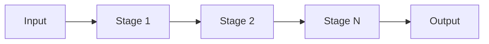
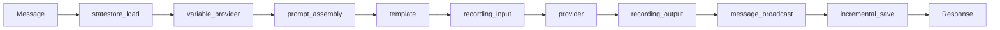
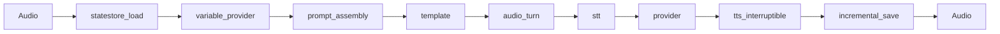
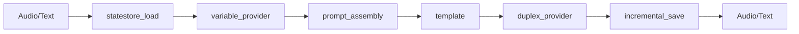

The runtime processes LLM requests with a stage-based streaming pipeline. This page explains the design: what a stage is, how elements flow, how execution, errors and shutdown behave, and why the pipeline uses channels.

## Core concept

A pipeline is a directed acyclic graph (DAG) of stages that process streaming elements. Most pipelines are a linear chain; `Branch`, `Merge` and `RouterStage` build fan-out and fan-in.

The diagram shows a linear chain.



Each stage:

- runs in its own goroutine
- receives elements on an input channel
- sends processed elements on an output channel
- passes elements on as they are produced, without waiting for the input to finish

## Why stages

The design targets streaming scenarios such as voice applications:

1. Streaming input: audio chunks from a microphone.
2. Accumulation: voice activity detection finds turn boundaries.
3. Processing: transcribe, call the LLM, generate speech.
4. Streaming output: audio chunks to a speaker.

Stages model this as a reactive stream:

```go
audioTurn, err := stage.NewAudioTurnStage(vadConfig) // accumulate until the turn completes
if err != nil {
    return err
}

pipeline, err := stage.NewPipelineBuilder().
    Chain(
        audioTurn,
        stage.NewSTTStage(sttService, sttConfig),                 // transcribe audio
        stage.NewProviderStage(provider, tools, policy, config),  // call the LLM
        stage.NewTTSStageWithInterruption(ttsService, ttsConfig), // generate audio
    ).
    Build()
```

## StreamElement

`StreamElement` is the unit of data in the pipeline:

```go
type StreamElement struct {
    // Content types (at most one is set)
    Text      *string
    Audio     *AudioData
    Video     *VideoData
    Image     *ImageData
    Message   *types.Message
    ToolCall  *types.MessageToolCall
    Part      *types.ContentPart
    MediaData *types.MediaContent

    // Metadata
    Sequence  int64
    Timestamp time.Time
    Source    string
    Priority  Priority        // Low, Normal, High, Critical
    Meta      ElementMetadata // typed per-element coordination data

    // Non-content: incremental model reasoning for live display
    Reasoning *ReasoningDelta

    // Control signals
    EndOfStream bool
    EndOfTurn   bool
    Interrupt   bool
    Error       error
}
```

Each element carries one content type, so a stage can route on type.

### Provider request metadata

Session-level context (for example `session_id`, `tenant_id`, `user_id`) travels on the pipeline's `TurnState`. A `ProviderStage` built with `NewProviderStageWithTurnState` copies `TurnState.ProviderRequestMetadata` into `PredictionRequest.Metadata` on every call.

```go
turnState := stage.NewTurnState()
turnState.ProviderRequestMetadata = map[string]interface{}{
    "session_id": sessionID,
    "tenant_id":  tenantID,
}

providerStage := stage.NewProviderStageWithTurnState(
    provider, nil, nil, &stage.ProviderConfig{}, nil, nil, turnState,
)
```

The map is read-only after the stage that produces it runs; downstream stages must not modify it.

No built-in model provider reads keys such as `session_id` or `tenant_id` from `PredictionRequest.Metadata`; only the mock provider reads its own scenario keys there. The OpenAI and Gemini realtime sessions read a few configuration keys (voice, modalities, VAD) from `StreamingInputConfig.Metadata`, a separate map this one does not feed. Session context in this map therefore reaches only a custom provider that reads it. When the state store does not implement `MessageAppender`, `IncrementalSaveStage` built with `NewIncrementalSaveStageWithTurnState` also merges the map into the saved conversation state's `Metadata`.

Conversation and user identity have typed fields. The load stages copy `StateStoreConfig.ConversationID` and `StateStoreConfig.UserID` into `TurnState.ConversationID` and `TurnState.UserID`, and stages should read those. The metadata map exists for the provider boundary, where the interface is untyped.

## Stage interface

All stages implement:

```go
type Stage interface {
    Name() string
    Type() StageType
    Process(ctx context.Context, input <-chan StreamElement, output chan<- StreamElement) error
}
```

A stage with several upstream edges also implements `MultiInputStage` (`MergeStage` does), and a stage that routes to named outputs implements `MultiOutputStage` (`RouterStage` does).

### Stage types

| Type | Pattern | Example |
|------|---------|---------|
| `StageTypeTransform` | 1:1 or 1:N | `TemplateStage`, prompt assembly, `RecordingStage`, `MessageBroadcastStage` |
| `StageTypeAccumulate` | N:1 | VAD buffering, context building |
| `StageTypeGenerate` | 0:N | LLM streaming |
| `StageTypeSink` | N:0 | State store save |
| `StageTypeBidirectional` | Varies | Duplex provider session |

### Contract

Every stage:

1. reads from the input channel until it closes
2. sends results to the output channel
3. closes the output channel when done
4. respects context cancellation

```go
func (s *MyStage) Process(ctx context.Context, input <-chan StreamElement, output chan<- StreamElement) error {
    defer close(output) // always close output

    for elem := range input {
        result := s.transform(elem)

        select {
        case output <- result:
        case <-ctx.Done():
            return ctx.Err()
        }
    }
    return nil
}
```

## Pipeline execution

### Streaming execution

`Execute` starts every stage and returns an output channel. Elements arrive as the stages produce them:

```go
output, err := pipeline.Execute(ctx, input)
if err != nil {
    return err
}

for elem := range output {
    if elem.Text != nil {
        fmt.Print(*elem.Text)
    }
}
```

### Synchronous execution

For request/response patterns, `ExecuteSync` runs `Execute`, drains the output and accumulates it:

```go
result, err := pipeline.ExecuteSync(ctx, inputElements...)
// result.Messages contains all messages
// result.Response contains the final assistant response
```

## Execution modes

The SDK assembles a different stage chain for each mode. The diagrams use the stage names that `Name()` returns.

### Text mode (request/response)

Standard HTTP-based LLM interactions:



`recording_input` and `recording_output` are optional `RecordingStage` instances. They capture user input and assistant output as events written directly to an `EventStore`, not through the EventBus, and pass elements through unchanged. `message_broadcast` is present when an event emitter is configured.

Hooks (guardrails, tool hooks) run inside `ProviderStage`; they are not separate stages. Provider hooks run before and after each LLM call, and chunk interceptors run on each streaming chunk.

Use it for chat applications and content generation.

### VAD mode (voice activity detection)

For voice applications that use a text LLM:



Use it for voice assistants and telephony integrations.

### ASM mode (audio streaming)

For native multimodal LLMs with real-time audio. A `duplex_provider` stage replaces `provider`:



Use it for Gemini Live and other real-time voice conversations.

## Concurrency model

### Goroutine lifecycle

`Execute` creates one buffered channel per stage, sized by `PipelineConfig.ChannelBufferSize` (default 32), and starts each stage in its own goroutine. A stage that returns an error ends its turn; the pipeline reports the first such error. The output channel closes when the leaf stages finish.

### Backpressure

Channel-based communication handles backpressure without extra machinery:

- Slow consumers block producers.
- The buffer size trades latency against throughput.
- Buffering is bounded.

### Shutdown

`Shutdown(ctx)` stops the pipeline from accepting new executions, then waits for in-flight executions to finish. It returns `ErrShutdownTimeout` if they outlast `PipelineConfig.GracefulShutdownTimeout` (default 10 seconds). `Execute` returns `ErrPipelineShuttingDown` after shutdown begins.

## Pipeline builder

The builder constructs pipelines with a fluent API:

```go
// Prompt, template and provider stages share the turn's system prompt through
// one TurnState; Build rejects a prompt stage constructed without one.
turnState := stage.NewTurnState()
pipeline, err := stage.NewPipelineBuilder().
    Chain(
        stage.NewStateStoreLoadStage(stateConfig),
        stage.NewPromptAssemblyStageWithTurnState(registry, taskType, vars, turnState),
        stage.NewTemplateStageWithTurnState(nil, turnState),
        stage.NewProviderStageWithTurnState(provider, tools, policy, config, nil, nil, turnState),
        stage.NewIncrementalSaveStage(&stage.IncrementalSaveConfig{StateStoreConfig: stateConfig}),
    ).
    Build()
```

### Branching

`Branch` connects one stage to several downstream stages. The downstream stages share the upstream stage's output channel and compete for elements: each element goes to one of them, not to all. To send an element to chosen destinations, or to several at once, use a `RouterStage` and connect its named outputs:

```go
router := stage.NewRouterStage("router", func(elem *stage.StreamElement) []string {
    if elem.Audio != nil {
        return []string{"tts"}
    }
    return []string{"log"}
})

pipeline, err := stage.NewPipelineBuilder().
    AddStage(router).
    AddStage(ttsStage).
    AddStage(logStage).
    Connect("router", "tts").
    Connect("router", "log").
    Build()
```

Use `Merge` with a `MergeStage` to fan several stages back into one.

### DAG validation

`Build` rejects a pipeline that:

- has no stages
- has an invalid `PipelineConfig`
- repeats a stage name
- has an edge to a stage that does not exist
- contains a cycle
- sends several upstream edges into a stage that is not a `MultiInputStage`, or repeats an edge between the same pair of stages

## Error handling

### Error elements

A stage can send an error as an element for downstream handling and keep processing:

```go
if err := s.validate(elem); err != nil {
    output <- stage.NewErrorElement(err)
    continue
}
```

### Fatal errors

Returning an error from `Process()` fails the turn:

```go
if err := s.criticalOperation(elem); err != nil {
    return err
}
```

The pipeline does not cancel the other stages. It tells the failed stage's downstream stages by sending the error as the last element on their input, so a stage such as the provider stage does not act on a turn that failed. The other stages drain and persist, and the output channel ends with the error as an element.

### Context cancellation

Stages respect context cancellation:

```go
select {
case output <- elem:
case <-ctx.Done():
    return ctx.Err()
}
```

## Event integration

When the builder has an event emitter, the pipeline emits these events for every stage and for the pipeline itself. Stage authors do not emit them.

| Event | Emitted when |
|-------|--------------|
| `events.EventStageStarted` | a stage begins processing |
| `events.EventStageCompleted` | a stage finishes successfully |
| `events.EventStageFailed` | a stage returns an error |
| `events.EventPipelineStarted` | an execution starts |
| `events.EventPipelineCompleted` | an execution ends successfully |
| `events.EventPipelineFailed` | an execution ends with an error |

### RecordingStage

`RecordingStage` is an observe-only stage. It writes content-carrying events directly to an `EventStore`, bypassing the EventBus. That keeps it synchronous, lossless and full-fidelity (it retains binary content for replay), at the cost of back-pressuring the pipeline on a slow store.

```go
stage.NewRecordingStage(eventStore, stage.RecordingStageConfig{
    Position:       stage.RecordingPositionOutput, // RecordingPositionInput for user messages
    SessionID:      sessionID,
    ConversationID: conversationID,
})
```

It records elements as events:

- A complete message becomes `message.created`, with its index, tool calls and tool results.
- Audio, image and video elements become the matching multimodal events when `IncludeAudio`, `IncludeImages` or `IncludeVideo` is set.
- Text deltas become `message.text.delta` when `IncludeStreamingText` is set.
- A tool call becomes `tool.call.started`.
- An error becomes `stream.interrupted`.

Replayed history counts toward the message index but is not recorded again, so each message is recorded once, on the turn it is new.

Any `EventStore` receives these events, for example `FileEventStore` for JSONL persistence and replay.

### MessageBroadcastStage

`MessageBroadcastStage` is the live counterpart. It publishes `message.created` on the EventBus as each complete message arrives, and forwards every element unchanged:

```go
stage.NewMessageBroadcastStage(emitter)
```

The SDK adds it whenever an event emitter is configured, so it needs no `EventStore`, no `WithRecording()` and no state store. A TUI, an SSE relay or a log tail uses this route.

The two stages differ in one payload field: the bus route strips binary content parts to metadata, and the recording route retains them. Both build the payload with `events.NewMessageCreatedData`.

`MessageBroadcastStage` also counts replayed history for position without publishing it again, so `Index` is transcript-absolute. Read `Index` rather than arrival order: with concurrent publishers, the bus order need not match transcript order.

See [Observability](/sdk/explanation/observability/) for the EventBus architecture and the [Eval Framework](https://promptarena.altairalabs.ai/arena/explanation/eval-framework/) for how recorded events trigger evals.

## Design decisions

### Why channels over callbacks

Channels fit Go's concurrency model, give backpressure for free, are easy to reason about, and propagate cancellation through the context.

### Why one goroutine per stage

Each stage has a clear lifecycle owner and predictable resource use, is easy to debug (one goroutine per stage), and is easy to instrument with metrics and tracing.

### Why stages close their output channel

Closing signals completion downstream, enables `for range` iteration, prevents goroutine leaks, and gives shutdown clear semantics.

## Related topics

- [Stage Reference](/runtime/reference/pipeline/): the stage API
- [Provider System](/runtime/explanation/provider-system/): how providers integrate
- [State Management](/runtime/explanation/state-management/): conversation persistence
