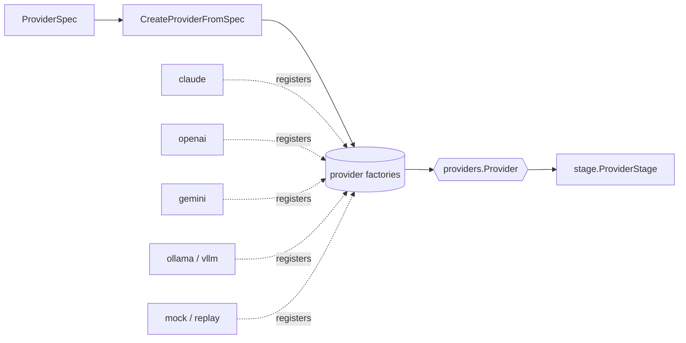

Runtime talks to Claude, OpenAI, Gemini, Ollama and vLLM through one Go interface. This page explains how that abstraction is built, what it hides, and what it leaves to your application.

## How it works

Every chat provider implements `providers.Provider`. The pipeline's provider stage holds that interface and never sees a vendor type.

```go
type Provider interface {
    base.Provider // Name, Type, Pricing, Validate, Init, HealthCheck, Close

    ID() string
    Model() string
    Predict(ctx context.Context, req PredictionRequest) (PredictionResponse, error)
    PredictStream(ctx context.Context, req PredictionRequest) (<-chan StreamChunk, error)
    SupportsStreaming() bool
    ShouldIncludeRawOutput() bool
    CalculateCost(inputTokens, outputTokens, cachedTokens int) types.CostInfo
}
```

Code written against this interface runs unchanged on any provider:

```go
resp, err := provider.Predict(ctx, req)
```

The diagram shows how a provider reaches the pipeline. A `ProviderSpec` names a type, `CreateProviderFromSpec` looks up the factory that type's package registered in `init()`, and the factory returns a `providers.Provider`.



Import `providers/all` to register every factory, or import a single provider package to register only that type. The registered chat types are `claude`, `openai`, `gemini`, `ollama`, `vllm`, `mock` and `replay`; `imagen` registers an image provider. An unknown type fails with `UnsupportedProviderError`.

Bedrock, Vertex and Azure are hosting platforms, not provider types. Set `ProviderSpec.Platform` to host a `claude`, `gemini` or `openai` model on one of them. A combination the platform vendor does not offer fails at construction with `UnsupportedProviderPlatformError`.

## One request, one response

`PredictionRequest` carries a `System` string, the `Messages`, and the sampling fields (`Temperature`, `TopP`, `MaxTokens`, `Seed`, `TopK`, the penalties and `ResponseFormat`). `NormalizeMessages` folds any system-role messages into `System`, so a provider reads the system prompt from one place.

`PredictionResponse` returns the content and any tool calls, plus cost information, latency, reasoning and a normalized `FinishReason`.

A provider whose API takes no `top_k` or no penalties drops the field and logs one warning per provider and parameter. OpenAI's Chat Completions API takes `seed`; its Responses API has no `seed` parameter, so a seed set on that path is dropped with a warning.

### Defaults

A `ProviderDefaults` fills each field the request leaves at zero:

```go
defaults := providers.ProviderDefaults{
    Temperature: 0.7,
    TopP:        0.95,
    MaxTokens:   2000,
}
```

A provider resolves each value in this order:

1. The request's value. In the SDK, that is the prompt's `parameters`.
2. The provider's `ProviderDefaults`.
3. No output-token limit, so the model's own maximum applies.

`MaxTokens: providers.MaxTokensUnlimited` (`-1`) states the third step explicitly. Claude's Messages API requires `max_tokens` on every request, so a Claude provider sends 4096 at step 3 and rejects `MaxTokensUnlimited` at construction.

## The translation layer

Each provider converts Runtime's `types.Message` and tool descriptors into its vendor's wire format, and converts the response back. Roles and content shapes differ:

| Runtime | OpenAI | Claude | Gemini |
|---|---|---|---|
| `assistant` role | `assistant` | `assistant` | `model` |
| Message content | `content` | `content` blocks, each with a `type` | `parts`, each with `text` |
| System prompt | system message | top-level system field | top-level system instruction |

Tool definitions differ in the same way. Runtime hands every provider a `ToolDescriptor` (name, description, JSON Schema) and the provider builds its native form:

```json
{ "type": "function", "function": { "name": "get_weather", "description": "...", "parameters": { } } }
```

```json
{ "name": "get_weather", "description": "...", "input_schema": { } }
```

```json
{ "function_declarations": [ { "name": "get_weather", "description": "...", "parameters": { } } ] }
```

The first shape is OpenAI's, the second Claude's, the third Gemini's. Callers see none of it.

## Design decisions

### A common interface

All providers implement the same interface. That makes provider-agnostic code possible, simplifies testing and keeps vendor APIs out of the pipeline.

The trade-off is that a vendor-specific feature has no place in the interface until enough providers share it. Provider-specific behavior goes through `ProviderSpec` fields such as `AdditionalConfig`, `Platform` and `Headers`.

### One instance per service

A provider instance represents one model on one service. Each instance owns its HTTP client, its credentials and its configuration. `providers.Registry` stores instances by ID when a host holds several, but it does not choose between them.

### Direct translation

Each provider translates directly to its vendor format, with no shared adapter layer in between. The result is fewer layers and simpler debugging, and the translation code is repeated in each provider package. The repetition is small, because the translation is straightforward.

## Multi-provider patterns

Runtime has no built-in fallback, load balancing or routing. The interface makes each one a short function in your application, where the policy (which errors fall through, how to weigh cost against quality) belongs.

A fallback tries providers in order:

```go
func predictWithFallback(
    ctx context.Context, req providers.PredictionRequest, candidates ...providers.Provider,
) (providers.PredictionResponse, error) {
    var errs []error
    for _, p := range candidates {
        resp, err := p.Predict(ctx, req)
        if err == nil {
            return resp, nil
        }
        errs = append(errs, fmt.Errorf("%s: %w", p.ID(), err))
    }
    return providers.PredictionResponse{}, errors.Join(errs...)
}
```

Load balancing and cost-based routing have the same shape: pick a `providers.Provider` by a rule, then call `Predict`. Each provider already retries transient HTTP failures, so fall through to the next provider on errors that outlast those retries.

## Testing with the mock provider

The mock provider answers without an API call, so tests are fast, free and deterministic:

```go
mockProvider := mock.NewProvider("mock", "mock-model", false)

resp, _ := mockProvider.Predict(ctx, providers.PredictionRequest{
    Messages: []types.Message{{Role: "user", Content: "Hi"}},
})
fmt.Println(resp.Content) // Mock response from mock model mock-model
```

The `replay` provider serves recorded responses for deterministic runs against real conversations.

## Resource handling

A provider owns an HTTP client with a connection pool. Create one provider and reuse it across requests so the pool is reused, and call `Close` when you are done:

```go
provider, err := providers.CreateProviderFromSpec(spec)
if err != nil {
    return err
}
defer provider.Close()
```

`Close` closes the client's idle connections. `ProviderSpec.RateLimit` caps how fast one provider instance sends requests: a token bucket of `RequestsPerSecond` with room for `Burst` requests at once. Each HTTP request, including every retry attempt, takes one token. Bound each call with a context deadline:

```go
ctx, cancel := context.WithTimeout(context.Background(), 30*time.Second)
defer cancel()

resp, err := provider.Predict(ctx, req)
```

## Related topics

- [Pipeline Architecture](/runtime/explanation/pipeline-architecture/): how providers fit in pipelines
- [Tools reference](/runtime/reference/tools/): function calling across providers
- [Providers reference](/runtime/reference/providers/): the complete API
