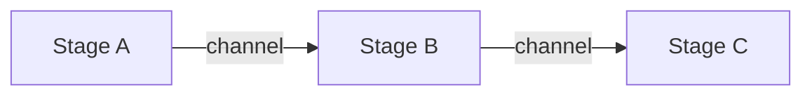

Every component that processes streaming data in the runtime is a stage. This page explains why, how stages compose, and which trade-offs the design makes.

## What a stage is

A stage reads `StreamElement` values from an input channel, writes to an output channel, and closes the output when it finishes:

```go
type Stage interface {
    Name() string
    Type() StageType
    Process(ctx context.Context, input <-chan StreamElement, output chan<- StreamElement) error
}
```

The pipeline connects stages with channels and runs each stage in its own goroutine.



A `StreamElement` carries one content type (text, audio, video, image, a complete message, a tool call) plus metadata and control signals such as `EndOfStream`, `EndOfTurn` and `Interrupt`.

## Why stages

An application needs state loading, prompt assembly, validation, an LLM call, speech conversion, metrics and error handling. Written as one function, these concerns tangle and the function cannot stream:

```go
func execute(audio []byte) []byte {
    if !detectSpeech(audio) {
        return nil
    }
    text := transcribe(audio)
    history := loadFromRedis(sessionID)
    response := openai.Complete(text, history)
    saveToRedis(sessionID, response)
    return synthesize(response)
}
```

Each step waits for the previous one to finish, none can be tested alone, and none can be reused. As stages, each concern is a unit that you test alone and the builder wires together:

```go
audioTurn, err := stage.NewAudioTurnStage(vadConfig)
if err != nil {
    return err
}

pipeline, err := stage.NewPipelineBuilder().
    Chain(
        audioTurn,
        stage.NewSTTStage(sttService, sttConfig),
        stage.NewStateStoreLoadStage(stateConfig),
        stage.NewProviderStage(provider, tools, policy, config),
        stage.NewIncrementalSaveStage(&stage.IncrementalSaveConfig{StateStoreConfig: stateConfig}),
        stage.NewTTSStage(ttsService, ttsConfig),
    ).
    Build()
```

## Design principles

### Single responsibility

`StateStoreLoadStage` loads history. `PromptAssemblyStage` assembles the prompt. `ProviderStage` calls the LLM and runs the tool loop. `IncrementalSaveStage` persists new messages.

Validation is not a stage. It runs as `ProviderHook` and `ToolHook` chains that `ProviderStage` invokes (`BeforeCall`, `AfterCall`, and `ChunkInterceptor` for streaming). Pack-declared validators, guardrails added with `WithGuardrail`, and hooks added with `WithProviderHook` or `WithToolHook` all register on one `hooks.Registry`. A hook sees the request, the response and each streamed chunk, which a separate stage placed before or after the provider could not.

`ProviderStage` also decides how a response schema applies to a tool loop. When a turn has tools and a `ResponseFormat`, the stage withholds the schema from the tool-calling rounds and re-asks the closing answer under it, because a schema sent on every round suppresses tool calls. The turn costs one extra provider call. `WithStructuredOutputMode("every_round")` restores per-round schemas; it is an escape hatch, and it is the configuration that loses tool calls.

### Composability

Stages combine by listing them. Add state by adding two stages:

```go
// Prompt, template and provider stages share the turn's system prompt through
// one TurnState; Build rejects a prompt stage constructed without one.
turnState := stage.NewTurnState()
pipeline, err := stage.NewPipelineBuilder().
    Chain(
        stage.NewStateStoreLoadStage(stateConfig),
        stage.NewPromptAssemblyStageWithTurnState(registry, task, vars, turnState),
        stage.NewTemplateStageWithTurnState(nil, turnState),
        stage.NewProviderStageWithTurnState(provider, tools, policy, config, nil, nil, turnState),
        stage.NewIncrementalSaveStage(&stage.IncrementalSaveConfig{StateStoreConfig: stateConfig}),
    ).
    Build()
```

Add validation by passing a hook registry to `NewProviderStageWithHooks`. The pipeline shape does not change:

```go
hook, err := guardrails.NewGuardrailHook("banned_words", map[string]any{"patterns": []any{"secret"}})
if err != nil {
    return err
}
hookRegistry := hooks.NewRegistry(hooks.WithProviderHook(hook))
providerStage := stage.NewProviderStageWithHooks(provider, tools, policy, config, nil, hookRegistry)
```

### Explicit ordering

You choose the order, and order matters: a stage sees only what upstream stages emitted. `Build` rejects an empty pipeline, duplicate stage names, edges to unknown stages, cycles, a stage with several upstreams that does not implement `MultiInputStage`, and a `TemplateStage` or `PromptAssemblyStage` built without a `TurnState`.

### Streaming first

Stages process elements as they arrive rather than in batches, so audio can reach the model while the user is still speaking and text can reach the speaker while the model is still generating.

## Stage types

`StageType` declares a stage's processing model:

| Type | Model | Examples |
|------|-------|----------|
| `StageTypeTransform` | 1:1 or 1:N | `TemplateStage`, `STTStage` |
| `StageTypeAccumulate` | N:1 | `AudioTurnStage`, `ContextBuilderStage` |
| `StageTypeGenerate` | 0:N | `ProviderStage` |
| `StageTypeSink` | N:0 | `IncrementalSaveStage` |
| `StageTypeBidirectional` | full duplex | `DuplexProviderStage` |

The type labels the stage in pipeline events and errors; it does not change how the pipeline runs the stage. A transform stage forwards elements as it reads them:

```go
type UppercaseStage struct {
    stage.BaseStage
}

func (s *UppercaseStage) Process(
    ctx context.Context, input <-chan stage.StreamElement, output chan<- stage.StreamElement,
) error {
    defer close(output)

    for elem := range input {
        if elem.Text != nil {
            upper := strings.ToUpper(*elem.Text)
            elem.Text = &upper
        }
        select {
        case output <- elem:
        case <-ctx.Done():
            return ctx.Err()
        }
    }
    return nil
}
```

An accumulate stage reads until its input closes or a boundary arrives, then emits once. A generate stage emits many elements from one input, as a tokenizer or a streaming LLM does. A sink consumes elements and emits none, but still closes its output.

## Built-in stages

| Group | Stages |
|-------|--------|
| Core | `StateStoreLoadStage`, `IncrementalSaveStage`, `PromptAssemblyStage`, `TemplateStage`, `ProviderStage`, `MessageBroadcastStage`, `RecordingStage` |
| Streaming and speech | `AudioTurnStage`, `STTStage`, `TTSStage`, `TTSStageWithInterruption`, `DuplexProviderStage` |
| Routing and monitoring | `RouterStage`, `MergeStage`, `MetricsStage` |
| Utility | `DebugStage`, `VariableProviderStage`, `MediaExternalizerStage`, `ContextBuilderStage` |

`MessageBroadcastStage` publishes `message.created` on the event bus as each complete message arrives. `RecordingStage` writes content-carrying events directly to an `EventStore`. `IncrementalSaveStage` appends through `MessageAppender` when the store implements it and otherwise falls back to a full save through `BulkWriter`. The [pipeline reference](/runtime/reference/pipeline/) lists every stage and constructor.

## Writing a custom stage

Embed `stage.BaseStage` and name the stage. Close the output, honor `ctx.Done()` when sending, and return an error only for failures that should fail the turn:

```go
type MyStage struct {
    stage.BaseStage
}

func NewMyStage() *MyStage {
    return &MyStage{BaseStage: stage.NewBaseStage("my_stage", stage.StageTypeTransform)}
}
```

A stage reports a problem in one of two ways. It can emit an error element with `stage.NewErrorElement(err)` and keep reading, or return the error, which fails the turn:

```go
for elem := range input {
    result, err := s.process(elem)
    if err != nil {
        output <- stage.NewErrorElement(err)
        continue
    }
    output <- result
}
```

## Branching, routing and merging

`Branch` connects one stage to several readers. The readers share one channel, and each element goes to whichever reader takes it. The element is not copied to every branch:

```go
pipeline, err := stage.NewPipelineBuilder().
    Chain(stage.NewProviderStage(provider, tools, policy, config)).
    Chain(ttsStage).
    Chain(loggerStage).
    Branch("provider", "tts", "logger").
    Build()
```

To send an element to named destinations, use `RouterStage`, which takes a function that returns the output names for each element. Returning both names copies the element to both. A pipeline that contains a `RouterStage` suits a single `Execute` call, such as a duplex session, not concurrent calls.

To combine streams, wire several upstream stages into a `MergeStage`:

```go
mergeStage := stage.NewMergeStage("merge", 2)
```

## Ordering

A typical request/response pipeline:

```go
// Prompt, template and provider stages share the turn's system prompt through
// one TurnState; Build rejects a prompt stage constructed without one.
turnState := stage.NewTurnState()
pipeline, err := stage.NewPipelineBuilder().
    Chain(
        stage.NewStateStoreLoadStage(stateConfig),
        stage.NewVariableProviderStageWithVarsAndTurnState(nil, providers, turnState),
        stage.NewPromptAssemblyStageWithTurnState(registry, task, vars, turnState),
        stage.NewTemplateStageWithTurnState(nil, turnState),
        stage.NewProviderStageWithTurnState(provider, tools, policy, config, nil, nil, turnState),
        stage.NewIncrementalSaveStage(&stage.IncrementalSaveConfig{StateStoreConfig: stateConfig}),
    ).
    Build()
```

Load state first so later stages see history. Resolve variables before templates substitute them. Save last so the save sees everything the turn produced. Validation needs no slot because it runs inside `ProviderStage`.

## Performance

`PipelineConfig.ChannelBufferSize` sets the buffer between stages (default 32). Smaller buffers lower latency and apply backpressure sooner. Larger buffers raise throughput and use more memory:

```go
config := stage.DefaultPipelineConfig().WithChannelBufferSize(64)
pipeline, err := stage.NewPipelineBuilderWithConfig(config).Chain(stages...).Build()
```

Stages run concurrently, so a slow stage does not block a fast one until the channel between them fills. A slow consumer throttles its producers through channel blocking.

## Testing stages

A stage is a function of channels, so you can drive it without a pipeline:

```go
func TestUppercaseStage(t *testing.T) {
    s := NewUppercaseStage()

    input := make(chan stage.StreamElement, 1)
    output := make(chan stage.StreamElement, 1)

    go s.Process(context.Background(), input, output)

    text := "hello"
    input <- stage.StreamElement{Text: &text}
    close(input)

    result := <-output
    assert.Equal(t, "HELLO", *result.Text)
}
```

To test composition, build a pipeline from the stages and read the channel that `pipeline.Execute(ctx, input)` returns.

## Trade-offs

Channels and goroutines give concurrency and backpressure at the cost of a goroutine and a channel hop per stage. A hop is cheap next to an LLM call, and it is what lets audio and text stream.

A fixed stage order makes data flow visible and leaves correct order to you. `Build` catches structural mistakes, not semantic ones such as saving before the provider runs.

Hooks keep validation inside the provider call at the price of one more concept beside stages. Validation stages around the provider could not see streamed chunks or abort a stream early.

## Related

- [Pipeline architecture](/runtime/explanation/pipeline-architecture/) covers how stages form pipelines.
- [State management](/runtime/explanation/state-management/) covers the state store stages.
- [Pipeline reference](/runtime/reference/pipeline/) lists the complete API.
