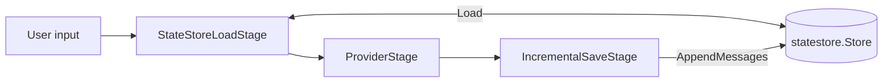
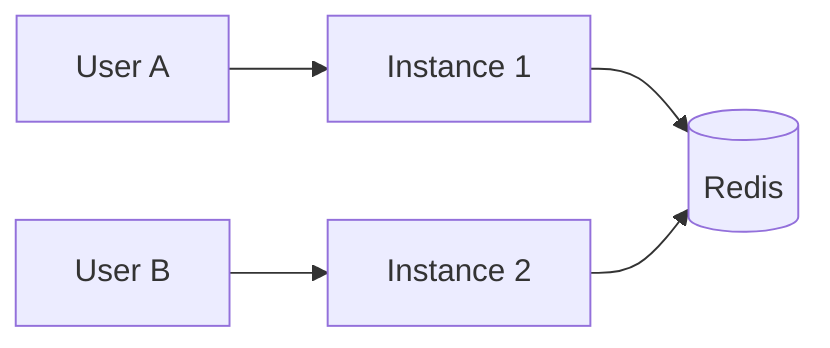

LLMs keep no memory between calls, so the runtime stores each conversation and replays its history on every turn. This page explains the model, the store implementations, and the trade-offs of each.

## The model

A conversation has an ID, a message history, and a state store that holds both. The ID is the key: the load and save stages share one `StateStoreConfig`, and its `ConversationID` selects which conversation they read and write.



```go
stateConfig := &pipeline.StateStoreConfig{
    Store:          store,
    ConversationID: "user-123-conv-456",
    UserID:         "user-123",
}
```

Before the provider runs, `StateStoreLoadStage` loads the history for the ID and emits it ahead of the new input. A conversation that does not exist yet is an empty history. After the turn, `IncrementalSaveStage` persists only the messages the turn produced. Any other load error fails the turn.

With the SDK, `WithStateStore` supplies the store and `WithConversationID` the ID. Without a state store, each `Open` creates a private in-memory store, so reusing an ID in a second `Open` reaches a different, empty conversation:

```go
conv, err := sdk.Open("./chat.pack.json", "assistant",
    sdk.WithStateStore(store),
    sdk.WithConversationID("user-123-conv-456"),
)
```

## Why a separate store

The store is an interface that the pipeline stages call, not logic inside the pipeline. You swap backends without touching stages, test with an in-memory store, and use a store outside a pipeline, for example to seed or inspect conversations. Embedding storage in the pipeline would couple every stage to one backend.

The store holds full `types.Message` values, not text. Roles, tool calls and metadata survive, so a conversation replays exactly and maps onto each provider's wire format.

The conversation ID is a caller-chosen string, not derived from the user. A user can then have one ongoing conversation (`user-<id>`), many (`user-<id>-conv-<n>`), or a throwaway (a UUID). An implicit per-user session would make multiple conversations and fresh starts impossible.

## The store interfaces

`Store` is read-shaped. Writes go through optional typed interfaces that stores implement as they can:

```go
type Store interface {
    Load(ctx context.Context, id string) (*ConversationState, error)
    Fork(ctx context.Context, sourceID, newID string) error
}

type BulkWriter interface {
    Save(ctx context.Context, state *ConversationState) error
}
```

`MessageAppender`, `MetadataAccessor` and `SummaryAccessor` append messages, merge metadata and save summaries without rewriting the whole state. `MessageReader` loads only the most recent messages. `IncrementalSaveStage` appends through `MessageAppender` when the store implements it; otherwise it loads the state, appends, and writes it back through `BulkWriter`. Pipeline stages never take a `BulkWriter` directly, because a load-modify-save cycle loses updates when two requests overlap.

`ConversationState` holds the data:

```go
type ConversationState struct {
    ID             string
    UserID         string
    Messages       []types.Message
    SystemPrompt   string
    Summaries      []Summary
    TokenCount     int
    LastAccessedAt time.Time
    Metadata       map[string]interface{}
}
```

## Choosing a backend

| Backend | Durable across restarts | Multi-process | Operations surface |
|---------|-------------------------|---------------|--------------------|
| Memory | No | No | None |
| File | Yes | No (one process per root) | Local disk |
| Redis | Yes | Yes | Redis server |

### Memory store

```go
store := statestore.NewMemoryStore()
```

The memory store suits tests, development and short-lived single-instance deployments. State is lost on restart. By default it expires a conversation one hour after its last use (`WithMemoryTTL`, `WithNoTTL`) and holds at most 10,000 conversations, evicting the least recently used (`WithMemoryMaxEntries`, `WithNoMaxEntries`). Eviction happens on access; `WithMemoryEvictionInterval` adds a background sweep.

### Redis store

```go
redisClient := redis.NewClient(&redis.Options{Addr: "localhost:6379"})
store := statestore.NewRedisStore(redisClient,
    statestore.WithTTL(24*time.Hour),
    statestore.WithPrefix("myapp"),
)
```

Redis suits production, multiple instances and long-lived sessions. State survives restarts and every instance sees the same conversations. The default TTL is 24 hours and the default key prefix is `promptkit`. The constructor takes a `*redis.Client`.

### File store

`runtime/statestore/file` persists each conversation as a `state.json` snapshot plus append-only JSONL files. It survives restarts like Redis, with no daemon to run:

```go
import "github.com/AltairaLabs/PromptKit/runtime/v2/statestore/file"

store, err := file.NewStore(file.Options{
    Root:  "/var/lib/promptkit/conversations",
    FSync: file.FSyncOnSave, // FSyncOff, FSyncOnSave (default) or FSyncOnAppend
})
```

The file store suits single-box deployments and per-process agents on a node with a persistent volume, where recovering mid-tool-loop state matters more than horizontal scale. Two processes pointed at the same `Root` have undefined behavior, because the store has no cross-process locking. Use Redis once more than one process needs the same conversation. `Options.TTL` removes conversation directories older than the TTL when the store opens.

## TTL

All three stores can expire conversations. Memory and Redis treat the TTL as a sliding window from last use: loading a conversation extends it, so an active conversation is never collected under its owner, while diagnostic reads such as `MessageCount` do not extend it. Expiry cleans up old sessions, limits how long conversations are kept, and bounds storage cost. The trade-off is that a conversation idle past the TTL is gone, so choose a TTL longer than your longest expected gap between turns.

## Bounding history

Sending the full history every turn costs tokens and I/O, so the SDK bounds it in three ways.

With `sdk.WithContextWindow(n)`, `ContextAssemblyStage` loads only the last `n` messages through `MessageReader`, and falls back to a full load when the store does not implement it. With `sdk.WithTokenBudget(tokens)` and `sdk.WithTruncation(strategy)`, history that exceeds the budget is truncated or summarized. Without a context window, `ContextAssemblyStage` keeps at most 200 messages and preserves the leading system messages. The [conversation manager reference](/sdk/reference/conversation-manager/) lists the options.

A smaller window loads less and costs fewer tokens but forgets older context. Summaries and semantic retrieval (`WithContextRetrieval`) recover some of it.

## Forking

`Fork` copies a conversation under a new ID and leaves the original unchanged, so you can explore a different direction from the same history:

```go
err := store.Fork(ctx, "user-123", "user-123-branch-a")
```

It returns `ErrNotFound` if the source does not exist.

## Scaling

A memory or file store ties a conversation to one process. Run one instance, or route each conversation to the same instance with session affinity at the load balancer.



With Redis, any instance serves any conversation, and instances add availability and capacity. Session affinity still helps if you cache per-instance state, because it lowers Redis load.

Concurrent requests on one conversation need care. Two requests that each load, execute and save can overwrite each other when the store only supports `BulkWriter`. Stores that implement `MessageAppender` append atomically, which removes the race for messages. Serialize requests per conversation if you also depend on whole-state writes.

## Load performance

Typical load times:

- Memory: 1-10µs
- Redis, local: 1-2ms
- Redis, remote: 5-10ms

Loading fewer messages helps most with a remote store, which is why `WithContextWindow` reads through `MessageReader`.

## Testing

Use `NewMemoryStore` in tests. It implements `Store`, `BulkWriter`, `MessageAppender` and the other optional interfaces, so tests exercise the same paths as production:

```go
func TestStateManagement(t *testing.T) {
    store := statestore.NewMemoryStore()
    ctx := context.Background()

    state := &statestore.ConversationState{ID: "session-1", Messages: []types.Message{}}
    if err := store.Save(ctx, state); err != nil {
        t.Fatal(err)
    }

    loaded, err := store.Load(ctx, "session-1")
    if err != nil {
        t.Fatal(err)
    }
    if loaded.ID != "session-1" {
        t.Fatalf("got %q", loaded.ID)
    }
}
```

`Load` on an unknown ID returns `statestore.ErrNotFound`.

## Production considerations

Monitor load latency, save latency, history size and active conversations. For Redis, enable RDB snapshots and AOF for durability. Stored messages hold user data, so encrypt at rest, set a TTL that matches your retention policy, and provide a way to delete or export a user's conversations.

## Trade-offs

Replaying full history is simple and exact, and its cost grows with conversation length; windows and summaries trade fidelity for cost. Durable stores trade latency for survival: memory is microseconds and volatile, Redis is milliseconds and shared, the file store sits between and is single-process. Optional store interfaces let a minimal store work everywhere and a capable store skip the load-modify-save cycle.

## Related

- [Pipeline architecture](/runtime/explanation/pipeline-architecture/) shows where state fits in a pipeline.
- [State store reference](/runtime/reference/statestore/) lists the complete API.
- [Multi-turn conversations tutorial](/runtime/tutorials/02-multi-turn/) walks through it hands-on.
