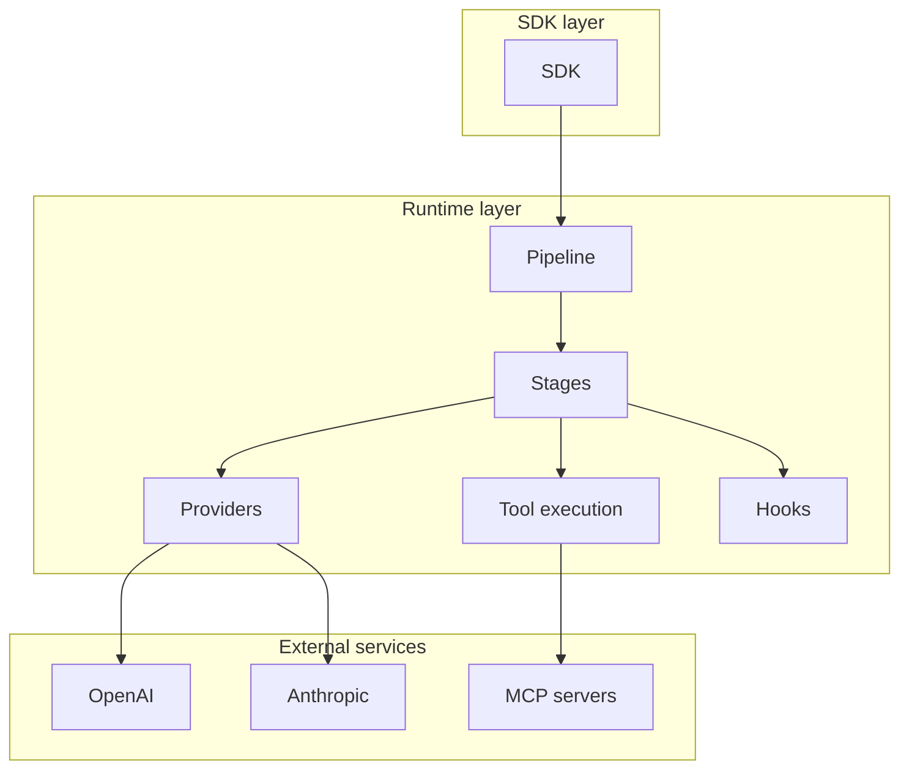

The runtime is the Go library layer under the SDK. It owns providers, the streaming pipeline, tool execution, hooks and the shared types.

## What the runtime provides

- Provider interfaces for implementing custom LLM providers
- A streaming pipeline built from composable stages
- Type definitions used across PromptKit
- A tool execution framework with MCP integration
- The A2A protocol for agent-to-agent communication and tool delegation
- Hooks and guardrails for input and output checks

## Who should use the runtime

Use the runtime directly to:

- Build a custom provider for a new LLM service
- Write custom stages for specialized processing
- Add guardrails with custom hooks for domain-specific checks
- Integrate MCP servers with custom tools
- Customize pipelines
- Contribute to PromptKit

Most applications should use the [SDK](/sdk/) instead.

## Quick start

This program builds a one-stage pipeline around an OpenAI provider and prints the streamed reply:

```go
package main

import (
    "context"
    "fmt"

    "github.com/AltairaLabs/PromptKit/runtime/v2/pipeline/stage"
    "github.com/AltairaLabs/PromptKit/runtime/v2/providers"
    "github.com/AltairaLabs/PromptKit/runtime/v2/providers/openai"
    "github.com/AltairaLabs/PromptKit/runtime/v2/types"
)

func main() {
    // Create provider
    provider := openai.NewProvider(
        "openai", "gpt-4o-mini", "",
        providers.ProviderDefaults{Temperature: 0.7, MaxTokens: 1500},
        false,
    )

    // Build stage-based pipeline
    pipeline, err := stage.NewPipelineBuilder().
        Chain(
            stage.NewProviderStage(provider, nil, nil, &stage.ProviderConfig{
                MaxTokens:   1500,
                Temperature: 0.7,
            }),
        ).
        Build()
    if err != nil {
        panic(err)
    }

    // Execute
    input := make(chan stage.StreamElement, 1)
    msg := types.Message{Role: "user"}
    msg.AddTextPart("Hello!")
    input <- stage.NewMessageElement(&msg)
    close(input)

    output, _ := pipeline.Execute(context.Background(), input)
    for elem := range output {
        if elem.Text != nil {
            fmt.Print(*elem.Text)
        }
    }
}
```

The provider reads its API key from `OPENAI_API_KEY` (or `OPENAI_TOKEN`). Next: [Build your first pipeline](/runtime/tutorials/01-first-pipeline/).

## Architecture

The SDK assembles runtime stages into a pipeline. The provider stage calls the LLM provider, runs tools and invokes hooks.



## Pipeline topologies

The SDK builds one of three pipelines from runtime stages. The table lists the core stages of each; the SDK adds others (prompt templating, context building, recording) when configured.

| Mode | Input | Core stages |
|------|-------|-------------|
| Text | Messages | StateStoreLoad, PromptAssembly, Provider, IncrementalSave |
| VAD | Audio | AudioTurn, STT, Provider, TTS |
| ASM | Audio or text | DuplexProvider |

VAD mode pairs voice activity detection with a text LLM. ASM mode streams audio to and from a multimodal LLM in real time. See [pipeline architecture](/runtime/explanation/pipeline-architecture/) for how stages run.

## Documentation by type

### Tutorials

1. [First pipeline](/runtime/tutorials/01-first-pipeline/): build your first pipeline
2. [Multi-turn conversations](/runtime/tutorials/02-multi-turn/): state management
3. [MCP integration](/runtime/tutorials/03-mcp-integration/): add MCP tools
4. [Validation and guardrails](/runtime/tutorials/04-validation-guardrails/): content safety
5. [Production deployment](/runtime/tutorials/05-production-deployment/): deploy pipelines
6. [Advanced patterns](/runtime/tutorials/06-advanced-patterns/): complex pipelines
7. [A2A client](/runtime/tutorials/07-a2a-client/): discover agents and send messages

### How-to guides

- [Configure a pipeline](/runtime/how-to/pipeline/configure-pipeline/)
- [Set up providers](/runtime/how-to/providers/setup-providers/)
- [Handle errors](/runtime/how-to/pipeline/handle-errors/)
- [Stream responses](/runtime/how-to/pipeline/streaming-responses/)
- [Manage state](/runtime/how-to/state/manage-state/)
- [Integrate MCP](/runtime/how-to/tools/integrate-mcp/)
- [Map HTTP tools](/runtime/how-to/tools/http-tool-mapping/)
- [Monitor costs](/runtime/how-to/observability/monitor-costs/)
- [Export traces over OTLP](/runtime/how-to/observability/export-traces-otlp/)
- [Collect Prometheus metrics](/runtime/how-to/observability/prometheus-metrics/)
- [Redact secrets from logs](/runtime/how-to/observability/redact-log-secrets/)
- [Use the A2A tool bridge](/runtime/how-to/a2a/use-a2a-tool-bridge/)
- [Use the A2A mock server](/runtime/how-to/a2a/use-a2a-mock-server/)

### Explanation

- [Pipeline architecture](/runtime/explanation/pipeline-architecture/): stage-based streaming
- [Stage design](/runtime/explanation/stage-design/): composable stage patterns
- [Provider system](/runtime/explanation/provider-system/): LLM provider abstraction
- [State management](/runtime/explanation/state-management/): conversation persistence
- [Media storage](/runtime/explanation/media-storage/)
- [Retrieval architecture](/runtime/explanation/retrieval-architecture/)

### Reference

The [reference index](/runtime/reference/) lists every page. The main ones:

- [Pipeline](/runtime/reference/pipeline/): stage and pipeline interfaces
- [Providers](/runtime/reference/providers/): provider interfaces
- [Types](/runtime/reference/types/): core type definitions
- [Tools](/runtime/reference/tools/): tool execution
- [MCP](/runtime/reference/mcp/): Model Context Protocol integration
- [Hooks and guardrails](/runtime/reference/hooks/): hook and guardrail interfaces
- [State store](/runtime/reference/statestore/): conversation persistence
- [Storage](/runtime/reference/storage/): media storage
- [A2A](/runtime/reference/a2a/): client, types, tool bridge, mock

## Getting help

- Start with the [first pipeline tutorial](/runtime/tutorials/01-first-pipeline/).
- Report bugs and ask questions on [GitHub Issues](https://github.com/AltairaLabs/PromptKit/issues).
- Read the [contribution guide](/contributors/contributing/) before sending changes.

## Related

- [SDK](/sdk/) builds on the runtime
- [PromptArena](https://promptarena.altairalabs.ai/arena/) uses the runtime for testing
- [Architecture](/architecture/) covers the system design
