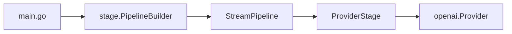

## What we will build

In this tutorial we build a command-line program that sends a prompt to an LLM through a runtime pipeline and prints the response, the token counts and the cost. The program wires one provider stage into a pipeline and runs a single request through it.



## Prerequisites

- Go 1.26 or later
- An OpenAI API key from [platform.openai.com](https://platform.openai.com)

## Step 1: Set up the project

Create a Go module and install the runtime:

```bash
mkdir my-llm-app
cd my-llm-app
go mod init my-llm-app
go get github.com/AltairaLabs/PromptKit/runtime/v2@latest
```

## Step 2: Set your API key

The OpenAI provider reads the key from the `OPENAI_API_KEY` environment variable:

```bash
export OPENAI_API_KEY="sk-..."
```

## Step 3: Write the program

Create `main.go`:

```go
package main

import (
	"context"
	"fmt"
	"log"

	"github.com/AltairaLabs/PromptKit/runtime/v2/pipeline/stage"
	"github.com/AltairaLabs/PromptKit/runtime/v2/providers"
	"github.com/AltairaLabs/PromptKit/runtime/v2/providers/openai"
	"github.com/AltairaLabs/PromptKit/runtime/v2/types"
)

func main() {
	ctx := context.Background()

	// Create the provider.
	provider := openai.NewProvider(
		"openai",      // provider ID
		"gpt-4o-mini", // model
		"",            // base URL; empty uses the default
		providers.ProviderDefaults{Temperature: 0.7, MaxTokens: 2000},
		false, // do not include raw responses
	)
	defer provider.Close()

	// Build a pipeline with one stage.
	pipe, err := stage.NewPipelineBuilder().
		Chain(
			stage.NewProviderStage(provider, nil, nil, &stage.ProviderConfig{
				MaxTokens:   500,
				Temperature: 0.7,
			}),
		).
		Build()
	if err != nil {
		log.Fatal(err)
	}
	defer pipe.Shutdown(ctx)

	// Send a user message and wait for the result.
	msg := &types.Message{Role: "user", Content: "What is artificial intelligence?"}
	result, err := pipe.ExecuteSync(ctx, stage.NewMessageElement(msg))
	if err != nil {
		log.Fatal(err)
	}

	// Print the response.
	fmt.Printf("Response: %s\n", result.Response.Content)
	fmt.Printf("Tokens: %d in, %d out\n", result.CostInfo.InputTokens, result.CostInfo.OutputTokens)
	fmt.Printf("Cost: $%.6f\n", result.CostInfo.TotalCost)
}
```

## Step 4: Run it

```bash
go run main.go
```

The output looks like this. The reply text, the output token count and the cost vary from run to run:

```text
Response: Artificial intelligence (AI) refers to the simulation of human intelligence...
Tokens: 14 in, 138 out
Cost: $0.000085
```

Each part of the program did one job:

- `openai.NewProvider` created the connection to OpenAI.
- `stage.NewPipelineBuilder().Chain(...).Build()` linked the stages into a `StreamPipeline`. Here there is one stage, `ProviderStage`, which calls the model.
- `ExecuteSync` sent one message element into the pipeline, waited for it to finish, and returned an `ExecutionResult`.
- `result.Response.Content` holds the reply text, and `result.CostInfo` holds the token counts and cost.

## Step 5: Change a setting

Lower `MaxTokens` in the `ProviderConfig` to shorten the reply:

```go
stage.NewProviderStage(provider, nil, nil, &stage.ProviderConfig{
	MaxTokens:   100,
	Temperature: 0.7,
})
```

Run the program again. The reply is typically shorter, because `MaxTokens` caps the output at 100 tokens.

## Step 6: Ask several questions

The pipeline handles any number of requests. Replace the single `ExecuteSync` call with a loop:

```go
questions := []string{"What is AI?", "What is machine learning?", "What is deep learning?"}

for _, question := range questions {
	msg := &types.Message{Role: "user", Content: question}
	result, err := pipe.ExecuteSync(ctx, stage.NewMessageElement(msg))
	if err != nil {
		log.Printf("Error: %v", err)
		continue
	}
	fmt.Printf("\nQ: %s\nA: %s\n", question, result.Response.Content)
	fmt.Printf("Cost: $%.6f\n", result.CostInfo.TotalCost)
}
```

Each question is independent: this pipeline stores no history. The next tutorial adds it.

## Next steps

- Continue to [Tutorial 2: Multi-turn conversations](/runtime/tutorials/02-multi-turn/) to add conversation state and build a chatbot.
- [Configure the pipeline](/runtime/how-to/pipeline/configure-pipeline/), [set up providers](/runtime/how-to/providers/setup-providers/) and the [pipeline reference](/runtime/reference/pipeline/) cover the other settings.
