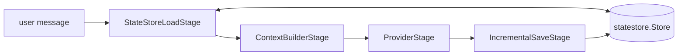

## What we will build

In this tutorial we build a command-line chatbot that remembers what you said earlier in the conversation, first in memory and then in Redis. The chatbot runs each message through four stages. The first loads the conversation history, the last saves the new messages.



## Prerequisites

- Completed [Tutorial 1](/runtime/tutorials/01-first-pipeline/), with `OPENAI_API_KEY` still set
- Docker, for the Redis step

## Step 1: Write the chatbot

In a new directory, create a module as in Tutorial 1, then create `main.go`:

```go
package main

import (
	"bufio"
	"context"
	"fmt"
	"log"
	"os"
	"strings"

	"github.com/AltairaLabs/PromptKit/runtime/v2/pipeline"
	"github.com/AltairaLabs/PromptKit/runtime/v2/pipeline/stage"
	"github.com/AltairaLabs/PromptKit/runtime/v2/providers"
	"github.com/AltairaLabs/PromptKit/runtime/v2/providers/openai"
	"github.com/AltairaLabs/PromptKit/runtime/v2/statestore"
	"github.com/AltairaLabs/PromptKit/runtime/v2/types"
)

func main() {
	ctx := context.Background()

	provider := openai.NewProvider(
		"openai",
		"gpt-4o-mini",
		"",
		providers.ProviderDefaults{Temperature: 0.7, MaxTokens: 2000},
		false,
	)
	defer provider.Close()

	// The conversation ID names the history to load and save.
	conversationID := os.Getenv("SESSION_ID")
	if conversationID == "" {
		conversationID = "demo"
	}

	store := statestore.NewMemoryStore()
	storeConfig := &pipeline.StateStoreConfig{Store: store, ConversationID: conversationID}

	pipe, err := stage.NewPipelineBuilder().
		Chain(
			stage.NewStateStoreLoadStage(storeConfig),
			stage.NewContextBuilderStage(&stage.ContextBuilderPolicy{
				TokenBudget:      8000,
				ReserveForOutput: 500,
				Strategy:         stage.TruncateOldest,
			}),
			stage.NewProviderStage(provider, nil, nil, &stage.ProviderConfig{
				MaxTokens:   500,
				Temperature: 0.7,
			}),
			stage.NewIncrementalSaveStage(&stage.IncrementalSaveConfig{StateStoreConfig: storeConfig}),
		).
		Build()
	if err != nil {
		log.Fatal(err)
	}
	defer pipe.Shutdown(ctx)

	fmt.Printf("Session: %s\nChatbot ready! Type 'exit' to quit.\n\nYou: ", conversationID)
	scanner := bufio.NewScanner(os.Stdin)
	for scanner.Scan() {
		input := strings.TrimSpace(scanner.Text())
		if input == "exit" {
			break
		}
		if input == "" {
			fmt.Print("You: ")
			continue
		}

		msg := &types.Message{Role: "user", Content: input}
		result, err := pipe.ExecuteSync(ctx, stage.NewMessageElement(msg))
		if err != nil {
			log.Printf("Error: %v", err)
			fmt.Print("You: ")
			continue
		}

		// The last message is this turn's assistant reply.
		reply := result.Messages[len(result.Messages)-1]
		fmt.Printf("\nBot: %s\n\n", result.Response.Content)
		fmt.Printf("Turn cost: $%.6f | Conversation cost: $%.6f\n\nYou: ",
			reply.CostInfo.TotalCost, result.CostInfo.TotalCost)
	}
	fmt.Println("\nGoodbye!")
}
```

The `StateStoreLoadStage` and `IncrementalSaveStage` share one `StateStoreConfig`, so they read and write the same conversation.

## Step 2: Test the conversation memory

Run the chatbot:

```bash
go run main.go
```

Try this conversation. The replies vary, but they typically use what you said earlier:

```text
You: My name is Alice
Bot: Hello Alice! It's nice to meet you...

You: What's my name?
Bot: Your name is Alice...

You: I love pizza
Bot: That's great! Pizza is delicious...

You: What food do I love?
Bot: You mentioned that you love pizza!
```

The bot answers from earlier turns because the load stage puts the saved messages in front of each new message.

Type `exit` and run the program again. The new run starts without the earlier turns, because the memory store lives and dies with the process.

## Step 3: Keep the history in Redis

Start Redis:

```bash
docker run -d -p 6379:6379 redis
```

Install the Redis client:

```bash
go get github.com/redis/go-redis/v9
```

Add `"github.com/redis/go-redis/v9"` to the imports. Then replace the memory store in `main.go`:

```go
store := statestore.NewMemoryStore()
```

with a Redis store:

```go
store := statestore.NewRedisStore(redis.NewClient(&redis.Options{Addr: "localhost:6379"}))
```

Run the chatbot with a fixed session ID, tell it your name, and exit:

```bash
SESSION_ID=alice go run main.go
```

Run the same command again and ask `What's my name?`. The bot answers correctly, because the history survived the restart. A different `SESSION_ID` starts a separate conversation.

## Step 4: See the token budget at work

The `ContextBuilderStage` keeps the history inside the model's context window. With `TokenBudget: 8000` and `ReserveForOutput: 500`, it drops the oldest messages once the history exceeds the remaining 7,500 tokens.

To watch it, lower `TokenBudget` to `800`, tell the bot your name, then ask it a few questions that need long answers. Ask for your name again. The bot cannot answer, while the store still holds every message.

## Next steps

- Continue to [Tutorial 3: MCP integration](/runtime/tutorials/03-mcp-integration/) to add external tools to your chatbot.
- [Manage state](/runtime/how-to/state/manage-state/) and the [StateStore reference](/runtime/reference/statestore/) cover state in more depth.
