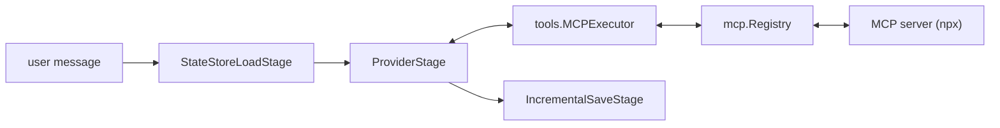

## What we will build

In this tutorial we build a command-line chatbot that reads and lists files through a Model Context Protocol (MCP) server, on the pipeline from Tutorial 2. The runtime starts an MCP server, registers its tools, and lets the model call them.



## Prerequisites

- Completed [Tutorial 2](/runtime/tutorials/02-multi-turn/), with `OPENAI_API_KEY` still set
- Node.js, which provides `npx` to start the MCP server

## Step 1: Create a test directory

In the Tutorial 2 module, create a directory the MCP server may access, with two files:

```bash
mkdir -p allowed
echo "Hello from file!" > allowed/test.txt
echo "Shopping: milk, eggs, bread" > allowed/shopping.txt
```

## Step 2: List the server's tools

Replace `main.go` with a program that starts the filesystem server and prints the tools it offers. `mcp.Registry` starts the server process on first use and `Close` stops it.

```go
package main

import (
	"context"
	"fmt"
	"log"
	"path/filepath"

	"github.com/AltairaLabs/PromptKit/runtime/v2/mcp"
)

func main() {
	ctx := context.Background()

	dir, err := filepath.Abs("allowed")
	if err != nil {
		log.Fatal(err)
	}

	mcpReg := mcp.NewRegistry()
	defer mcpReg.Close()

	err = mcpReg.RegisterServer(mcp.ServerConfig{
		Name:    "filesystem",
		Command: "npx",
		Args:    []string{"-y", "@modelcontextprotocol/server-filesystem", dir},
	})
	if err != nil {
		log.Fatal(err)
	}

	serverTools, err := mcpReg.ListAllTools(ctx)
	if err != nil {
		log.Fatal(err)
	}
	for server, list := range serverTools {
		fmt.Printf("%s: %d tools\n", server, len(list))
		for _, t := range list {
			fmt.Printf("  %s\n", t.Name)
		}
	}
}
```

Run it:

```bash
go run .
```

The program prints the server's tools. The order varies between runs:

```text
filesystem: 16 tools
  read_file
  read_text_file
  read_media_file
  read_multiple_files
  write_file
  append_file
  edit_file
  create_directory
  list_directory
  list_directory_with_sizes
  directory_tree
  move_file
  copy_file
  search_files
  get_file_info
  list_allowed_directories
```

## Step 3: Give the tools to the model

The model can call a tool only when the pipeline's tool registry holds it. Replace `main.go` with the chatbot below. It does three things on top of Step 2:

- It registers `tools.NewMCPExecutor`, which sends tool calls to the MCP server.
- It registers a `ToolDescriptor` with `Mode: "mcp"` for each tool the server lists.
- It passes the tool registry and a `ToolPolicy` to `stage.NewProviderStage`, so the stage runs up to five tool rounds per message.

```go
package main

import (
	"bufio"
	"context"
	"fmt"
	"log"
	"os"
	"path/filepath"
	"strings"

	"github.com/AltairaLabs/PromptKit/runtime/v2/mcp"
	"github.com/AltairaLabs/PromptKit/runtime/v2/pipeline"
	"github.com/AltairaLabs/PromptKit/runtime/v2/pipeline/stage"
	"github.com/AltairaLabs/PromptKit/runtime/v2/providers"
	"github.com/AltairaLabs/PromptKit/runtime/v2/providers/openai"
	"github.com/AltairaLabs/PromptKit/runtime/v2/statestore"
	"github.com/AltairaLabs/PromptKit/runtime/v2/tools"
	"github.com/AltairaLabs/PromptKit/runtime/v2/types"
)

func main() {
	ctx := context.Background()

	dir, err := filepath.Abs("allowed")
	if err != nil {
		log.Fatal(err)
	}

	// Start the MCP server and list its tools.
	mcpReg := mcp.NewRegistry()
	defer mcpReg.Close()

	err = mcpReg.RegisterServer(mcp.ServerConfig{
		Name:    "filesystem",
		Command: "npx",
		Args:    []string{"-y", "@modelcontextprotocol/server-filesystem", dir},
	})
	if err != nil {
		log.Fatal(err)
	}

	serverTools, err := mcpReg.ListAllTools(ctx)
	if err != nil {
		log.Fatal(err)
	}

	// Make each MCP tool callable from the pipeline.
	toolReg := tools.NewRegistry()
	toolReg.RegisterExecutor(tools.NewMCPExecutor(mcpReg))
	registered := 0
	for _, list := range serverTools {
		for _, t := range list {
			err := toolReg.Register(&tools.ToolDescriptor{
				Name:        t.Name,
				Description: t.Description,
				InputSchema: t.InputSchema,
				Mode:        "mcp",
			})
			if err != nil {
				log.Fatal(err)
			}
			registered++
		}
	}
	fmt.Printf("Registered %d MCP tools\n", registered)

	provider := openai.NewProvider(
		"openai",
		"gpt-4o-mini",
		"",
		providers.ProviderDefaults{Temperature: 0.7, MaxTokens: 2000},
		false,
	)
	defer provider.Close()

	store := statestore.NewMemoryStore()
	storeConfig := &pipeline.StateStoreConfig{Store: store, ConversationID: "files"}

	pipe, err := stage.NewPipelineBuilder().
		Chain(
			stage.NewStateStoreLoadStage(storeConfig),
			stage.NewProviderStage(provider, toolReg,
				&pipeline.ToolPolicy{ToolChoice: "auto", MaxRounds: 5},
				&stage.ProviderConfig{MaxTokens: 1500, Temperature: 0.7},
			),
			stage.NewIncrementalSaveStage(&stage.IncrementalSaveConfig{StateStoreConfig: storeConfig}),
		).
		Build()
	if err != nil {
		log.Fatal(err)
	}
	defer pipe.Shutdown(ctx)

	fmt.Printf("Allowed directory: %s\nType 'exit' to quit.\n\nYou: ", dir)
	scanner := bufio.NewScanner(os.Stdin)
	for scanner.Scan() {
		input := strings.TrimSpace(scanner.Text())
		if input == "exit" {
			break
		}
		if input == "" {
			fmt.Print("You: ")
			continue
		}

		msg := &types.Message{Role: "user", Content: input}
		result, err := pipe.ExecuteSync(ctx, stage.NewMessageElement(msg))
		if err != nil {
			log.Printf("Error: %v", err)
			fmt.Print("You: ")
			continue
		}
		fmt.Printf("\nBot: %s\n\nYou: ", result.Response.Content)
	}
}
```

## Step 4: Run the bot

```bash
go run .
```

The program prints how many tools it registered and the absolute path of the allowed directory. Include that path in your prompts. The replies vary, but the model typically calls a file tool for each request:

```text
Registered 16 MCP tools
Allowed directory: <dir>
Type 'exit' to quit.

You: Read the file <dir>/test.txt

Bot: The file contains: "Hello from file!"

You: List all files in <dir>

Bot: There are 2 files: test.txt and shopping.txt

You: Create a file called notes.txt in <dir> containing "Meeting at 3pm"

Bot: I created notes.txt with your message.
```

The model chooses to call the MCP tools, and the pipeline executes them and returns the results to the model. Check `allowed/notes.txt` to see the file the bot created.

## Step 5: Restrict the tools

The MCP server offers every tool it has, and the registry lists them all. `mcp.ServerConfig` has a `ToolFilter` and a `TimeoutMs`. The registry does not apply the filter, so you apply it when you register tools.

In `main.go`, replace the `RegisterServer` call with a server configuration that allows only the read and list tools:

```go
server := mcp.ServerConfig{
	Name:       "filesystem",
	Command:    "npx",
	Args:       []string{"-y", "@modelcontextprotocol/server-filesystem", dir},
	TimeoutMs:  10000,
	ToolFilter: &mcp.ToolFilter{Allowlist: []string{"read_*", "list_*"}},
}
if err := mcpReg.RegisterServer(server); err != nil {
	log.Fatal(err)
}
```

At the top of the inner registration loop, skip tools the filter excludes:

```go
if !server.ToolFilter.Includes(t.Name) {
	continue
}
```

An entry ending in `*` matches a name prefix. Run the bot again and ask it to create `notes2.txt`.

```text
Registered 7 MCP tools
```

The bot reads and lists files but has no tool to create them, so it typically tells you it cannot.

## Step 6: Add a second server

Replace the `RegisterServer` call and the filter check with a list of servers. This adds the memory server beside the filesystem server and keeps each server's filter:

```go
servers := []mcp.ServerConfig{
	{
		Name:       "filesystem",
		Command:    "npx",
		Args:       []string{"-y", "@modelcontextprotocol/server-filesystem", dir},
		TimeoutMs:  10000,
		ToolFilter: &mcp.ToolFilter{Allowlist: []string{"read_*", "list_*"}},
	},
	{
		Name:    "memory",
		Command: "npx",
		Args:    []string{"-y", "@modelcontextprotocol/server-memory"},
	},
}
filters := map[string]*mcp.ToolFilter{}
for _, server := range servers {
	if err := mcpReg.RegisterServer(server); err != nil {
		log.Fatal(err)
	}
	filters[server.Name] = server.ToolFilter
}
```

`ListAllTools` returns tools keyed by server name. Use the key to look up the filter, and change the loop header to match:

```go
for serverName, list := range serverTools {
	for _, t := range list {
		if f := filters[serverName]; f != nil && !f.Includes(t.Name) {
			continue
		}
		// ... register the tool as before
	}
}
```

Run the bot. It registers the 7 filesystem tools and the 9 memory tools:

```text
Registered 16 MCP tools
```

Keep tool names unique across servers: the tool registry holds one descriptor per name, so a later registration replaces an earlier one.

## Next steps

- Continue to [Tutorial 4: Validation and guardrails](/runtime/tutorials/04-validation-guardrails/) to add content safety.
- [Integrate MCP](/runtime/how-to/tools/integrate-mcp/) covers transports, authorization and tool list changes.
- [Configure MCP in the SDK](/sdk/how-to/tools/configure-mcp/) sets up the same servers through `sdk.WithMCP`.
- The [MCP reference](/runtime/reference/mcp/) lists the complete API.
