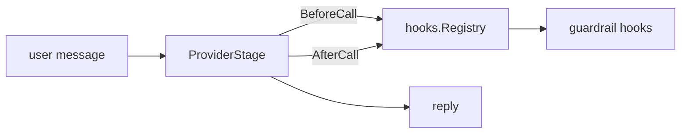

In this tutorial we add content guardrails to a chatbot: banned words on the way in and out, a length limit, and custom checks.

**Time**: 20 minutes
**Level**: Intermediate

## What we will build

A command-line chatbot whose guardrails block a request before it reaches the model, replace a response that breaks a rule, and reject a response that contains personal data. Each guardrail is a hook on the `ProviderStage`.



## Prerequisites

- Completed [Tutorial 1](/runtime/tutorials/01-first-pipeline/), with `OPENAI_API_KEY` still set

## Step 1: Add guardrails to a pipeline

In a new directory, create a module as in Tutorial 1, then create `main.go`. `guardrails.NewGuardrailHook` builds a hook from an eval type and its params. A `direction` of `input` checks the user's message before the model call. The default direction checks the response. `hooks.NewRegistry` collects the hooks, and `stage.NewProviderStageWithHooks` runs them around each model call.

```go
package main

import (
	"bufio"
	"context"
	"fmt"
	"log"
	"os"
	"strings"

	"github.com/AltairaLabs/PromptKit/runtime/v2/hooks"
	"github.com/AltairaLabs/PromptKit/runtime/v2/hooks/guardrails"
	"github.com/AltairaLabs/PromptKit/runtime/v2/pipeline/stage"
	"github.com/AltairaLabs/PromptKit/runtime/v2/providers"
	"github.com/AltairaLabs/PromptKit/runtime/v2/providers/openai"
	"github.com/AltairaLabs/PromptKit/runtime/v2/types"
)

func main() {
	ctx := context.Background()

	provider := openai.NewProvider(
		"openai",
		"gpt-4o-mini",
		"",
		providers.ProviderDefaults{Temperature: 0.7, MaxTokens: 2000},
		false,
	)
	defer provider.Close()

	// The direction param makes a guardrail check the user's message
	// before the model call. The default direction checks the response.
	noHacking, err := guardrails.NewGuardrailHook("banned_words", map[string]any{
		"words":     []any{"hack", "exploit"},
		"direction": "input",
	}, guardrails.WithMessage("I can't help with that."))
	if err != nil {
		log.Fatal(err)
	}
	noCredentials, err := guardrails.NewGuardrailHook("banned_words", map[string]any{
		"words": []any{"password", "secret"},
	}, guardrails.WithMessage("I can't share credentials."))
	if err != nil {
		log.Fatal(err)
	}
	shortReplies, err := guardrails.NewGuardrailHook("length", map[string]any{
		"max_characters": 500,
	})
	if err != nil {
		log.Fatal(err)
	}

	registry := hooks.NewRegistry(
		hooks.WithProviderHook(noHacking),
		hooks.WithProviderHook(noCredentials),
		hooks.WithProviderHook(shortReplies),
	)

	pipe, err := stage.NewPipelineBuilder().
		Chain(stage.NewProviderStageWithHooks(provider, nil, nil,
			&stage.ProviderConfig{MaxTokens: 500, Temperature: 0.7}, nil, registry)).
		Build()
	if err != nil {
		log.Fatal(err)
	}
	defer pipe.Shutdown(ctx)

	fmt.Print("Safe chatbot. Type 'exit' to quit.\n\nYou: ")
	scanner := bufio.NewScanner(os.Stdin)
	for scanner.Scan() {
		input := strings.TrimSpace(scanner.Text())
		if input == "exit" {
			break
		}
		if input == "" {
			fmt.Print("You: ")
			continue
		}

		msg := &types.Message{Role: "user", Content: input}
		result, err := pipe.ExecuteSync(ctx, stage.NewMessageElement(msg))
		if err != nil {
			log.Printf("Error: %v", err)
			fmt.Print("\nYou: ")
			continue
		}

		reply := result.Messages[len(result.Messages)-1]
		fmt.Printf("\nBot: %s\n", result.Response.Content)
		for _, v := range reply.Validations {
			if !v.Passed {
				fmt.Printf("[guardrail enforced: %s]\n", v.ValidatorType)
			}
		}
		fmt.Print("\nYou: ")
	}
}
```

## Step 2: Try it

```bash
go run .
```

```text
You: Hello!

Bot: Hi! How can I help you?

You: How do I hack a system?

Bot: I can't help with that.
[guardrail enforced: banned_words]

You: What is a good default password for a database?

Bot: I can't share credentials.
[guardrail enforced: banned_words]
```

The input guardrail blocks the first request before the model call, so it costs no tokens. The output guardrail replaces a response that contains a banned word. Neither returns an error: the pipeline returns the replacement text, and the reply message's `Validations` records which guardrail fired.

Banned-word matching is case-insensitive and matches whole words, so `hack` blocks "HACK it" but not "hackers". Set `"match_mode": "substring"` in the params to match inside words. While a response streams, the check matches substrings in the partial text, so a stream can stop on a word that the finished response would pass. The length guardrail truncates a response longer than `max_characters`.

## Step 3: Add a function guardrail

`guardrails.InputFunc` and `guardrails.OutputFunc` turn a plain function into a guardrail spec, and `Hook` builds the hook. Add this to `main.go` before the registry, and pass `noSSN` with another `hooks.WithProviderHook`:

```go
noSSN, err := guardrails.InputFunc("no-ssn", func(_ context.Context, in *hooks.InputRequest) hooks.Decision {
	if strings.Contains(strings.ToLower(in.UserInput), "social security number") {
		in.Replacement = "I can't help with that request."
		return hooks.Enforced("ssn requested", map[string]any{"validator_type": "no-ssn"})
	}
	return hooks.Allow
}).Hook()
if err != nil {
	log.Fatal(err)
}
```

Setting `in.Replacement` chooses the text the user sees, and the `validator_type` metadata makes the firing appear in `Validations`. Ask "What is my social security number?" and the bot answers `I can't help with that request.` with `[guardrail enforced: no-ssn]`.

## Step 4: Write a custom hook

A check that needs more control implements `hooks.ProviderHook`. Create `pii.go`. This hook rejects responses that contain an email address. It returns `hooks.Deny`, which makes `ExecuteSync` return an error instead of replacement text.

```go
package main

import (
	"context"
	"regexp"

	"github.com/AltairaLabs/PromptKit/runtime/v2/hooks"
)

// PIIHook rejects responses that contain an email address.
type PIIHook struct {
	email *regexp.Regexp
}

func NewPIIHook() *PIIHook {
	return &PIIHook{email: regexp.MustCompile(`[a-zA-Z0-9._%+\-]+@[a-zA-Z0-9.\-]+\.[a-zA-Z]{2,}`)}
}

func (h *PIIHook) Name() string { return "pii_filter" }

func (h *PIIHook) BeforeCall(_ context.Context, _ *hooks.ProviderRequest) hooks.Decision {
	return hooks.Allow
}

func (h *PIIHook) AfterCall(
	_ context.Context, _ *hooks.ProviderRequest, resp *hooks.ProviderResponse,
) hooks.Decision {
	if h.email.MatchString(resp.Message.Content) {
		return hooks.Deny("response contains an email address")
	}
	return hooks.Allow
}
```

Register it next to the other hooks:

```go
hooks.WithProviderHook(NewPIIHook()),
```

Handle the denial in the loop, before the `err != nil` check, by looking for `*hooks.HookDeniedError`. Add `"errors"` to the imports.

```go
var denied *hooks.HookDeniedError
if errors.As(err, &denied) {
	fmt.Printf("\nBot: [blocked: %s]\n\nYou: ", denied.Reason)
	continue
}
```

Ask the bot to "make up a fake contact card with an email address":

```text
Bot: [blocked: response contains an email address]
```

## Step 5: Build guardrails from declared validators

`guardrails.CompileValidators` turns validator declarations into hooks, the same way a pack's `validators` list does. Replace the banned-word and length hooks from Step 1 with this, add `"github.com/AltairaLabs/PromptKit/runtime/v2/prompt"` to the imports, and build the registry from the compiled hooks:

```go
declared, err := guardrails.CompileValidators([]prompt.ValidatorConfig{
	{
		Type:    "banned_words",
		Params:  map[string]any{"words": []any{"competitor_name"}, "direction": "input"},
		Message: "I can't discuss that.",
	},
	{
		Type:   "length",
		Params: map[string]any{"max_characters": 500},
	},
})
if err != nil {
	log.Fatal(err)
}

opts := []hooks.Option{hooks.WithProviderHook(noSSN), hooks.WithProviderHook(NewPIIHook())}
for _, h := range declared {
	opts = append(opts, hooks.WithProviderHook(h))
}
registry := hooks.NewRegistry(opts...)
```

A validator checks the response unless its `direction` param is `input`. The `Message` field sets the text the user sees when the validator fires. A validator always enforces; set `Enabled` to a pointer to `false` to switch one off. Ask "Tell me about competitor_name":

```text
Bot: I can't discuss that.
[guardrail enforced: banned_words]
```

## Common issues

| Symptom | Fix |
|---|---|
| Legitimate messages blocked | Shorten the word list, and keep the default whole-word `match_mode` instead of `"substring"`. |
| Inappropriate content gets through | Add guardrails, or write a custom `hooks.ProviderHook` for a domain-specific check. |
| `NewGuardrailHook` or `CompileValidators` returns an error | The eval type or its params are invalid. Check the error before you build the pipeline. |

## Next steps

- Continue to [Tutorial 5: Production Deployment](/runtime/tutorials/05-production-deployment/).
- [Checks Reference](/reference/checks/): all check types and parameters.
- [Unified Check Model](/concepts/validation/): how guardrails, assertions and evals relate.
- [Hooks & Guardrails Reference](/runtime/reference/hooks/): the runtime hook API.
- [Handle Errors](/runtime/how-to/pipeline/handle-errors/): error strategies.
