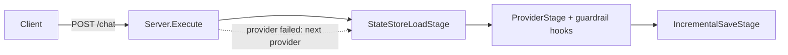

## What we will build

In this tutorial we build an HTTP server with a `/chat` endpoint, `/health` and `/metrics` endpoints, guardrails on every reply, conversation history in a state store, and fallback from OpenAI to Claude.



## Prerequisites

- Completed [Tutorial 1](/runtime/tutorials/01-first-pipeline/)
- An OpenAI API key and an Anthropic API key

## Step 1: Set up the project

```bash
mkdir chat-server && cd chat-server
go mod init chat-server
go get github.com/AltairaLabs/PromptKit/runtime/v2@latest
export OPENAI_API_KEY="sk-..."
export ANTHROPIC_API_KEY="sk-ant-..."
```

## Step 2: Track metrics

We create `main.go` with the imports for the whole server and a small metrics type. The server records every attempt, so a failed provider shows up in the error count.

```go
package main

import (
	"context"
	"encoding/json"
	"errors"
	"fmt"
	"log"
	"net/http"
	"os"
	"os/signal"
	"sync"
	"syscall"
	"time"

	"github.com/AltairaLabs/PromptKit/runtime/v2/hooks"
	"github.com/AltairaLabs/PromptKit/runtime/v2/hooks/guardrails"
	"github.com/AltairaLabs/PromptKit/runtime/v2/pipeline"
	"github.com/AltairaLabs/PromptKit/runtime/v2/pipeline/stage"
	"github.com/AltairaLabs/PromptKit/runtime/v2/providers"
	"github.com/AltairaLabs/PromptKit/runtime/v2/providers/claude"
	"github.com/AltairaLabs/PromptKit/runtime/v2/providers/openai"
	"github.com/AltairaLabs/PromptKit/runtime/v2/statestore"
	"github.com/AltairaLabs/PromptKit/runtime/v2/types"
)

type Metrics struct {
	mu          sync.Mutex
	requests    int
	errors      int
	totalCost   float64
	providerUse map[string]int
}

func (m *Metrics) Record(provider string, cost float64, err error) {
	m.mu.Lock()
	defer m.mu.Unlock()
	m.requests++
	if err != nil {
		m.errors++
	}
	m.totalCost += cost
	m.providerUse[provider]++
}

func (m *Metrics) Report() map[string]any {
	m.mu.Lock()
	defer m.mu.Unlock()
	return map[string]any{
		"requests":       m.requests,
		"errors":         m.errors,
		"total_cost_usd": m.totalCost,
		"provider_usage": m.providerUse,
	}
}
```

## Step 3: Create the server

In `NewServer` we build two guardrail hooks, two providers and an in-memory state store. An empty base URL selects the provider's default endpoint, and each provider reads its API key from the environment. The `banned_words` hook replaces a reply that contains a listed word with a policy message, and the `length` hook truncates a reply at 2,000 characters.

```go
type Server struct {
	providers []providers.Provider
	store     *statestore.MemoryStore
	hooks     *hooks.Registry
	metrics   *Metrics
}

func NewServer() (*Server, error) {
	banned, err := guardrails.NewGuardrailHook("banned_words", map[string]any{
		"words": []string{"spam", "hack"},
	})
	if err != nil {
		return nil, err
	}
	length, err := guardrails.NewGuardrailHook("length", map[string]any{
		"max_characters": 2000,
	})
	if err != nil {
		return nil, err
	}

	return &Server{
		providers: []providers.Provider{
			openai.NewProvider("openai", "gpt-4o-mini", "",
				providers.ProviderDefaults{Temperature: 0.7, MaxTokens: 2000}, false),
			claude.NewProvider("claude", "claude-haiku-4-5", "",
				providers.ProviderDefaults{Temperature: 0.7, MaxTokens: 2000}, false),
		},
		store: statestore.NewMemoryStore(),
		hooks: hooks.NewRegistry(
			hooks.WithProviderHook(banned),
			hooks.WithProviderHook(length),
		),
		metrics: &Metrics{providerUse: map[string]int{}},
	}, nil
}

func (s *Server) Close() {
	for _, p := range s.providers {
		_ = p.Close()
	}
	s.store.Close()
}
```

## Step 4: Run a request through a pipeline

In `run` we build a pipeline for one conversation: it loads history, calls the provider with the hooks attached, and saves the new messages. The state store config names the conversation, so the pipeline is built per request.

```go
// run sends one user message through a pipeline backed by provider p and
// returns the assistant message.
func (s *Server) run(ctx context.Context, p providers.Provider, sessionID, content string) (*types.Message, error) {
	state := &pipeline.StateStoreConfig{Store: s.store, ConversationID: sessionID}

	pipe, err := stage.NewPipelineBuilder().
		Chain(
			stage.NewStateStoreLoadStage(state),
			stage.NewProviderStageWithHooks(p, nil, nil,
				&stage.ProviderConfig{MaxTokens: 1000}, nil, s.hooks),
			stage.NewIncrementalSaveStage(&stage.IncrementalSaveConfig{StateStoreConfig: state}),
		).
		Build()
	if err != nil {
		return nil, err
	}
	defer pipe.Shutdown(context.Background())

	input := make(chan stage.StreamElement, 1)
	input <- stage.NewMessageElement(&types.Message{Role: "user", Content: content})
	close(input)

	output, err := pipe.Execute(ctx, input)
	if err != nil {
		return nil, err
	}

	var reply *types.Message
	for elem := range output {
		if elem.Error != nil {
			err = elem.Error
		}
		if elem.Message != nil && elem.Message.Role == "assistant" && !elem.Meta.FromHistory {
			reply = elem.Message
		}
	}
	if err != nil {
		return nil, err
	}
	if reply == nil {
		return nil, errors.New("pipeline produced no reply")
	}
	return reply, nil
}
```

Each provider retries transient failures such as `429` and `503` itself. `Execute` moves to the next provider only when a provider returns an error after its retries.

```go
// Execute tries each provider in order until one succeeds.
func (s *Server) Execute(ctx context.Context, sessionID, content string) (*types.Message, error) {
	var lastErr error
	for _, p := range s.providers {
		reply, err := s.run(ctx, p, sessionID, content)
		cost := 0.0
		if reply != nil && reply.CostInfo != nil {
			cost = reply.CostInfo.TotalCost
		}
		s.metrics.Record(p.ID(), cost, err)
		if err == nil {
			return reply, nil
		}
		lastErr = err
		log.Printf("provider %s failed: %v", p.ID(), err)
	}
	return nil, fmt.Errorf("all providers failed: %w", lastErr)
}
```

## Step 5: Add the HTTP handlers

```go
type ChatRequest struct {
	SessionID string `json:"session_id"`
	Message   string `json:"message"`
}

type ChatResponse struct {
	Response string  `json:"response"`
	Cost     float64 `json:"cost_usd"`
}

func (s *Server) handleChat(w http.ResponseWriter, r *http.Request) {
	if r.Method != http.MethodPost {
		http.Error(w, "method not allowed", http.StatusMethodNotAllowed)
		return
	}

	var req ChatRequest
	if err := json.NewDecoder(r.Body).Decode(&req); err != nil {
		http.Error(w, "invalid request", http.StatusBadRequest)
		return
	}
	if req.SessionID == "" || req.Message == "" {
		http.Error(w, "session_id and message required", http.StatusBadRequest)
		return
	}

	ctx, cancel := context.WithTimeout(r.Context(), 30*time.Second)
	defer cancel()

	reply, err := s.Execute(ctx, req.SessionID, req.Message)
	if err != nil {
		log.Printf("request failed: %v", err)
		http.Error(w, "request failed", http.StatusInternalServerError)
		return
	}

	resp := ChatResponse{Response: reply.GetContent()}
	if reply.CostInfo != nil {
		resp.Cost = reply.CostInfo.TotalCost
	}
	w.Header().Set("Content-Type", "application/json")
	_ = json.NewEncoder(w).Encode(resp)
}

func (s *Server) handleHealth(w http.ResponseWriter, r *http.Request) {
	w.Header().Set("Content-Type", "application/json")
	_ = json.NewEncoder(w).Encode(map[string]string{"status": "ok"})
}

func (s *Server) handleMetrics(w http.ResponseWriter, r *http.Request) {
	w.Header().Set("Content-Type", "application/json")
	_ = json.NewEncoder(w).Encode(s.metrics.Report())
}
```

## Step 6: Serve and shut down gracefully

`main` serves the three routes and, on `SIGINT` or `SIGTERM`, gives in-flight requests 30 seconds to finish.

```go
func main() {
	server, err := NewServer()
	if err != nil {
		log.Fatal(err)
	}
	defer server.Close()

	mux := http.NewServeMux()
	mux.HandleFunc("/chat", server.handleChat)
	mux.HandleFunc("/health", server.handleHealth)
	mux.HandleFunc("/metrics", server.handleMetrics)

	httpServer := &http.Server{
		Addr:         ":8080",
		Handler:      mux,
		ReadTimeout:  10 * time.Second,
		WriteTimeout: 60 * time.Second,
	}

	go func() {
		log.Println("server starting on :8080")
		if err := httpServer.ListenAndServe(); err != nil && !errors.Is(err, http.ErrServerClosed) {
			log.Fatal(err)
		}
	}()

	stop := make(chan os.Signal, 1)
	signal.Notify(stop, os.Interrupt, syscall.SIGTERM)
	<-stop
	log.Println("shutting down")

	ctx, cancel := context.WithTimeout(context.Background(), 30*time.Second)
	defer cancel()
	if err := httpServer.Shutdown(ctx); err != nil {
		log.Printf("shutdown error: %v", err)
	}
}
```

Run `go build`. The command prints nothing when the server compiles.

## Step 7: Try it

We start the server:

```bash
go run main.go
```

In another terminal, we send a request and check the health and metrics endpoints:

```bash
curl -X POST http://localhost:8080/chat \
  -H "Content-Type: application/json" \
  -d '{"session_id": "user-1", "message": "Hello!"}'

curl http://localhost:8080/health

curl http://localhost:8080/metrics
```

The chat call returns the reply and its cost. The health call returns `{"status":"ok"}`. The metrics call reports one request served by `openai`. The cost varies with the length of the reply:

```json
{"errors":0,"provider_usage":{"openai":1},"requests":1,"total_cost_usd":0.000041}
```

We send a second message with the same `session_id`. The model sees the first exchange because the pipeline loads it from the state store.

## Next steps

- Continue to [Tutorial 6: Advanced patterns](/runtime/tutorials/06-advanced-patterns/).
- [Handle errors](/runtime/how-to/pipeline/handle-errors/)
- [Monitor costs](/runtime/how-to/observability/monitor-costs/)
- [Manage state](/runtime/how-to/state/manage-state/)
