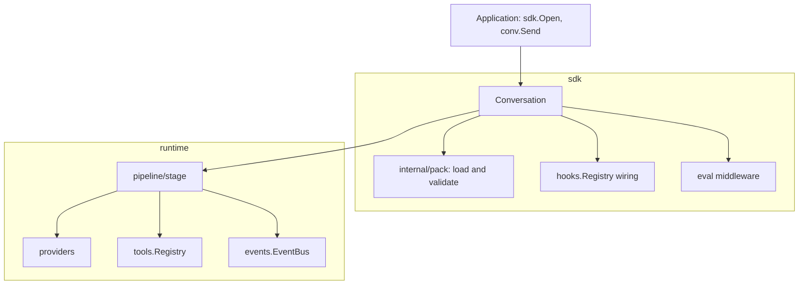
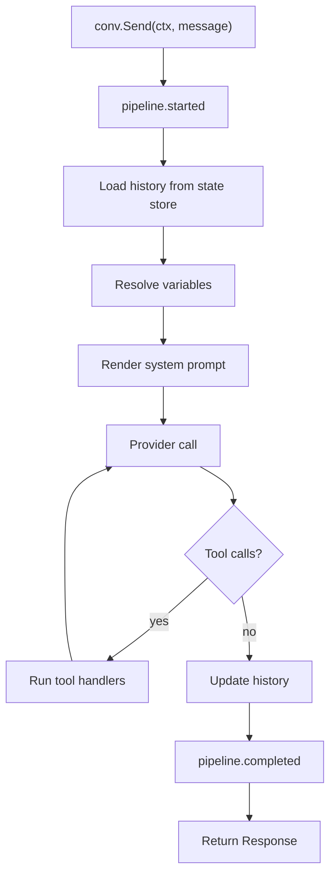
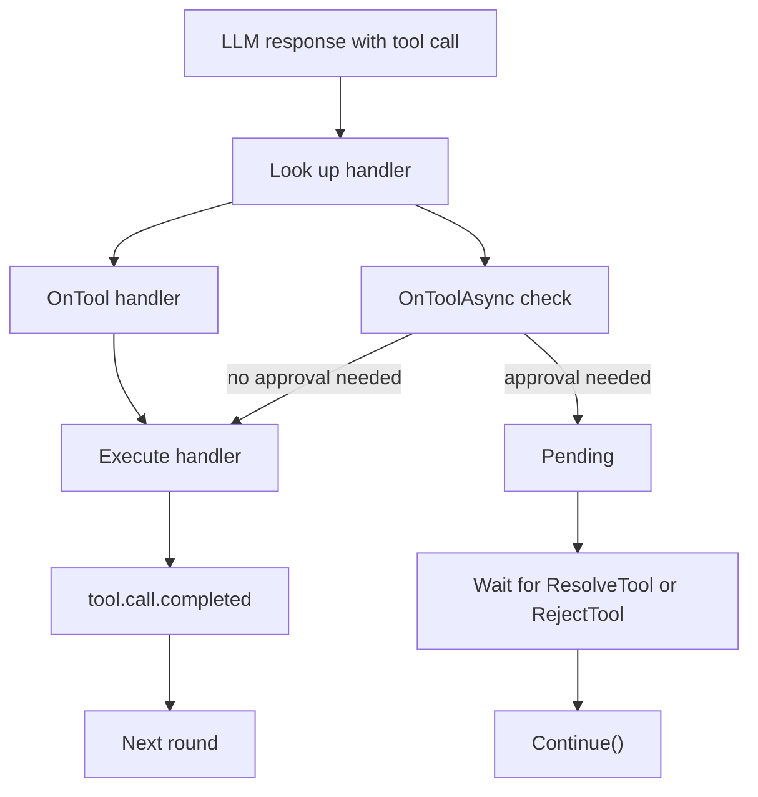

How does the SDK relate to the runtime, and what happens between `conv.Send()` and the response? This page describes the pack-first design and the components behind a `Conversation`.

## Design principles

1. Pack first: the pack file is the single source of truth for prompts, tools, validators and evals.
2. Minimal setup: `sdk.Open()` loads the pack and builds the provider, pipeline and session.
3. Type safety: options and handlers are plain Go types.
4. Concurrency: a `Conversation` is safe for concurrent use.
5. Extension points: hooks, tool handlers and event subscribers.

## Layers

The SDK sits on the runtime. Your application calls the SDK, and the SDK assembles runtime components.



## Core components

### Pack loading

`sdk.Open()` resolves the pack path, validates the file against the PromptPack JSON schema (unless you pass the option that skips validation), and checks that the named prompt exists. The SDK caches the loaded pack by absolute path, so repeated `Open()` calls for one file skip disk reads and schema compilation. The cached pack is immutable and shared across conversations.

### Conversation

`Conversation` is the main interaction point. Its fields are unexported. The public API includes `Send()`, `Stream()`, `SetVar()`, `GetVar()`, `OnTool()` and `Close()`.

A conversation:

- holds the variables for the session
- keeps the registry of tool handlers
- builds the pipeline once at `Open()` and runs each message through it
- reads and writes history through a state store
- emits events on the event bus

### Hooks and events

Two mechanisms observe or control a conversation. [Hooks](/sdk/explanation/hooks/) run synchronously and can veto or rewrite work. Events are published on the event bus and delivered to subscribers asynchronously. An event carries these fields:

```go
type Event struct {
    Type           EventType
    Timestamp      time.Time
    Sequence       int64
    ExecutionID    string
    SessionID      string
    ConversationID string
    UserID         string
    Data           EventData // type-specific payload
    // ...plus a trace span context
}
```

A turn emits events in this order:

1. `pipeline.started` when the pipeline begins.
2. `provider.call.started` and `provider.call.completed` around each provider call, or `provider.call.failed`.
3. `tool.call.started` and `tool.call.completed` around each tool call.
4. `pipeline.completed`, or `pipeline.failed` on error.

See [Observability](/sdk/explanation/observability/) for the full event model.

### Evals

Evals score LLM output. You define them in the pack, and the SDK runs them for each conversation.

- `EvalRunner` runs eval handlers (deterministic checks such as `contains`, `regex`, `json_valid` and `tools_called`, or `llm_judge`) with a timeout and panic recovery.
- `EvalHook` implementations observe each result and can modify it.
- `MetricResultWriter` records results through a metric recorder.
- The runner publishes `eval.completed` or `eval.failed` events as results arrive.

A trigger on each eval decides when it runs:

| Trigger | Runs |
|---|---|
| `every_turn` | After each assistant response |
| `sample_turns` | On a deterministic hash-based sample of turns |
| `on_session_complete` | When the session closes |
| `sample_sessions` | On a deterministic hash-based sample of sessions |

The SDK dispatches turn evals asynchronously after `Send()`, bounded by a concurrency limit. It runs session evals synchronously during `Close()`. Arena uses `PackEvalHook` to run evals against live or recorded conversations.

## Request flow

The pipeline turns a user message into a response through a chain of stages.



The system prompt renders once per turn. [How variables resolve](/sdk/explanation/variables/) explains the sources and their precedence. Each pass through the provider call is a round. A turn that uses tools runs several rounds before the model returns a final answer.

## Tool execution

When the model requests a tool, the stage looks up the handler you registered. `OnTool` handlers run immediately. `OnToolAsync` handlers first run a check function that decides whether the call needs approval.



A pending call suspends the turn. `Send()` returns a response that lists the pending tools. `ResolveTool` approves and `RejectTool` rejects, and `Continue()` resumes the turn with the results.

## State management

### Variables

The session stores variables behind a mutex. `SetVar` takes the write lock and `GetVar` takes the read lock, so concurrent access is safe.

### Message history

The state store holds the message history. Read and clear it through the public API:

```go
// Get all messages
messages := conv.Messages(ctx)

// Clear history
_ = conv.Clear()
```

## Thread safety

Conversations are safe for concurrent use:

```go
var wg sync.WaitGroup

for i := 0; i < 10; i++ {
    wg.Add(1)
    go func(n int) {
        defer wg.Done()
        conv.SetVar(fmt.Sprintf("key_%d", n), fmt.Sprintf("%d", n))
    }(i)
}

wg.Wait()
```

## See also

- [Hooks](/sdk/explanation/hooks/)
- [Observability](/sdk/explanation/observability/)
- [API reference](/sdk/reference/)
