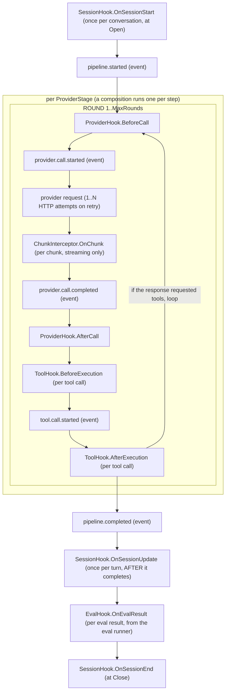

PromptKit exposes several hook contracts that let you observe, mutate, or veto work inside the runtime. Their semantics differ. This page gives the mental model so you can pick the right hook and reason about what happens when something goes wrong.

## Why several hook types?

Different parts of the runtime have different contracts with the caller. One "hook" abstraction would be too weak to gate a live LLM call, or too strong for observation. Each hook type has its own contract:

| Hook | Contract | Can deny? | Can mutate? | Fires per |
|---|---|---|---|---|
| `ProviderHook` | Request/response around an LLM call | Yes | Yes: the request before the call, the response after (via enforcement) | Each round, before and after the call |
| `ChunkInterceptor` | Each streaming chunk (opt-in extension of `ProviderHook`) | Yes (abort stream) | Yes (enforcement) | Each chunk |
| `ToolHook` | Request/response around a tool call | Before execution only; the model sees a blocked-by-policy tool error | No | Each tool call |
| `ToolResultRewriter` | Rewrites a tool result's text (opt-in extension of `ToolHook`) | An error fails the tool call | Yes: the result text | Each tool result |
| `SessionHook` | Session lifecycle | No (the SDK discards the error) | No | Session start, each turn, session end |
| `EvalHook` | Eval result | No (observational) | Yes (direct result mutation) | Each eval result |

Pick the hook whose contract matches your intent. A PII redactor gates content: `ProviderHook`. An audit log observes turns: `SessionHook`. A metrics exporter watches eval scores: `EvalHook`. A kill-switch that aborts mid-stream: `ChunkInterceptor`. A test harness that plants text in tool output: `ToolResultRewriter`.

## The two shapes of "mutate"

Hooks that modify behavior take one of two shapes.

Provider, chunk and tool hooks are decision-based: the hook returns a `Decision`. To mutate, the hook modifies the request or response in place before returning `hooks.Enforced(...)`. The alternative is `hooks.Deny(...)`. On a provider call, `Deny` produces a `HookDeniedError` and fails the turn: the provider stage returns the error, which reaches the caller as the last output element. Built-in guardrails return `Enforced` when a check fires. A guardrail whose handler errors also returns `Enforced`, with the validator's message, so it fails closed. The one exception is a streaming-check error in `OnChunk`, which returns `Deny`.

`Enforced` means something different at each of the two `ProviderHook` seams:

- `AfterCall`: the hook has already rewritten `resp.Message` (truncated or replaced it). The runtime picks up the modified content as the round's response.
- `BeforeCall`: the runtime skips the provider call entirely. It builds no request and spends no tokens. Write the assistant text you want returned to `req.Replacement` (`hooks.ProviderRequest.Replacement`; an exec hook returns it as `metadata.replacement`), or leave it empty to get the default blocked message. The runtime substitutes a canned assistant turn carrying `FinishReason: "safety"`, the decision metadata on `Message.Meta`, and a `ValidationResult` on `Message.Validations`.

Enforcing stops the round loop, and pending tool calls are dropped. If an `AfterCall` hook enforces on a response that also requested tool calls, the runtime does not execute those calls. It strips them from the message before the message lands in history, because an assistant message carrying tool calls with no matching tool results is a protocol error on the next provider call.

Enforcement does not fail the turn. A hook belongs to one stage: the provider call is skipped and that `ProviderStage`'s round loop stops, but the message is emitted and every downstream stage (saving, TTS, recording, evals) still runs, as it would for a real response. `Deny` fails the turn instead.

A `ToolHook` decision works differently. A non-`Allow` decision from `BeforeExecution` skips the tool and returns a "blocked by hook" error result to the model, and the turn continues. The runtime ignores the decision from `AfterExecution`.

Eval hooks mutate directly: the hook receives a pointer to the result and mutates it in place. There is no decision struct. The hook is observational by contract, but it may edit the observation before it propagates (redact explanations, enrich details, add tracing metadata). No pipeline gating happens either way.

Session hooks return a plain Go `error`. The SDK discards that error, so a failing lifecycle hook cannot block a conversation. The hook registry logs each failure at WARN with the hook's name, the event (`start`, `update` or `end`) and the session ID, and a failing hook does not stop the session hooks registered after it. Use session hooks for pure observation, not for gating or content modification.

## Execution ordering

Hooks do not fire in a flat sequence. The nesting is turn, provider, round, call:



Four consequences that a flat list hides:

- `BeforeCall` and `AfterCall` fire once per round, not once per turn. A turn that uses tools runs several rounds, so a hook doing expensive or billable work must decide whether it wants per-round or per-turn semantics. Built-in input guardrails evaluate only when the last message is a user message, because later rounds end in a tool result.
- A turn can involve more than one provider. Each composition step builds its own provider stage with its own round loop, and shares the same hook registry.
- Retries happen below the hook boundary. One round is one `BeforeCall`/`AfterCall` pair even if the transport retried the HTTP request several times. Hooks never see retries.
- On the streaming path, `OnChunk` fires before `provider.call.completed`. Chunks are consumed as they arrive, and the completion event carries the totals (tokens, cost, finish reason) that are known only once the stream closes. A chunk interceptor that aborts a stream runs before any completion event for that call.

Within a single phase, multiple hooks run in registration order. For decision-based hooks the first non-`Allow` decision short-circuits. Every session hook for the event runs, and the registry logs each failure. For eval hooks every registered hook always runs, and a panic in one does not block the others.

## Error handling and safety

A nil `*hooks.Registry` is a no-op. You can wire hooks optionally without special-casing "no hooks configured."

Eval hooks run inside a `recover()` scoped to each hook: one panic does not block the rest, and the eval result is still emitted. Provider, tool, and session hooks do not recover panics, so a panicking hook crashes the request. Do not panic in a hook.

Exec-based hooks (subprocess-backed) have a configurable `timeout_ms`. If the subprocess exceeds it, the parent kills it and, in `filter` mode, treats the timeout as a denial. In `observe` mode and for eval hooks, the timeout aborts the subprocess and the pipeline continues.

Hooks may run concurrently with one another across different conversations. Stateless hooks are always safe. Stateful hooks (a streaming buffer per response, for example) must scope their state to a single conversation or synchronize explicitly. The runtime does not isolate hook state for you.

## When to use an exec hook vs. a Go hook

A Go hook is the right choice when:

- You ship a library that wraps PromptKit and want opinionated defaults.
- The hook logic is fast enough that process-spawn overhead would dominate.
- You need access to Go types (for example, inspecting `*providers.StreamChunk` internals).

An exec hook is the right choice when:

- The hook is implemented in a non-Go language (Python ML models, Node log shippers).
- A different team operates the hook and upgrades it independently of the runtime.
- You want per-deployment configurability via `RuntimeConfig` YAML without rebuilding.

Exec hooks are slower (a process spawn per call) and less expressive (a JSON round-trip), but more flexible operationally. Many teams start with Go hooks and move specific policies (PII, audit) to exec hooks when the operational boundary matters.

## When not to reach for a hook

Hooks fit cross-cutting concerns (observability, safety, policy) that apply uniformly across many calls. They are the wrong tool for:

- Per-prompt behavior: use the prompt itself, or a scenario variable.
- Business logic: put it in a tool, not a tool hook.
- State that only one hook reads: use a local struct field.
- Changing what the LLM sees in a specific turn: use a pipeline stage (see [Pipeline Reference](/runtime/reference/pipeline/)), a cleaner extension point for content transformation.

If you find yourself writing "if this tool, then that hook," the logic probably belongs in the tool or the pipeline stage.

## Operational rules of thumb

These are not strict requirements. They reflect what tends to go wrong when hooks are written carelessly.

Order hooks fast to slow. Decision-based hooks short-circuit on the first non-`Allow` decision, so cheap checks should run first. They protect expensive ones from running on requests that were already going to be rejected.

```go
sdk.WithGuardrail(
    guardrails.Output("length", map[string]any{"max_characters": 1000}), // O(1)
    guardrails.Output("banned_words", map[string]any{"words": banned}),  // O(n*w)
),
sdk.WithProviderHook(customExpensiveHook),                               // slow
```

Prefer streaming guardrails when latency matters. A `ChunkInterceptor` can abort a streaming response mid-flight, saving generation cost when the model produces something you would reject anyway. Guardrails backed by a streamable eval handler do this: `length` (`max_length`) and `banned_words` (`content_excludes`). Guardrails such as `max_sentences` and `required_fields` need the full response and check it after the stream ends.

Keep hooks stateless when you can. Stateless hooks are safe under concurrent use across conversations.

Return an error value instead of panicking. If a provider hook can fail, return `Deny`. A session hook returns an error, which the registry logs and the SDK then discards.

## See also

- [Hooks Reference](/runtime/reference/hooks/): interface signatures, registration, built-in guardrails
- [Custom Hooks How-To](/sdk/how-to/hooks/custom-hooks/): implement each hook type in Go
- [Exec Hooks How-To](/sdk/how-to/hooks/exec-hooks/): subprocess-backed hooks in any language
- [Exec Protocol Reference](/sdk/reference/exec-protocol/): stdin/stdout wire format
- [RuntimeConfig](/sdk/how-to/conversations/use-runtime-config/): declarative hook configuration via YAML
