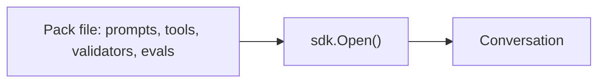

These pages explain how the SDK works and the reasons behind its design.

## Pages

- [SDK Architecture](/sdk/explanation/architecture/): the pack-first design, the components behind a `Conversation`, and how a message flows through the runtime.
- [How Variables Resolve](/sdk/explanation/variables/): sources, precedence and the single point where the system prompt renders.
- [The Hook System](/sdk/explanation/hooks/): the hook contracts, what each can change, and the order hooks run in.
- [Observability](/sdk/explanation/observability/): the event system and how to monitor a conversation.
- [RuntimeConfig Design](/sdk/explanation/runtime-config/): how RuntimeConfig separates what an agent does from how it runs.

## Why pack first

The pack file is the single source of truth. It holds the prompts, tools, validators and evals, and `sdk.Open()` builds the conversation from it.



This design has four consequences:

1. You do not wire providers or managers by hand.
2. `Open()` validates the pack against the PromptPack schema, so a malformed pack fails at startup.
3. The same pack file runs in every environment.
4. The pack is a file, so you version it with your code.

A working conversation takes three calls:

```go
conv, _ := sdk.Open("./pack.json", "chat")
defer conv.Close()
resp, _ := conv.Send(ctx, "Hello")
```

## Conversation lifecycle

1. Open: `sdk.Open()` loads the pack and creates the conversation.
2. Configure: `SetVar()` and `OnTool()` set variables and tool handlers.
3. Use: `Send()` and `Stream()` run turns.
4. Close: `Close()` ends the session and releases resources.

## See also

- [Tutorials](/sdk/tutorials/)
- [How-to guides](/sdk/how-to/)
- [API reference](/sdk/reference/)
