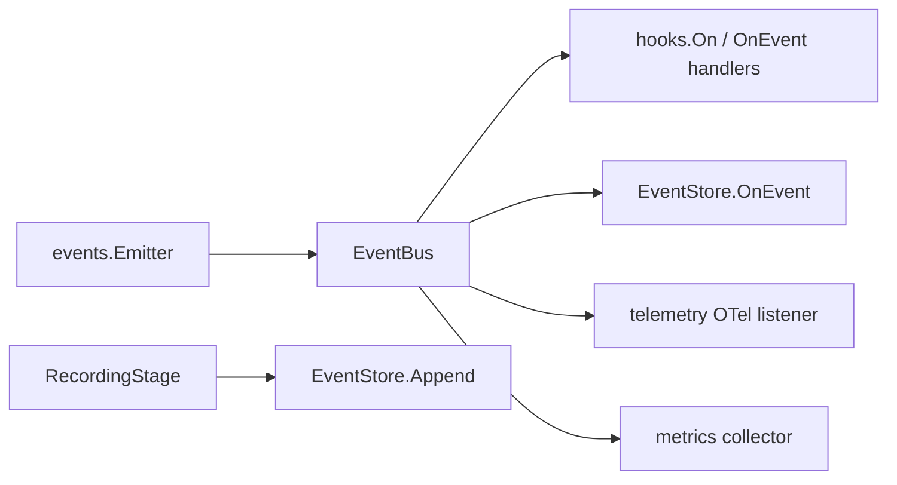

How the SDK reports what a conversation is doing, and which route an event takes to reach a consumer.

## Overview

The SDK emits events at each step of a conversation: pipeline and stage lifecycle, provider calls, tool calls, validation, messages, evals, media. The event types live in `runtime/events`. The helpers in `sdk/hooks` subscribe to them.

Events reach consumers by two routes with different guarantees. Choosing between them is the main design decision in this system.

## The two routes

The diagram shows where an event goes after it is produced.



The first route, `Emitter` to `EventBus`, carries nearly every event. The bus is asynchronous and lossy: `Publish` never blocks, and drops the event if the bus buffer is full. Each subscriber runs on its own goroutine with its own queue, receives events in publish order, and delays only itself. A subscriber that stays stuck past the subscriber timeout is eventually disabled.

The second route, `RecordingStage` to `EventStore.Append`, is opt-in, synchronous and lossless. It bypasses the bus, so it can keep full binary data for session replay.

`sdk.Open` creates an `EventBus` when you do not pass one with `WithEventBus`, and closes it with the conversation. A bus you supply outlives the conversation; the SDK removes only the subscribers it added. Pass the same bus to several conversations to observe them together.

## Event categories

Event types are `events.EventType` constants in `runtime/events`. They group into:

| Category | Examples |
|----------|----------|
| Pipeline and stage | `pipeline.started`, `stage.completed` |
| Provider | `provider.call.started`, `provider.call.completed` |
| Tool | `tool.call.started`, `tool.client.request` |
| Validation | `validation.passed`, `validation.failed` |
| Context and state | `context.built`, `context.compacted`, `state.saved` |
| Message | `message.created`, `message.text.delta`, `reasoning.completed` |
| Multimodal | `audio.input`, `image.output`, `video.frame` |
| Eval | `eval.completed`, `eval.failed` |
| Workflow and composition | `workflow.transitioned`, `composition.step.completed` |
| Other calls | `tts.call.completed`, `embedding.call.completed`, `media.stored` |

The [runtime events architecture page](/architecture/runtime-events/) describes the event types and their payload structs.

## Persistence

An `EventStore` persists events for later query and replay. `FileEventStore` is the built-in implementation. It writes one JSONL file per session and filters by session, conversation, execution, type and time range.

`WithEventStore` subscribes the store's `OnEvent` method to the bus, so bus events reach it on the lossy route. Events without a session ID are skipped.

For multimodal recordings, a `BlobStore` keeps large binary payloads (audio, video, images) apart from the event stream, and events carry a reference.

## Message events take both routes

`message.created` is the one event that travels both routes.

`MessageBroadcastStage` publishes it on the bus as each complete message arrives. The SDK adds this stage whenever the conversation has an event bus, with no store, recording or state store required. Subscribing to `message.created` is the supported way to watch a conversation unfold.

`RecordingStage` writes the same event type directly to the `EventStore`. `WithRecording` adds an input stage after template assembly and an output stage after the provider, and takes effect only when `WithEventStore` is also set. When a store and recording are both configured, the SDK stops the store receiving the bus copy of `message.created`, so each message appears in the recording once.

Both routes build the payload with `events.NewMessageCreatedData`, so they carry the same data with one difference:

| Route | Binary content parts | Needs |
|---|---|---|
| Bus (`MessageBroadcastStage`) | stripped to metadata | an event bus |
| Store (`RecordingStage`) | retained in full | `WithRecording()` and an `EventStore` |

Two consequences follow:

- The bus is lossy, so a live view can miss a message under burst. The state store remains the source of truth for a transcript.
- `MessageCreatedData.Index` is the message's position in the transcript. Read it instead of counting arrivals, because a dropped message leaves a gap.

:::caution[Binary never goes on the bus]
Audio samples and image data never travel on the bus, whether or not recording is on. For media, bus events carry the MIME type, dimensions, size and a URL reference.

This is about bytes, not content. Message text, an eval's structured value and a judge's reasoning all travel on the bus.
:::

Before adding an event, read [Adding a new event](/architecture/runtime-events/#adding-a-new-event).

## Evals

The SDK runs pack evals through an eval middleware attached to the conversation, not through a bus listener. Turn evals dispatch asynchronously after each assistant turn. Session evals run synchronously when the conversation closes. Each result is published as `eval.completed` or `eval.failed` on the conversation's bus, and written to the metrics collector when you configure one.

An eval result is an event like any other, so the redactor covers it.

## Content and redaction

Events carry customer data: tool arguments the model composed, tool results, message text, and the output of any eval that judged them. Two options control exposure, and they cover different consumers.

`WithTelemetryContentCapture(bool)` is off by default and applies to OpenTelemetry spans only. Span structure, timing, token usage and tool names are always exported.

`WithEventRedactor(policy)` rewrites content before it reaches the SDK's own observability consumers: the event store, the OTel listener and the metrics collector.

```go
sdk.WithEventRedactor(func(field, value string) string {
    if field == events.FieldToolCallArgs {
        return scrub(value)
    }
    return value
})
```

The policy receives a field name, so it can be as coarse or as narrow as you need: `FieldMessageContent`, `FieldMessageMetadata`, `FieldToolCallArgs`, `FieldToolResult`, `FieldContentPart`, and for eval events `FieldEvalValue`, `FieldEvalExplanation`, `FieldEvalDetails` and `FieldEvalEvidence`. An eval's output quotes what it judged, so it counts as content. Nested strings inside a value or details map are rewritten too.

Measurements are left alone. Score, metric value, pass/fail, kind and timings describe content without containing it, and scrubbing them would leave an audit unable to tell a blocked guardrail from a passing one.

`events.Redacting` wraps a subscriber so that it receives its own copy of each event. Redacting for the tracer therefore does not strip a store that should keep the original. Redaction applies per consumer rather than at emit time, because consumers have different entitlements: a recording is meant to hold content, and a trace exported to a third-party APM is not.

Two things sit outside the option:

- `RecordingStage` never touches the bus, so `WithRecording` output is not redacted. Redact in the store you supply if you need that.
- Handlers you register with `hooks.On` or `bus.Subscribe` receive the original events. Wrap them with `events.Redacting` to give them a redacted copy.

The [telemetry-redaction example](https://github.com/AltairaLabs/PromptKit/tree/main/sdk/examples/telemetry-redaction) is runnable.

## Subscribing

`hooks.On` and `hooks.OnEvent` subscribe to a conversation's bus. Typed helpers (`OnToolCall`, `OnProviderCall`, `OnValidationFailed`, `OnPipelineComplete`) unpack the payload for common cases. A handler registered this way stops when the conversation closes, even on a bus you supplied.

```go
hooks.On(conv, events.EventProviderCallCompleted, func(e *events.Event) {
    d := e.Data.(*events.ProviderCallCompletedData)
    log.Printf("%s: %d in, %d out, %v", d.Model, d.InputTokens, d.OutputTokens, d.Duration)
})

hooks.OnToolCall(conv, func(name string, args map[string]any) {
    log.Printf("tool %s", name)
})
```

Every event has the same envelope: `Type`, `Timestamp`, `Sequence`, `ExecutionID`, `SessionID`, `ConversationID`, `UserID` and a type-specific `Data` payload. The bus stamps `Sequence` on publish, so a consumer can order events from several listeners.

A handler runs on its own goroutine, concurrently with your code and with other handlers. Calls to one handler are serialized and arrive in publish order. Guard state shared with other code.

## Trade-offs

The bus keeps observability off the hot path: a slow dashboard cannot stall a turn, and a burst costs dropped events rather than latency. The price is that bus consumers cannot be an audit log. Use the recording route when you need every event with full fidelity, and the state store when you need the transcript.

Splitting redaction from recording keeps one policy from degrading the other. The cost is that you own the redaction of anything on the recording route.

## See also

- [How-to: monitor events](/sdk/how-to/observability/monitor-events/)
- [How-to: export traces with OTLP](/runtime/how-to/observability/export-traces-otlp)
- [Telemetry reference](/runtime/reference/telemetry)
- [Runtime events architecture](/architecture/runtime-events/)
- [Tutorial 6: Observability](/sdk/tutorials/06-media-storage/)
