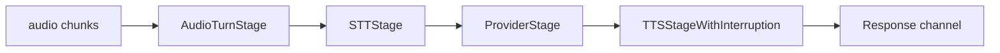

## What we will build

In this tutorial we build a voice conversation with a text LLM. We record a spoken question, stream it into a duplex session in [VAD](/glossary#vad) mode, and get back the transcript of what was said, the model's reply as text, and the reply as audio we can play.

In VAD mode the session turns speech into text with an [STT](/glossary#stt) service, sends the text to the model, and turns the reply back into speech with a [TTS](/glossary#tts) service:



## Prerequisites

- Completed [Tutorial 1: First conversation](/sdk/tutorials/01-first-conversation/), with a Go module that requires the SDK
- `OPENAI_API_KEY` set in the environment (the model, the STT service and the TTS service all use it)
- `ffplay` (part of FFmpeg) to play raw audio

## Step 1: Create the pack

Create `voice-assistant.pack.json`:

```json
{
  "id": "voice-assistant",
  "name": "Voice Assistant",
  "version": "1.0.0",
  "template_engine": {
    "version": "v1",
    "syntax": "{{variable}}"
  },
  "prompts": {
    "assistant": {
      "id": "assistant",
      "name": "Voice Assistant",
      "version": "1.0.0",
      "system_template": "You are a helpful voice assistant. Keep responses concise and natural for spoken conversation. The user's name is {{user_name}}.",
      "parameters": {
        "temperature": 0.7,
        "max_tokens": 150
      }
    }
  }
}
```

The pack has one prompt, `assistant`, with one variable, `user_name`.

## Step 2: Record a spoken question

A voice session needs audio to listen to. Instead of a microphone, we synthesize a question into a file of raw audio. Create `question/main.go`:

```go
package main

import (
	"context"
	"fmt"
	"io"
	"log"
	"os"

	"github.com/AltairaLabs/PromptKit/runtime/v2/tts"
)

func main() {
	speaker := tts.NewOpenAI(os.Getenv("OPENAI_API_KEY"))

	cfg := tts.DefaultSynthesisConfig()
	cfg.Format = tts.FormatPCM16 // raw 16-bit mono PCM at 24 kHz

	audio, err := speaker.Synthesize(context.Background(), "What is the capital of France?", cfg)
	if err != nil {
		log.Fatal(err)
	}
	defer audio.Close()

	pcm, err := io.ReadAll(audio)
	if err != nil {
		log.Fatal(err)
	}
	if err := os.WriteFile("question.pcm", pcm, 0o644); err != nil {
		log.Fatal(err)
	}

	fmt.Printf("wrote question.pcm: %.1f seconds of audio\n", float64(len(pcm))/(24000*2))
}
```

Run it and listen to the result:

```bash
go run ./question
ffplay -autoexit -f s16le -ar 24000 question.pcm
```

The program prints the length of the clip, and `ffplay` speaks the question.

## Step 3: Open a VAD session and ask the question

Create `voice/main.go`:

```go
package main

import (
	"context"
	"fmt"
	"log"
	"os"

	"github.com/AltairaLabs/PromptKit/runtime/v2/providers"
	"github.com/AltairaLabs/PromptKit/runtime/v2/stt"
	"github.com/AltairaLabs/PromptKit/runtime/v2/tts"
	"github.com/AltairaLabs/PromptKit/sdk/v2"
)

const (
	sampleRate = 24000               // the rate question.pcm was recorded at
	chunkSize  = sampleRate / 50 * 2 // 20 ms of 16-bit mono audio, in bytes
	silence    = sampleRate * 2      // one second of silence, in bytes
)

func main() {
	apiKey := os.Getenv("OPENAI_API_KEY")

	vadCfg := sdk.DefaultVADModeConfig()
	vadCfg.SampleRate = sampleRate

	conv, err := sdk.OpenDuplex("./voice-assistant.pack.json", "assistant",
		sdk.WithVADMode(stt.NewOpenAI(apiKey), tts.NewOpenAI(apiKey), vadCfg),
	)
	if err != nil {
		log.Fatal(err)
	}
	defer conv.Close()

	// A duplex session renders its system prompt once, when the first chunk
	// arrives, so variables are set before any audio is sent.
	conv.SetVar("user_name", "Alice")

	responses, err := conv.Response()
	if err != nil {
		log.Fatal(err)
	}

	question, err := os.ReadFile("question.pcm")
	if err != nil {
		log.Fatal(err)
	}
	go send(conv, append(question, make([]byte, silence)...))

	for chunk := range responses {
		if chunk.Error != nil {
			log.Fatal(chunk.Error)
		}
		if heard, ok := chunk.Metadata["input_transcription"].(string); ok {
			fmt.Println("you:", heard)
		}
		if chunk.Delta != "" {
			fmt.Print(chunk.Delta)
		}
		if done, _ := chunk.Metadata["assistant_turn_complete"].(bool); done {
			break
		}
	}
	fmt.Println()
}

// send streams PCM audio into the session in 20 ms chunks, as a microphone would.
func send(conv *sdk.Conversation, pcm []byte) {
	ctx := context.Background()
	for start := 0; start < len(pcm); start += chunkSize {
		end := min(start+chunkSize, len(pcm))
		err := conv.SendChunk(ctx, &providers.StreamChunk{
			MediaData: &providers.StreamMediaData{MIMEType: "audio/pcm", Data: pcm[start:end]},
		})
		if err != nil {
			log.Fatal(err)
		}
	}
}
```

The second of silence after the question is what ends the turn: the session waits for 800 ms of silence by default. The `input_transcription` chunk carries what the STT service heard, and the `assistant_turn_complete` chunk closes the reply.

Run it:

```bash
go run ./voice
```

The program prints the transcript and then the reply. The reply typically reads like this:

```text
you: What is the capital of France?
The capital of France is Paris, Alice.
```

## Step 4: Save the reply audio

The reply also arrives as audio, in chunks whose `MediaData` holds 24 kHz PCM. Collect it in the loop and write it to a file. Replace the `for` loop and the line after it in `voice/main.go`:

```go
	var reply []byte
	for chunk := range responses {
		if chunk.Error != nil {
			log.Fatal(chunk.Error)
		}
		if heard, ok := chunk.Metadata["input_transcription"].(string); ok {
			fmt.Println("you:", heard)
		}
		if chunk.Delta != "" {
			fmt.Print(chunk.Delta)
		}
		if chunk.MediaData != nil {
			reply = append(reply, chunk.MediaData.Data...)
		}
		if done, _ := chunk.Metadata["assistant_turn_complete"].(bool); done {
			break
		}
	}
	fmt.Println()

	if err := os.WriteFile("reply.pcm", reply, 0o644); err != nil {
		log.Fatal(err)
	}
	fmt.Printf("wrote reply.pcm: %.1f seconds of audio\n", float64(len(reply))/(24000*2))
```

The session sends the turn boundary after the last of the reply's audio, so the file holds the whole reply. Run the program again and play the reply:

```bash
go run ./voice
ffplay -autoexit -f s16le -ar 24000 reply.pcm
```

After the transcript and the reply text, the program prints the length of the reply clip, and `ffplay` speaks the reply in the default `alloy` voice.

## Next steps

- [Tutorial 8: TTS integration](/sdk/tutorials/08-tts-integration/) changes the voice and speaks replies from a text conversation.
- [Choose a voice mode](/sdk/how-to/voice/choose-voice-mode/) covers native audio models (ASM mode) and the VAD settings.
- [Handle turns, barge-in and transcripts](/sdk/how-to/voice/handle-turns-and-barge-in/) covers live microphone audio, interruptions and turn tuning.
- The [voice interview example](https://github.com/AltairaLabs/PromptKit/tree/main/sdk/examples/voice-interview) runs a full session from a microphone.
